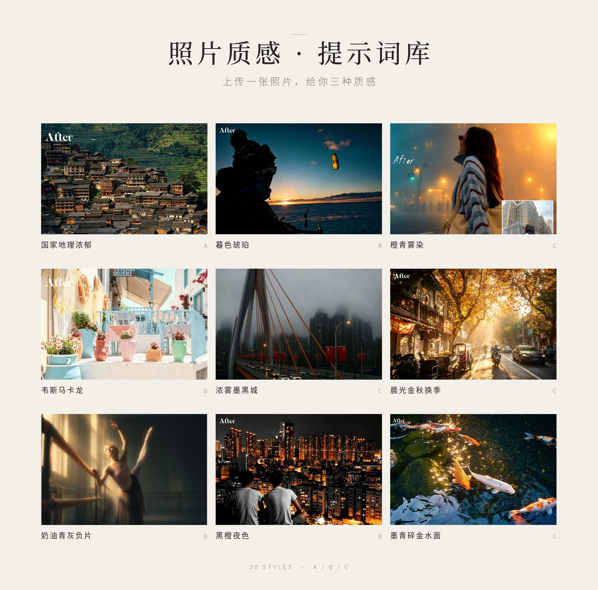

<p align="center"></p>

<p align="center">
<b>上传一张照片，直接给你三种质感。</b><br>
<sub>30 种 AI 修图风格 · 适配豆包 / 即梦 / GPT 等图像编辑模型 · 附 Agent Skill</sub>
</p>

---

## 它怎么用

把 [`skill/texture-to-photos`](skill/texture-to-photos) 装进你的 Agent（任何带图像编辑能力的 Agent 都行），然后**只需要发一张照片**。

1. **看图** —— Agent 判断题材、光线和原片的问题，比如「街景 · 阴天 · 画面偏灰」。
2. **挑三种** —— 从 30 种风格里按三个档位各挑一种，保证三张图一眼看上去就不一样：

   | 档位 | 做什么 | 例子 |
   |---|---|---|
   | **A 稳妥** | 保留原貌，修掉原片的问题 | 镜头原生去灰、旅行清透蓝天 |
   | **B 氛围** | 换一种情绪色调 | 暮色琥珀、奶油青灰负片 |
   | **C 反差** | 重构光影或画风，给你想不到的版本 | 浓雾墨黑城、梵高星旋油画 |

3. **出图** —— 三张一次给齐，不用先选。看完说「B 再浓一点」「换一批」就行。

也可以直接点名，比如「用暮色琥珀修这张」，就只出那一种。

## 风格库

### A · 稳妥
<table>
<tr><td width="33%" valign="top"><a href="styles/001_01-%E5%8D%95%E8%BD%B4%E6%B7%B1%E5%BD%B1%E5%BC%A0%E5%8A%9B"></a><br><b>单轴深影张力</b><br><sub>沿一条全局明暗轴大块羽化压暗，暗部近黑、亮侧连续铺开，天…</sub></td><td width="33%" valign="top"><a href="styles/014_01-%E9%95%9C%E5%A4%B4%E5%8E%9F%E7%94%9F%E5%8E%BB%E7%81%B0"></a><br><b>镜头原生去灰</b><br><sub>去灰去雾、色彩纯度与分离提升，蓝天更净、黄叶更浓，明暗层…</sub></td><td width="33%" valign="top"><a href="styles/018_01-%E6%97%85%E8%A1%8C%E6%B8%85%E9%80%8F%E8%93%9D%E5%A4%A9"></a><br><b>旅行清透蓝天</b><br><sub>提亮中间调，灰白天空换成通透蓝天白云，绿色自然、中性色干…</sub></td></tr>
<tr><td width="33%" valign="top"><a href="styles/027_01-%E6%97%A5%E5%85%89%E6%9F%AF%E8%BE%BE%E6%98%8E%E4%BA%AE"></a><br><b>日光柯达明亮</b><br><sub>明亮暖调负片：蓝天转浅青水蓝、白色与雪转奶油暖米、暖色更…</sub></td><td width="33%" valign="top"><a href="styles/038_01-%E6%B8%85%E9%80%8F%E8%96%84%E8%8D%B7%E7%A9%BA%E6%B0%94"></a><br><b>清透薄荷空气</b><br><sub>高调提亮、暗部抬升，色彩转为浅天青/薄荷绿松石与米白，低…</sub></td><td width="33%" valign="top"><a href="styles/041_01-%E7%BB%8F%E5%85%B8%E6%AD%A3%E7%89%87%E7%9B%B8%E6%9C%BA%E8%89%B2"></a><br><b>经典正片相机色</b><br><sub>降鲜艳、绿转橄榄灰、蓝收青灰，阴影冷灰、中间调有反差，克…</sub></td></tr>
<tr><td width="33%" valign="top"><a href="styles/056_01-%E5%9B%BD%E5%AE%B6%E5%9C%B0%E7%90%86%E6%B5%93%E9%83%81"></a><br><b>国家地理浓郁</b><br><sub>饱和偏高、对比硬朗，天空压出厚重云层，绿植深绿、秋叶橙金…</sub></td><td width="33%" valign="top"><a href="styles/058_01-%E7%94%B5%E5%BD%B1%E9%9D%92%E6%A9%99"></a><br><b>电影青橙</b><br><sub>干净明亮的经典青橙：阴影/天空偏青绿，灯光与肤色暖橙，中…</sub></td></tr>
</table>

### B · 氛围
<table>
<tr><td width="33%" valign="top"><a href="styles/003_01-%E6%B7%B1%E6%B2%89%E6%9A%96%E6%A3%95%E7%94%B5%E5%BD%B1"></a><br><b>深沉暖棕电影</b><br><sub>低饱和烟草棕/深咖褐骨架，环境大幅压暗、黑位沉为深褐黑，…</sub></td><td width="33%" valign="top"><a href="styles/004_01-%E7%82%AD%E9%BB%91%E7%BC%8E%E5%85%89%E4%BA%BA%E5%83%8F"></a><br><b>炭黑缎光人像</b><br><sub>背景大面积降到炭黑，人物皮肤与衣料形成侧上方缎面亮带，只…</sub></td><td width="33%" valign="top"><a href="styles/006_01-%E6%A9%99%E5%85%89%E6%B7%B1%E5%BD%B1"></a><br><b>橙光深影</b><br><sub>只在画面10–20%区域投下一小片低角度夕阳橙金光斑，其…</sub></td></tr>
<tr><td width="33%" valign="top"><a href="styles/007_01-%E5%A2%A8%E7%BB%BF%E9%9B%BE%E6%9E%97"></a><br><b>墨绿雾林</b><br><sub>低饱和墨绿灰青主调，远景加青绿薄雾形成空气透视，暗部通透…</sub></td><td width="33%" valign="top"><a href="styles/011_01-%E6%B3%95%E5%BC%8F%E7%94%BB%E5%86%8C%E6%9A%96%E9%98%B3"></a><br><b>法式画册暖阳</b><br><sub>整体暖米色，加入斑驳树影/窗影的方向性阳光，高光柔亮、阴…</sub></td><td width="33%" valign="top"><a href="styles/025_01-%E5%A5%B6%E6%B2%B9%E9%9D%92%E7%81%B0%E8%B4%9F%E7%89%87"></a><br><b>奶油青灰负片</b><br><sub>深青黑大块暗部+奶油象牙高光雾化halation，背景模…</sub></td></tr>
<tr><td width="33%" valign="top"><a href="styles/032_01-%E6%9A%97%E8%B0%83%E9%AB%98%E5%BD%A9"></a><br><b>暗调高彩</b><br><sub>环境压入深灰黑灰低纯冷色，只保留红黄橙等原生小面积高纯色…</sub></td><td width="33%" valign="top"><a href="styles/033_01-%E6%9A%AE%E8%89%B2%E7%90%A5%E7%8F%80"></a><br><b>暮色琥珀</b><br><sub>天空与环境压成深青蓝/墨黑，受光面转暗琥珀棕金，低调克制…</sub></td><td width="33%" valign="top"><a href="styles/034_01-%E9%BB%91%E6%A9%99%E5%A4%9C%E8%89%B2"></a><br><b>黑橙夜色</b><br><sub>夜景除橙金/橙红外全部去色成黑白灰，灯光橙金锐利，深黑高…</sub></td></tr>
<tr><td width="33%" valign="top"><a href="styles/060_01-%E8%93%9D%E8%B0%83%E9%BB%84%E6%98%8F"></a><br><b>蓝调黄昏</b><br><sub>日景转为蓝调时刻，环境深青蓝墨蓝，人物皮肤和灯光保留琥珀…</sub></td><td width="33%" valign="top"><a href="styles/061_01-%E6%9A%97%E8%B0%83%E5%A2%A8%E7%BB%BF%E8%8A%B1"></a><br><b>暗调墨绿花</b><br><sub>花朵保留原色并提亮带水润高光，茎叶背景压成低饱和深墨绿近…</sub></td><td width="33%" valign="top"><a href="styles/064_01-%E9%9F%A6%E6%96%AF%E9%A9%AC%E5%8D%A1%E9%BE%99"></a><br><b>韦斯马卡龙</b><br><sub>低饱和马卡龙粉/薄荷/奶油配色，浅青天空，低对比阴影提亮…</sub></td></tr>
</table>

### C · 反差
<table>
<tr><td width="33%" valign="top"><a href="styles/002_01-%E6%B5%93%E9%9B%BE%E5%A2%A8%E9%BB%91%E5%9F%8E"></a><br><b>浓雾墨黑城</b><br><sub>大幅欠曝近单色，前中景沉入深碳黑，天空冷银灰浓雾吞没高楼…</sub></td><td width="33%" valign="top"><a href="styles/018_03-%E5%A4%8D%E5%8F%A4%E6%95%B0%E7%A0%81%E7%9B%B4%E9%97%AA"></a><br><b>复古数码直闪</b><br><sub>正面直闪提亮主体、背景自然压暗，肤色光泽、对比略强、极轻…</sub></td><td width="33%" valign="top"><a href="styles/019_01-%E5%A2%A8%E9%9D%92%E5%89%AA%E5%BD%B1"></a><br><b>墨青剪影</b><br><sub>背景抹成无对象的青绿到青黑渐变色场，人物压成近黑剪影下端…</sub></td></tr>
<tr><td width="33%" valign="top"><a href="styles/021_01-%E6%A2%B5%E9%AB%98%E6%98%9F%E6%97%8B%E6%B2%B9%E7%94%BB"></a><br><b>梵高星旋油画</b><br><sub>整幅重绘为厚涂油画，天空多核螺旋笔触，群青钴蓝配奶油黄琥…</sub></td><td width="33%" valign="top"><a href="styles/022_01-%E6%A9%99%E9%9D%92%E9%9B%BE%E6%9F%93"></a><br><b>橙青雾染</b><br><sub>整幅画面被浓雾吞没，一侧深青绿冷雾、一侧画外暖逆光形成橙…</sub></td><td width="33%" valign="top"><a href="styles/023_01-%E8%A1%97%E5%A4%B4%E6%85%A2%E9%97%A8%E4%BA%BA%E6%B5%81"></a><br><b>街头慢门人流</b><br><sub>主体清晰，两侧补出半透明人流车流长拖影，冷青背景配金橙受…</sub></td></tr>
<tr><td width="33%" valign="top"><a href="styles/031_01-%E6%99%A8%E5%85%89%E9%87%91%E7%A7%8B%E6%8D%A2%E5%AD%A3"></a><br><b>晨光金秋换季</b><br><sub>绿树整体换成金黄橙秋叶，地面加落叶，清晨逆光穿叶隙形成光…</sub></td><td width="33%" valign="top"><a href="styles/046_01-%E5%A2%A8%E9%9D%92%E7%A2%8E%E9%87%91%E6%B0%B4%E9%9D%A2"></a><br><b>墨青碎金水面</b><br><sub>水体压成深墨青，加满侧斜落日的细碎金色闪光点，冷暖对冲静…</sub></td><td width="33%" valign="top"><a href="styles/063_01-%E4%BD%93%E7%A7%AF%E5%85%89%E5%94%A4%E9%86%92"></a><br><b>体积光唤醒</b><br><sub>天空拉开翻涌云层，侧后方体积光穿云洒下，加雨雾粒子，色彩…</sub></td></tr>
<tr><td width="33%" valign="top"><a href="styles/066_01-%E5%A4%8D%E5%8F%A4%E9%87%91%E5%85%89%E4%B8%81%E8%BE%BE%E5%B0%94"></a><br><b>复古金光丁达尔</b><br><sub>室内加强烈丁达尔放射光束穿透尘埃，整体浓郁金棕复古，暗部…</sub></td></tr>
</table>

每个风格目录里有：完整提示词（`prompt.txt`）、适用题材与禁忌，以及原作者的前后对比照片。

## 这 30 种是怎么来的

原始收集了 70 份提示词。逐份看过前后对比后，把观感相近的归成一簇，每簇只留成片最好、提示词最通用的一份：

- **35 份并入同类**：例如 7 份「深青环境 + 琥珀受光」统一保留为「暮色琥珀」，5 份冷暗都市保留为「暗调高彩」。
- **5 份移除**：前后差别过小，或提示词绑定了特定场景（摩托车、视频），无法迁移到别人的照片。
- **有独立辨识度的一律保留**，哪怕题材很窄——比如只适合水面的「墨青碎金」、只适合花卉的「暗调墨绿花」。

每个风格的 README 里注明了它合并了哪些编号；被合并的原始提示词与照片仍在 git 历史中（提交 `ec3307b`）。

## 目录

```
skill/texture-to-photos/   Agent Skill：SKILL.md、styles.json 索引、30 份提示词、样张
styles/<编号>-<风格名>/     每种风格：prompt.txt、前后对比原图、说明
tools/build_showcase.py     生成对比卡与封面的脚本
```

## 致谢

全部提示词与示例照片出自抖音创作者 **Delin**，本仓库仅做整理、分类与筛选，提示词原文未作改动。作品链接已移除；如需转载或商用，请联系原作者。
