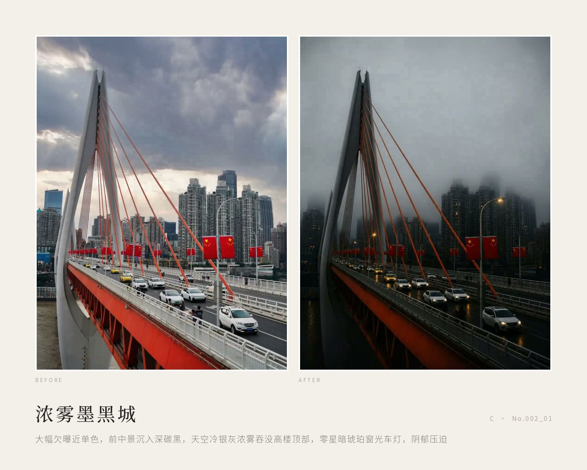
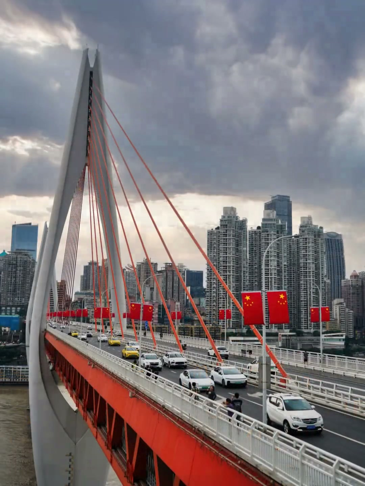
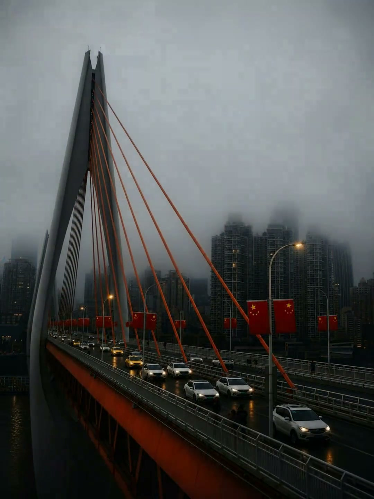
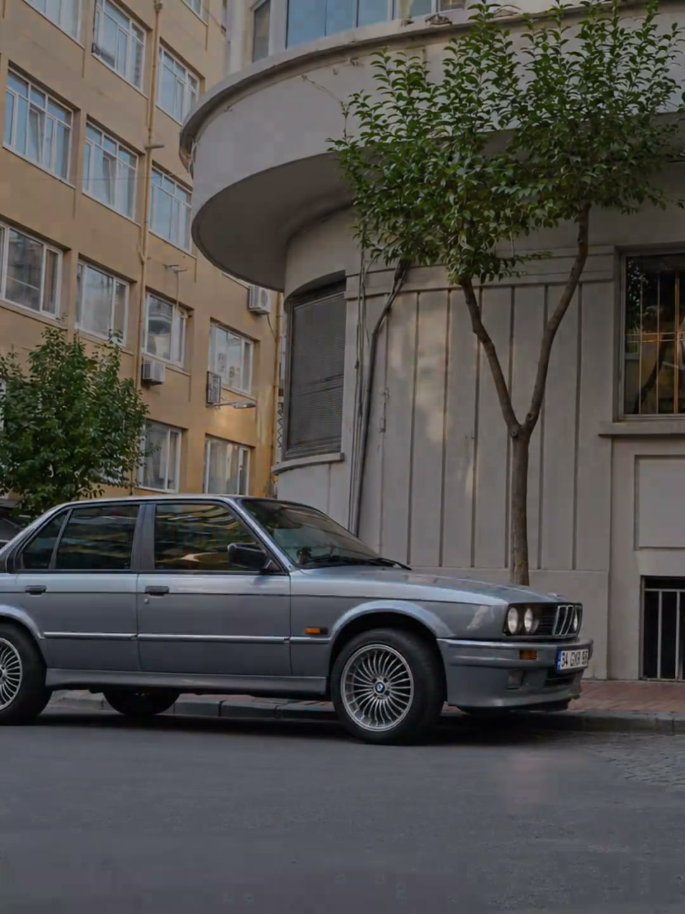
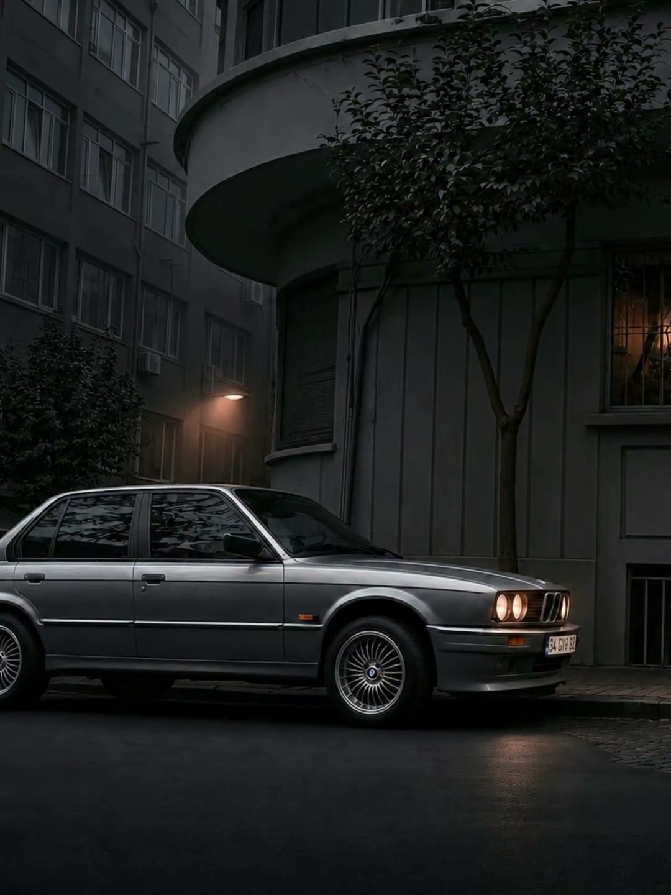
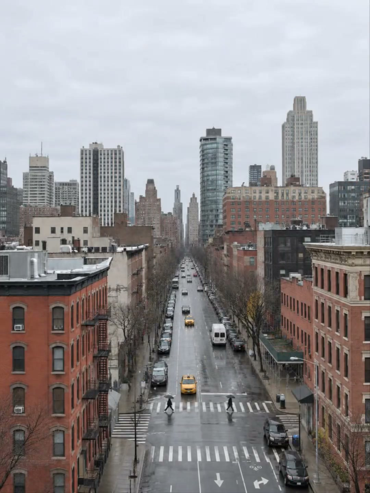
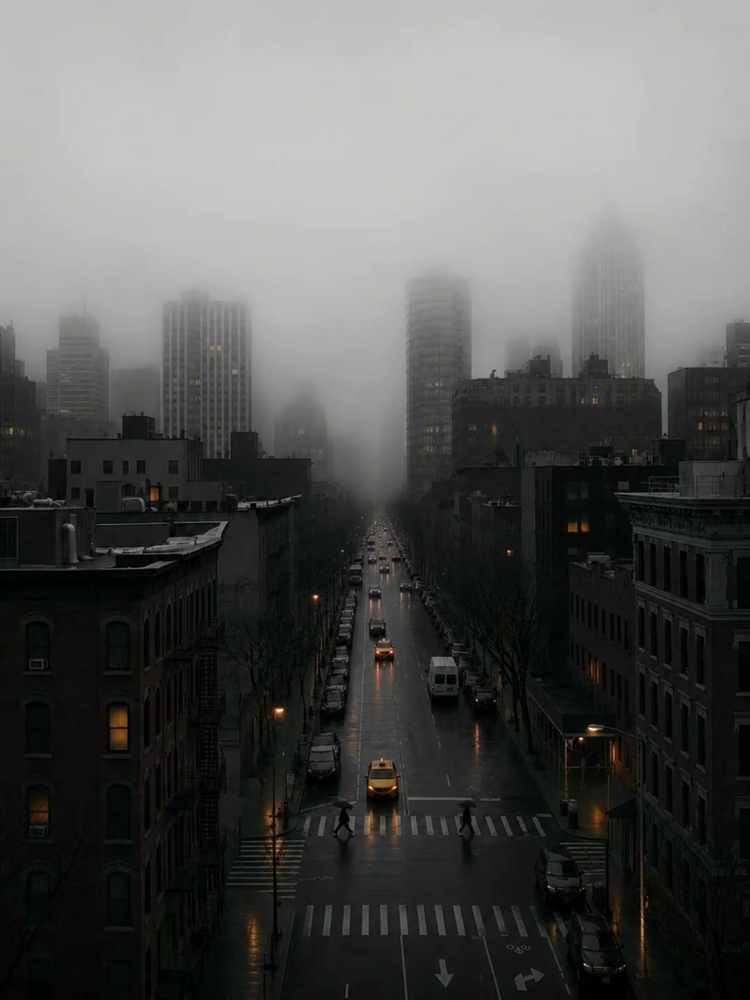

<p align="center"></p>

# 浓雾墨黑城

**C · 反差**　改动强度：重　·　原分类：暗调冷色与雾感

大幅欠曝近单色，前中景沉入深碳黑，天空冷银灰浓雾吞没高楼顶部，零星暗琥珀窗光车灯，阴郁压迫

| 适合题材 | 适合光线 | 不适合 |
|---|---|---|
| 城市建筑、街景、交通工具 | 阴天、黄昏、任意 | 人像特写、无纵深的近景、需要保留明亮色彩的照片 |

## 提示词

```text
严格保持原图主体、构图、透视及所有场景元素，仅重塑色调、影调、光影与质感。极致暗黑电影摄影，大幅欠曝，强烈压缩中间调，黑位下沉至近纯黑，深度下沉至近乎纯黑。前景及阴影形成大片厚重、密实、纯净的渐变深碳黑灰，吞没多数暗部细节。中景建筑及阴影呈厚重、纯净的深碳黑，大量暗部细节自然消失。天空呈连续平滑的冷银灰色，浓密低垂的雾幕均匀柔和，无明显云团及雾层边界。远景高楼顶部逐渐融入浓雾，结构对比度缓慢衰减，轮廓自然消失。雾仅集中于建筑顶部与空间尽头，前中景保持深黑通透，形成极端明暗分离。窗光、路灯、车灯等人工光源随机分布，亮度克制，以低饱和暗琥珀、暗橙红为主，局部微弱晕染。整体近乎单色，褪色、冷峻、阴郁、寂静、压迫。禁止全局灰雾、颗粒、脏灰黑位、暗部泛白、地面不合理反射、均匀提亮、过量暖光、夸张反射、HDR、过锐及虚假光效。
```

## 前后对比

| 原图 | 成片 |
|---|---|
|  |  |
|  |  |
|  |  |

<sub>原标题：AI重构是假的，被氛围波及却是真的　·　作者：Delin（抖音）</sub>
