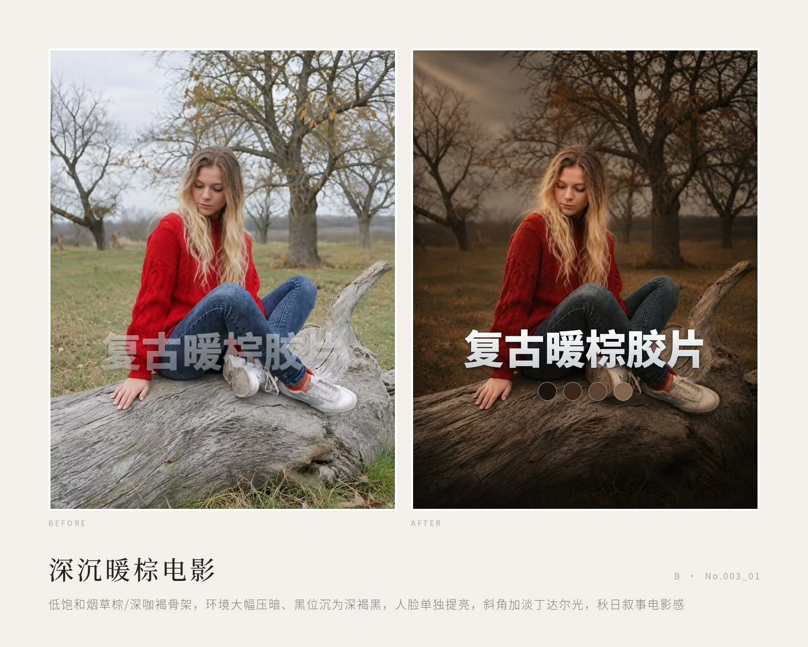
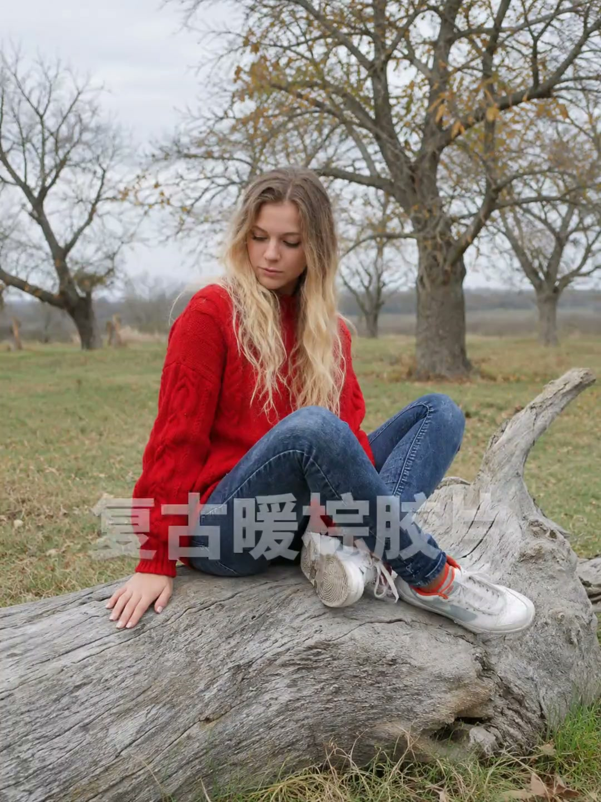
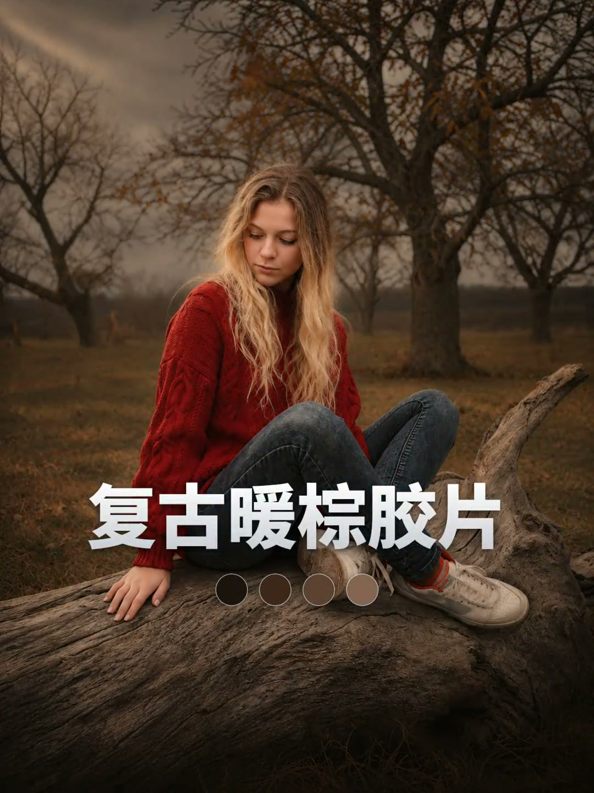
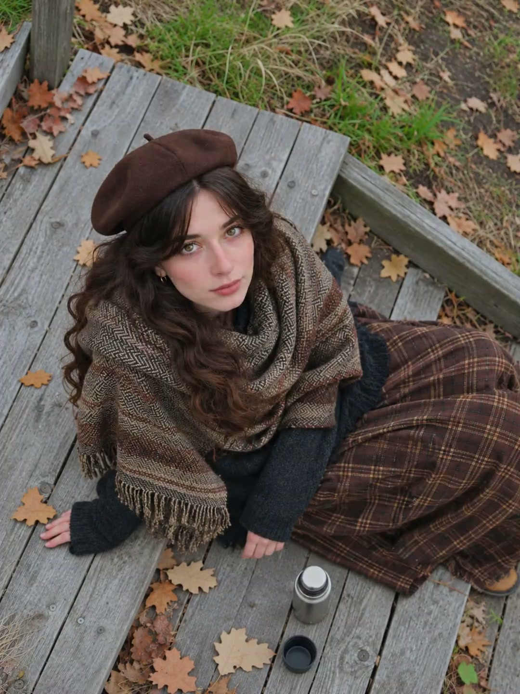
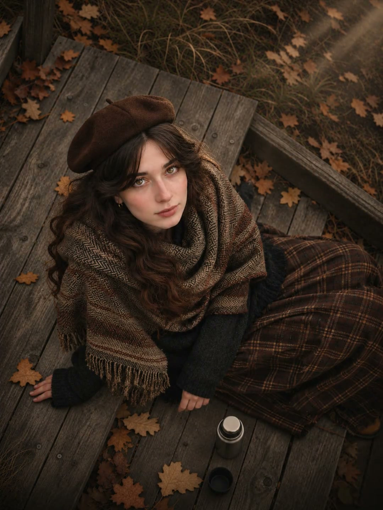
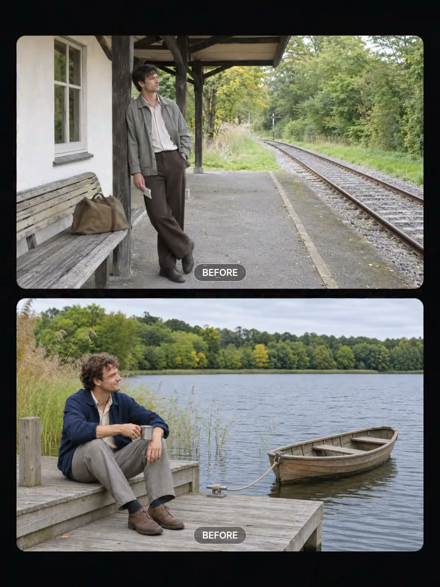
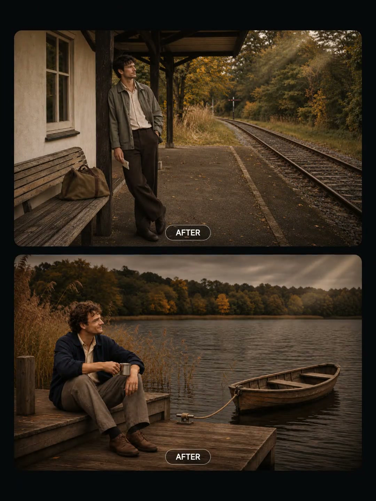

<p align="center"></p>

# 深沉暖棕电影

**B · 氛围**　改动强度：重　·　原分类：胶片复古与相机色彩

低饱和烟草棕/深咖褐骨架，环境大幅压暗、黑位沉为深褐黑，人脸单独提亮，斜角加淡丁达尔光，秋日叙事电影感

| 适合题材 | 适合光线 | 不适合 |
|---|---|---|
| 人像、风光 | 阴天、晴天顺光、黄昏 | 不适合需要明亮清新感或以蓝天为主体的照片；无人物时提亮重点会失焦 |

> 同类合并：059_01（已并入本风格，原提示词见 git 历史）

## 提示词

```text
保留原图主体、构图、场景及真实材质，仅调整色彩与光影，呈现深沉浓郁的复古暖棕叙事电影胶片风格。 
“整体低饱和，以烟草棕、深咖褐、焦糖棕、褪色赭棕为主。绿色转为灰橄榄绿与枯草褐，黄色偏暗金，压低蓝青色。肤色自然通透、中性微暖，避免全局棕色蒙层。 
模拟专业后期分区压暗与图下部渐变压暗，整体低调、中高对比，适度降低曝光，中间调厚实并向暗部集中。明显压低阴影与黑位，呈深褐黑色，允许非关键暗部沉入近黑，仅保留主体必要轮廓分离，杜绝黑位抬升与浮灰。 
模拟秋日阴天柔和漫射光，环境明显压暗，人物面部自然提亮，突出眼神与五官立体感。加入轻微丁达尔白光，选择左右一角斜向穿透，光束细腻、稀疏、低强度，隐约可见，轻微空气感，不抢夺主体视觉焦点。 
高光柔和滚降，暗部压缩有力，保持真实皮肤与织物质感，轻微光学软化。避免画面发灰、平光、肤色泛橙、多条不合理光束、明显颗粒、柔焦柔化、过度锐化及数码HDR感。”
```

## 前后对比

| 原图 | 成片 |
|---|---|
|  |  |
|  |  |
|  |  |

<sub>原标题：深沉复古的暖棕胶片｜AI调色Prompt 基调以低饱和深棕为主色，利用AI自行分区控光的优点，以　·　作者：Delin（抖音）</sub>
