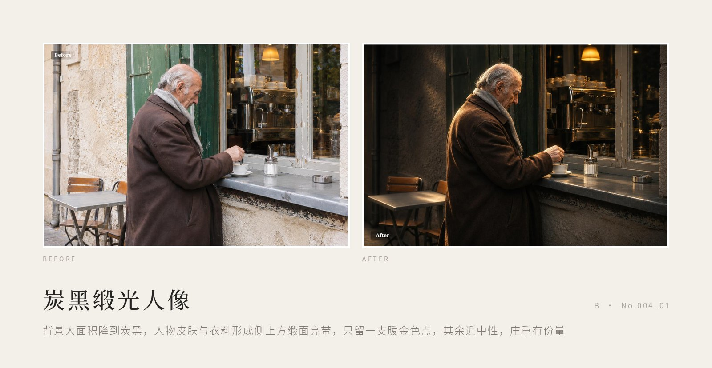
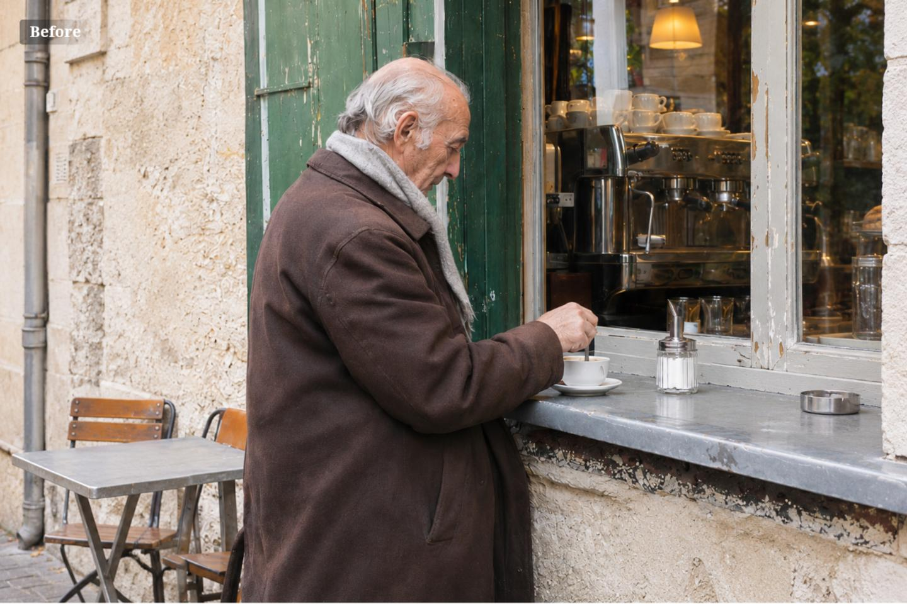
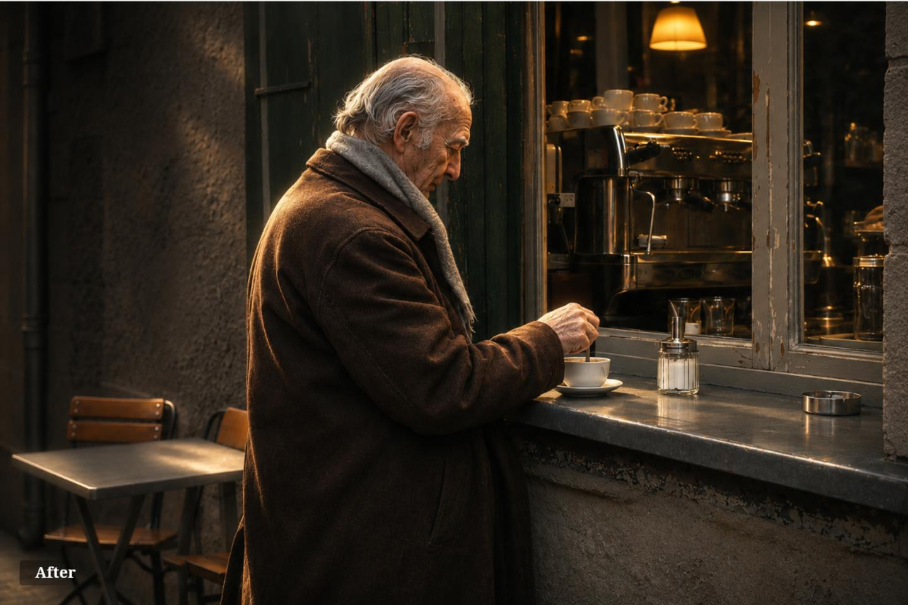
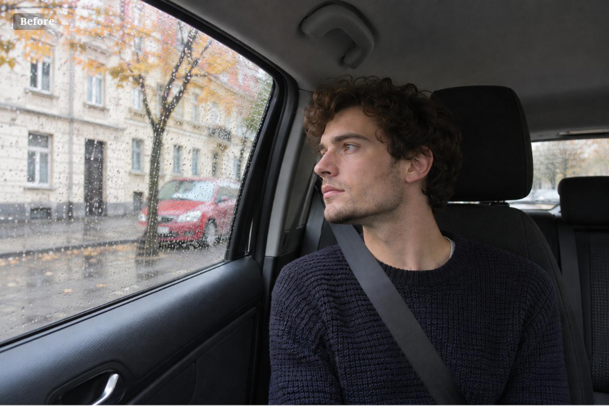
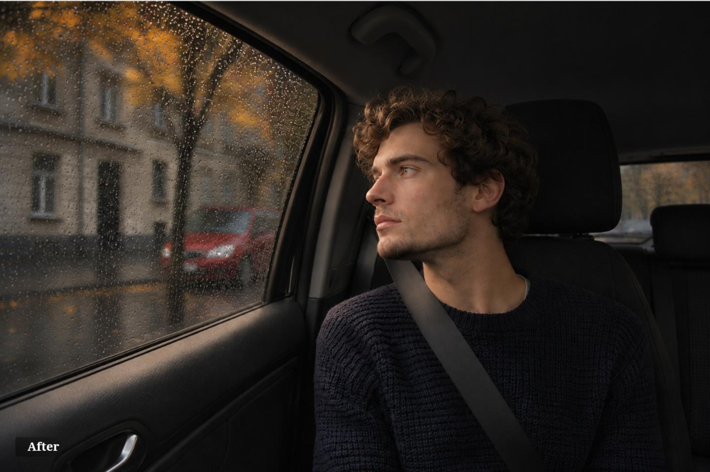
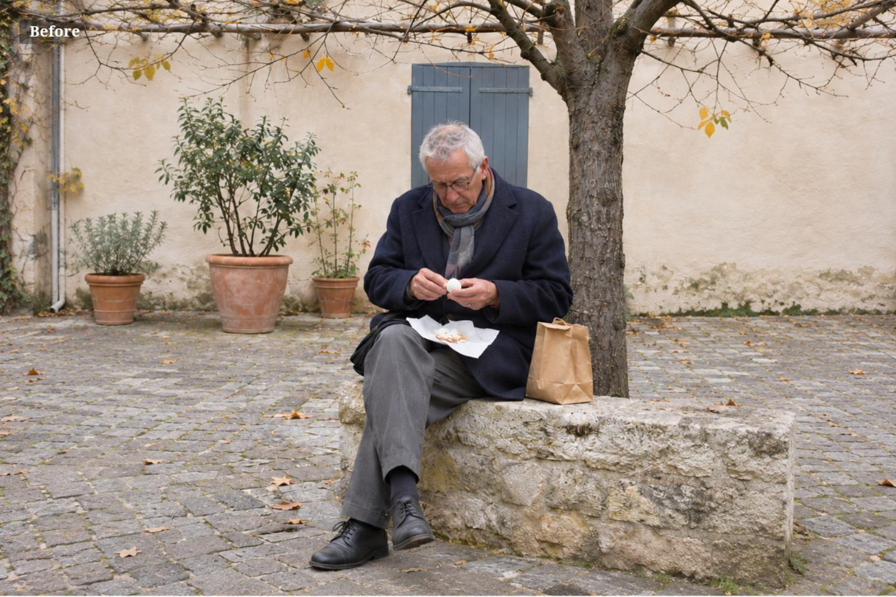
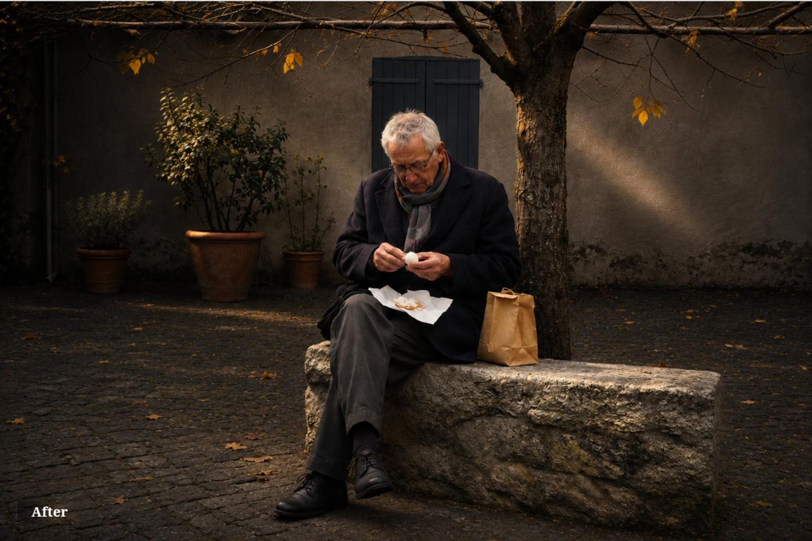

<p align="center"></p>

# 炭黑缎光人像

**B · 氛围**　改动强度：重　·　原分类：光影塑形与原片增强

背景大面积降到炭黑，人物皮肤与衣料形成侧上方缎面亮带，只留一支暖金色点，其余近中性，庄重有份量

| 适合题材 | 适合光线 | 不适合 |
|---|---|---|
| 人像、街景 | 阴天、室内、任意 | 无人物的大场景风光、需要明亮清新感的照片 |

## 提示词

```text
让明亮来自皮肤上的宽窄反射带，而非提高整张脸的曝光。
使用偏侧上方的柔中带硬主光，颧骨、鼻梁、肩颈依实际受
光方向形成缎面亮带，背光侧逐级下沉，负补光压实轮廓；
禁止背光区域出现无光源依据的金色描边，头发与肩背仅在
真实受光处产生局部零散反射，不形成连续轮廓光；人物不
同肤色都保持自身深浅关系。背景与大面积暗部降到炭黑，
在原有颜色中选择一支偏暖的金黄作为少量浓色支点，其余
色彩克制到近中性。曲线压紧黑位，舒展深中调，高光采用
长肩使反射呈乳金而不剪成白洞。增强皮肤细微起伏对反射
的影响，光滑材料更亮、粗糙材料更沉，成片具可触摸的缎
光与厚度。保留人物身份、肤色层级和身体结构与原图比
例。气氛庄重而有压迫力，风格依赖黑底密度与雕塑亮带，
不要特定妆容或改变人物肤色及纹理，禁止：反射强度不合
理、地面反射、轮廓光过于完整、光源方向冲突、材质光滑
化、AI塑料感。
```

## 前后对比

| 原图 | 成片 |
|---|---|
|  |  |
|  |  |
|  |  |

<sub>原标题：深暗托起微光，显轻的画面变得有份量　·　作者：Delin（抖音）</sub>
