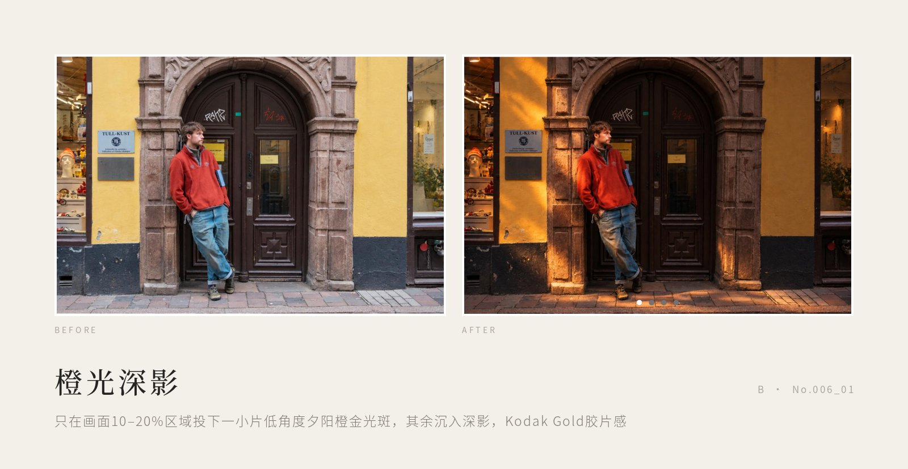
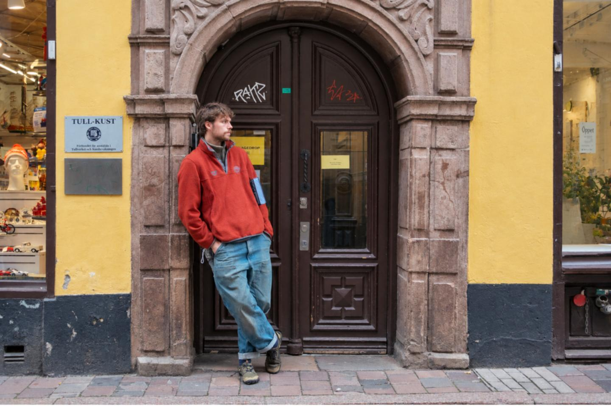
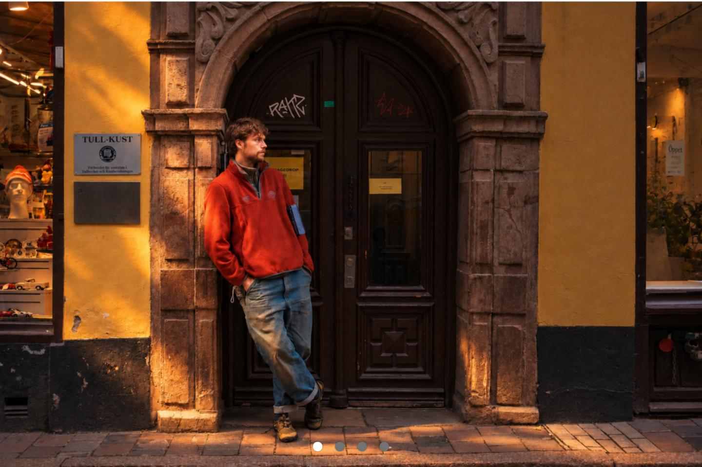
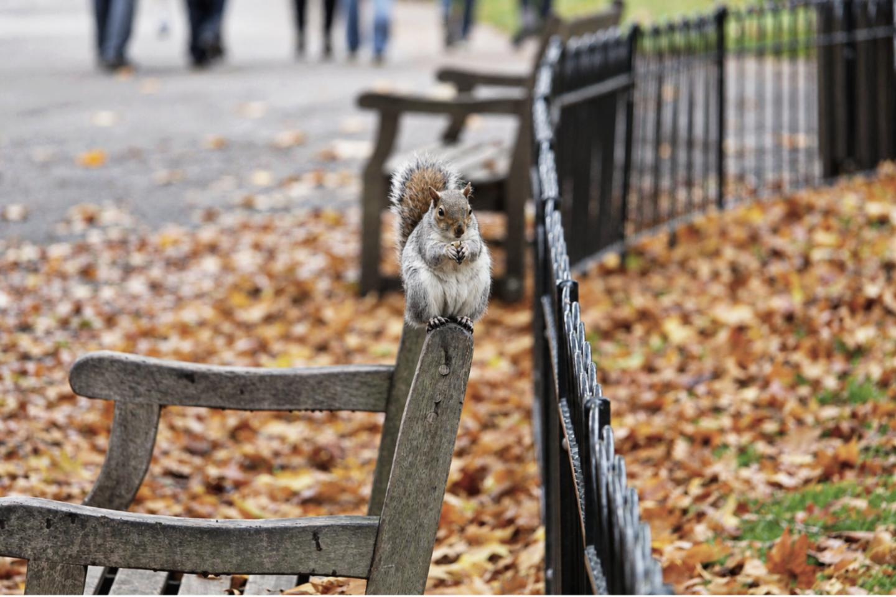
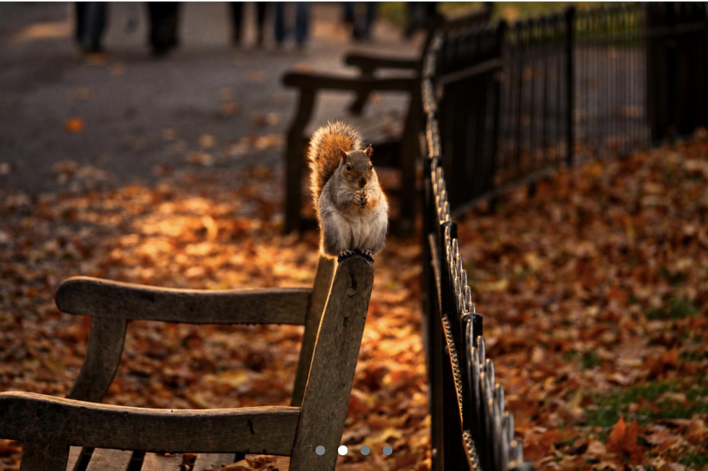
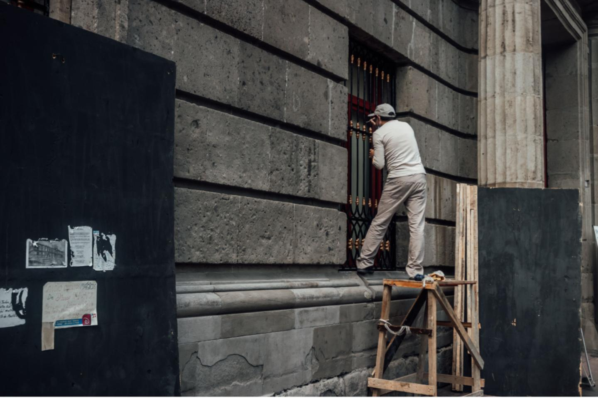
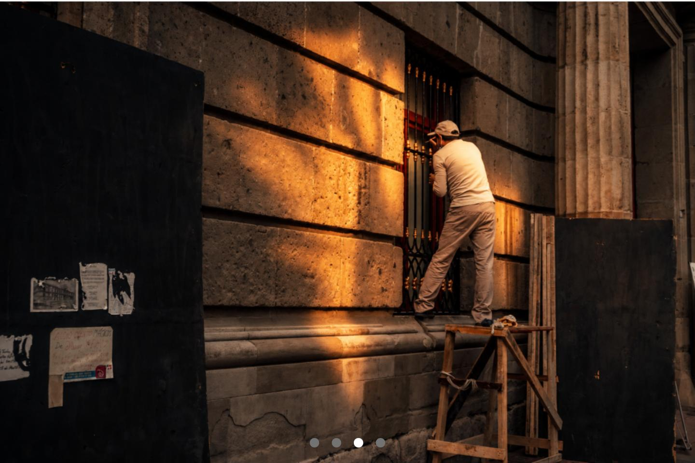

<p align="center"></p>

# 橙光深影

**B · 氛围**　改动强度：重　·　原分类：暖光黄昏与秋日

只在画面10–20%区域投下一小片低角度夕阳橙金光斑，其余沉入深影，Kodak Gold胶片感

| 适合题材 | 适合光线 | 不适合 |
|---|---|---|
| 人像、街景、城市建筑、静物 | 阴天、晴天顺光、任意 | 已经是强逆光或大面积受光的照片 |

> 同类合并：008_01, 037_01（已并入本风格，原提示词见 git 历史）

## 提示词

```text
保留原图主体、结构与构图。真实纪实摄影，采用傍晚极低角度画外夕阳光影，仅在画面约 10%–20% 的局部区域出现一小片低角度夕阳照明，受光区域形成橙金色奶油光斑，其余区域自然沉入深影。明暗对比强烈但过渡真实，保留暗部细节。Leica Q3，28mm，f/5.6，Kodak Gold 200 胶片色彩，低饱和暖色调，光学柔焦、细腻颗粒，轻微胶片色偏，真实皮肤纹理，自然曝光，克制的电影感，避免过度锐化、地面反光、镜面反射、新增太阳、改变云层、左右光影、HDR与人工打光痕迹。
```

## 前后对比

| 原图 | 成片 |
|---|---|
|  |  |
|  |  |
|  |  |

<sub>原标题：橙光深影 | 摄影佬眼中的梦中情光　·　作者：Delin（抖音）</sub>
