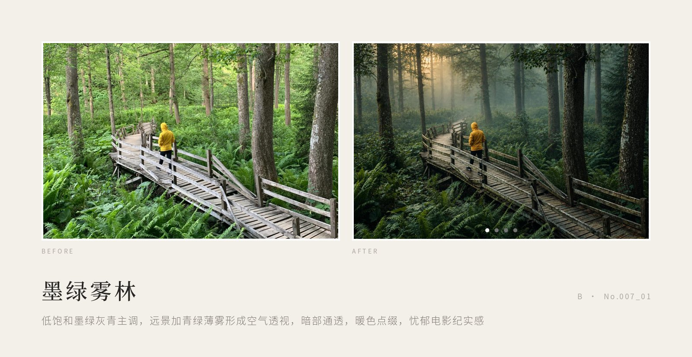
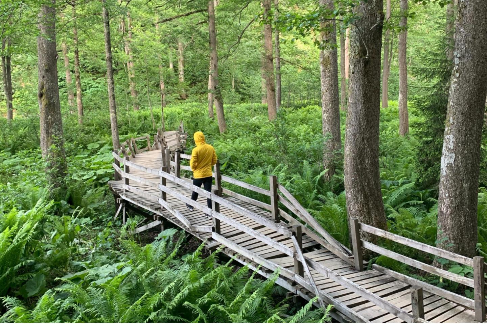
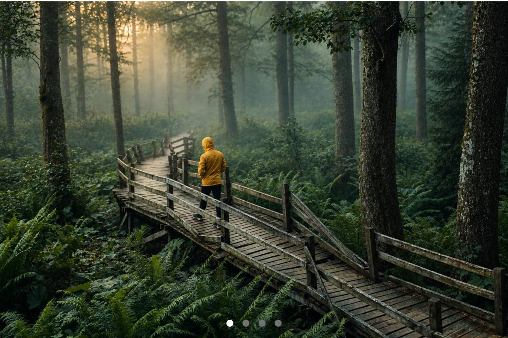
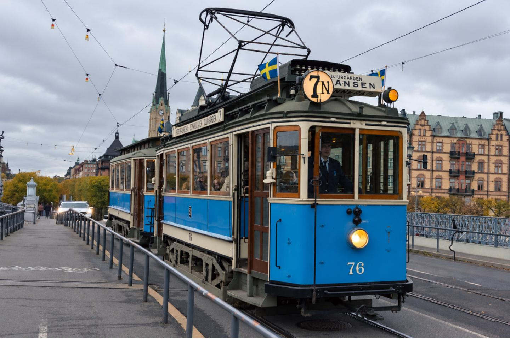
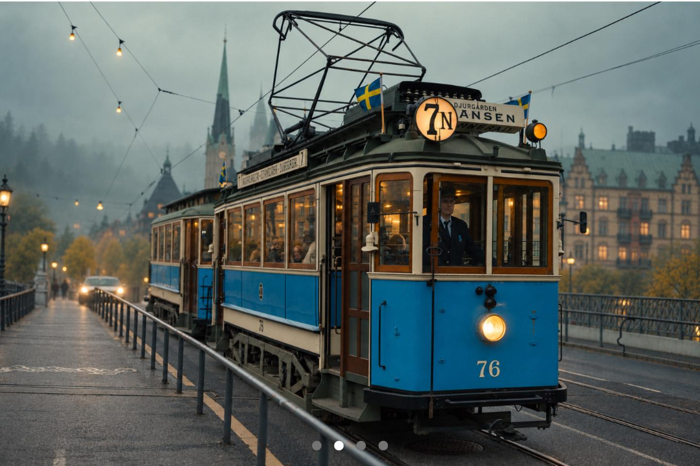
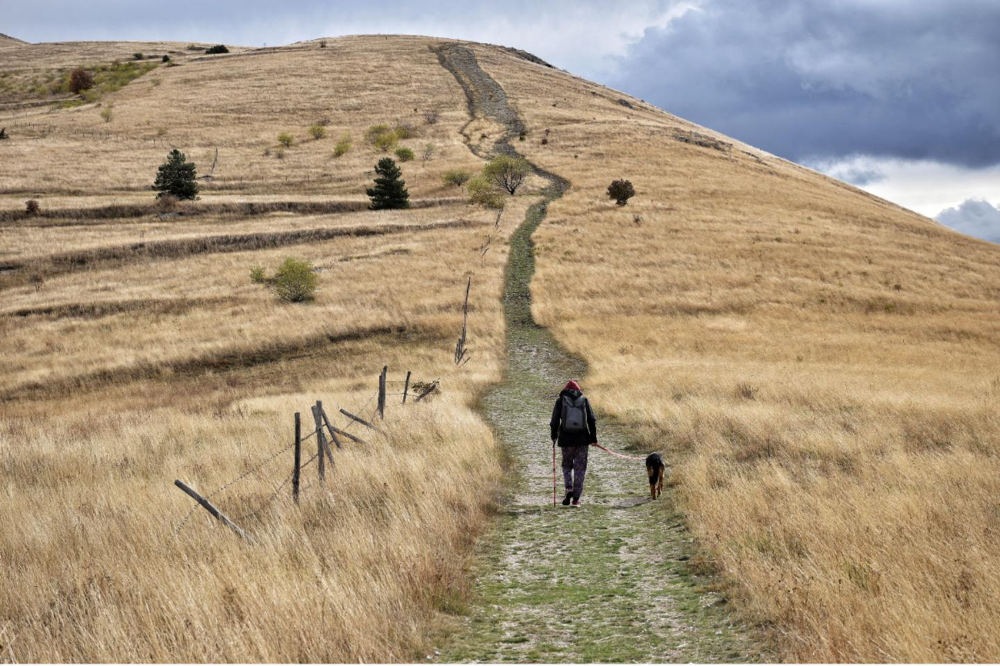
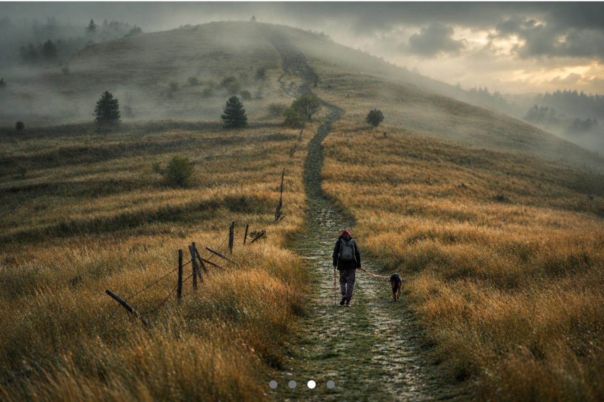

<p align="center"></p>

# 墨绿雾林

**B · 氛围**　改动强度：重　·　原分类：暗调冷色与雾感

低饱和墨绿灰青主调，远景加青绿薄雾形成空气透视，暗部通透，暖色点缀，忧郁电影纪实感

| 适合题材 | 适合光线 | 不适合 |
|---|---|---|
| 风光、植物花卉、街景、人像、交通工具 | 阴天、晴天顺光、任意 | 纯室内、夜景霓虹 |

## 提示词

```text
在完整保留原图主体、人物姿态、建筑结构、空间透视及整体构图的基础上，适度净化画面，减少杂乱元素与视觉干扰，保留真实自然的环境细节。 
整体采用 Moody Green Foggy Cinematic 风格，以低饱和墨绿色、灰青色和深森林绿为主色调，营造安静、深邃、略带忧郁的电影氛围。 
暗部自然沉入浓郁而通透的墨绿色阴影，保留丰富细节；近至远景逐渐融入轻柔细腻的青绿色浓雾，形成自然的空气透视与空间层次。 
增强自然光学柔焦与 Bokeh 散景效果，主体保持清晰，背景柔和虚化，局部光源呈现细腻温润的奶油质感光斑。 
整体光影克制，明暗过渡真实，适当保留柔和暖色点缀，搭配细腻胶片颗粒、轻微胶片色偏与自然曝光，呈现高级、真实、富有呼吸感的街头纪实电影质感。 
禁止:过度锐化、HDR、地面反光、人工打光、过度虚化及不自然的光影效果。
```

## 前后对比

| 原图 | 成片 |
|---|---|
|  |  |
|  |  |
|  |  |

<sub>原标题：墨色雾场 | 融进雾中的孤独感　·　作者：Delin（抖音）</sub>
