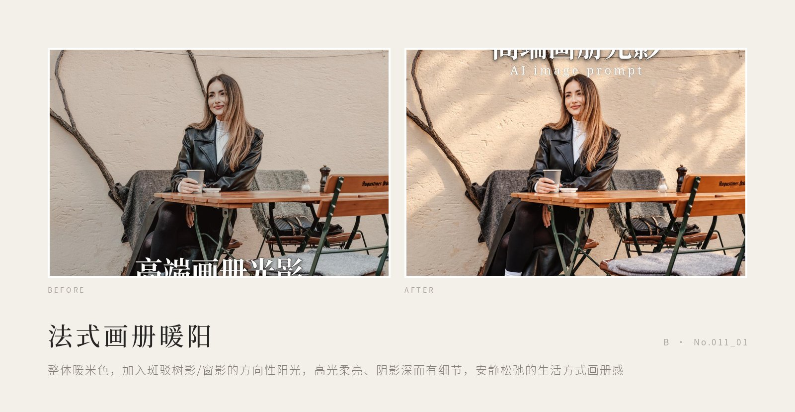
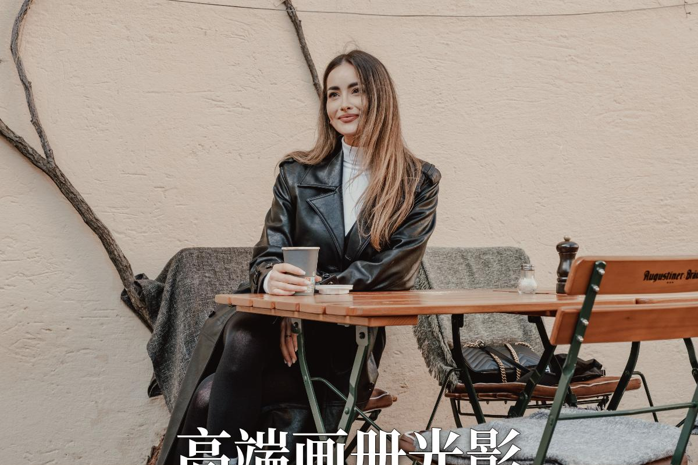
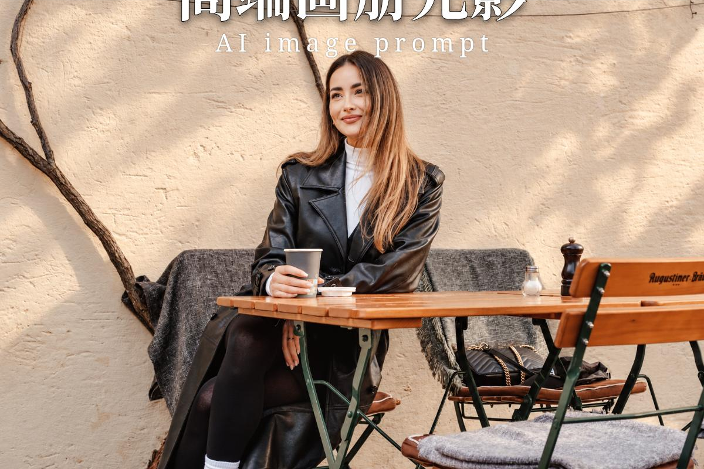
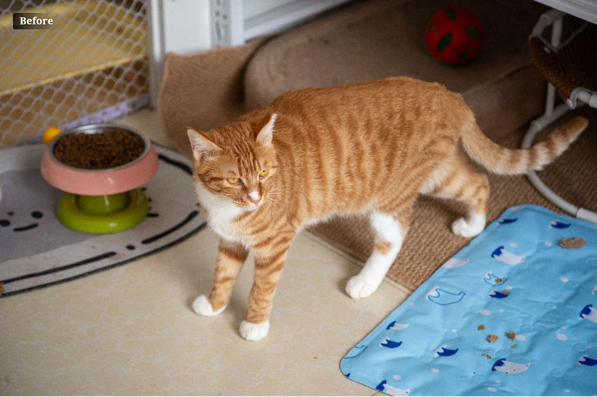
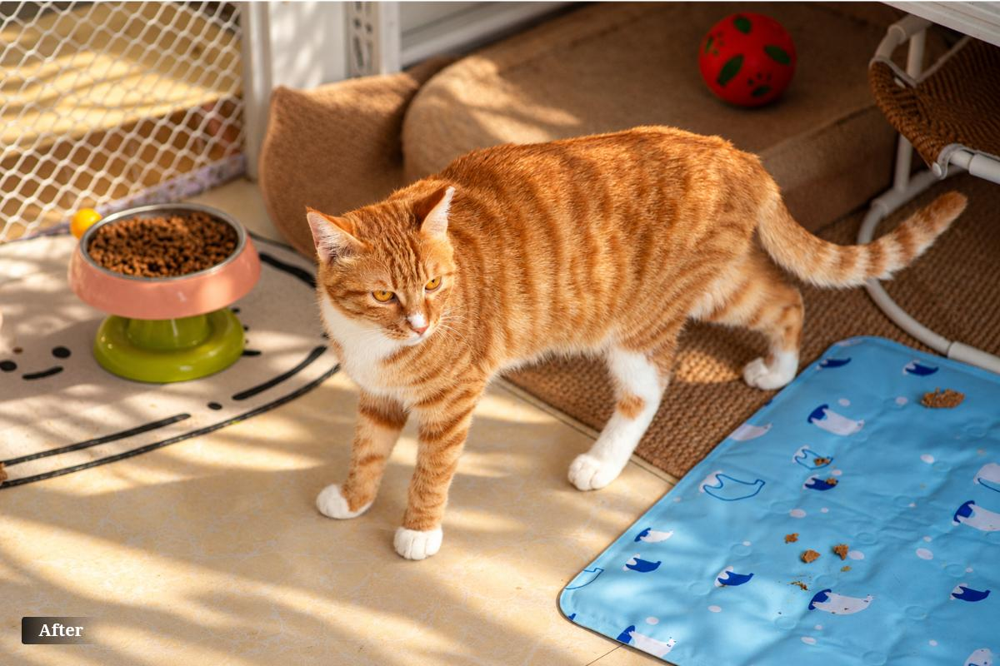
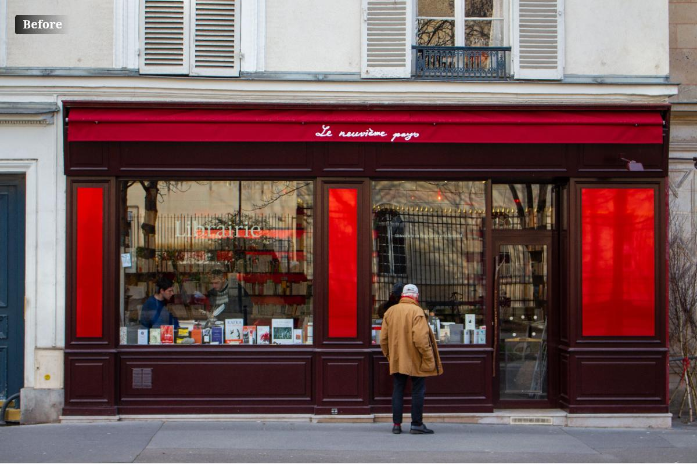
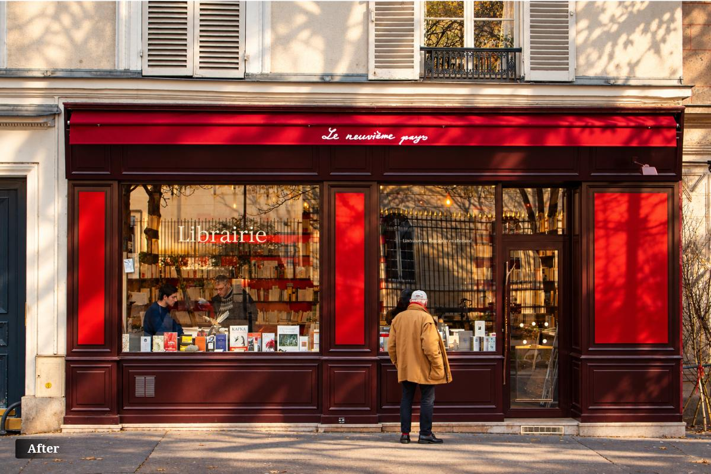

<p align="center"></p>

# 法式画册暖阳

**B · 氛围**　改动强度：中　·　原分类：光影塑形与原片增强

整体暖米色，加入斑驳树影/窗影的方向性阳光，高光柔亮、阴影深而有细节，安静松弛的生活方式画册感

| 适合题材 | 适合光线 | 不适合 |
|---|---|---|
| 人像、街景、静物、城市建筑 | 晴天顺光、阴天、室内 | 夜景、本身已强逆光或需要冷峻氛围的照片 |

## 提示词

```text
“保留原构图、比例、内容不变，将画面提升至法国高端生活方式画册的摄影品质与高级光影重构。强调克制、松弛、精致、明暗层次分明、舒适而不刻意的编辑摄影美学，保留空间呼吸感、生活痕迹与细腻的时间质感。以光影重构为核心，让光有明确方向、丰富层次与自然节奏，形成清晰可辨的受光变化、柔和投影与空间明暗对比，同时保持真实可信。以柔和且富有色彩密度的中性色协调全局，但不强加奶油滤镜；尊重原有色及其他辨识度高的环境色，校正杂乱偏色与浑浊灰调，使色彩清澈、温润。依据原有光线与环境逻辑，主动强化局部受光、自然投影及明暗过渡，让高光柔软而明亮，阴影深邃而保留细节，中间调通透而丰富，避免平光、过度提亮或硬光。呈现真实材质的纹理、层次与微小不完美，降低无关干扰，不磨平细节，不制造虚假景深。柔和不等于平淡，克制不等于微弱；光影可以鲜明，但光源必须可信，层次可以丰富，但痕迹不能刻意。最终呈现如专业摄影师捕捉、经高级编辑修图精细打磨的生活方式影像：真实不粗糙，优雅不拘谨，具有安静、自然、不炫耀的昂贵气质。”
```

## 前后对比

| 原图 | 成片 |
|---|---|
|  |  |
|  |  |
|  |  |

<sub>原标题：日常照片质感蜕变｜画册级光影发圈大招　·　作者：Delin（抖音）</sub>
