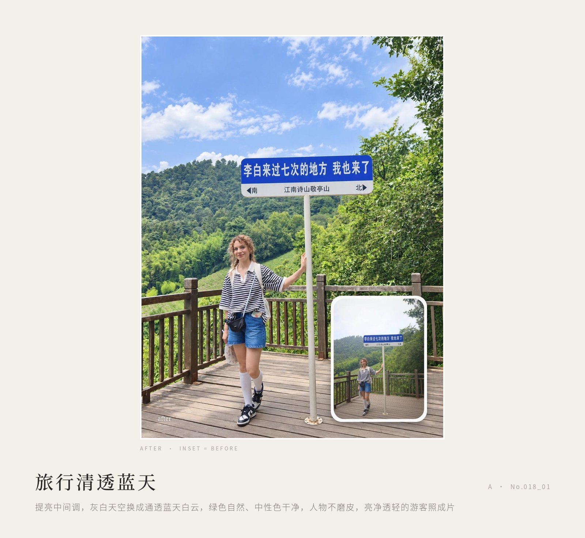
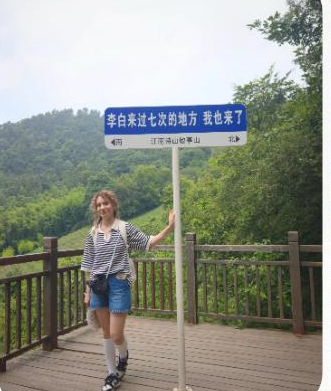
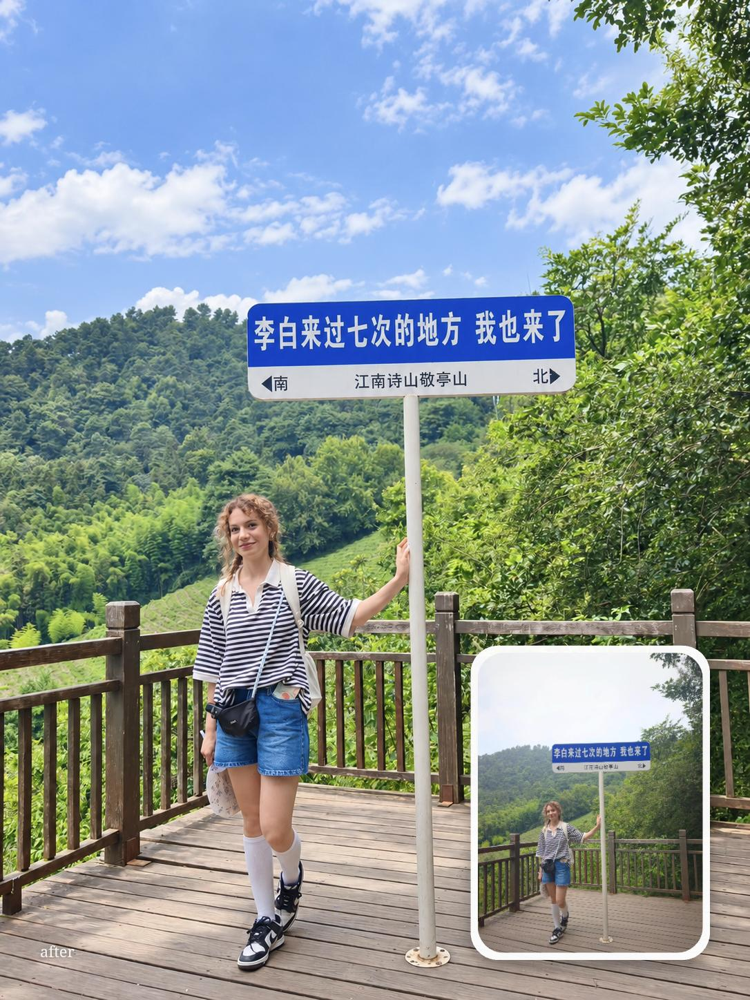
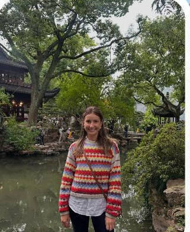
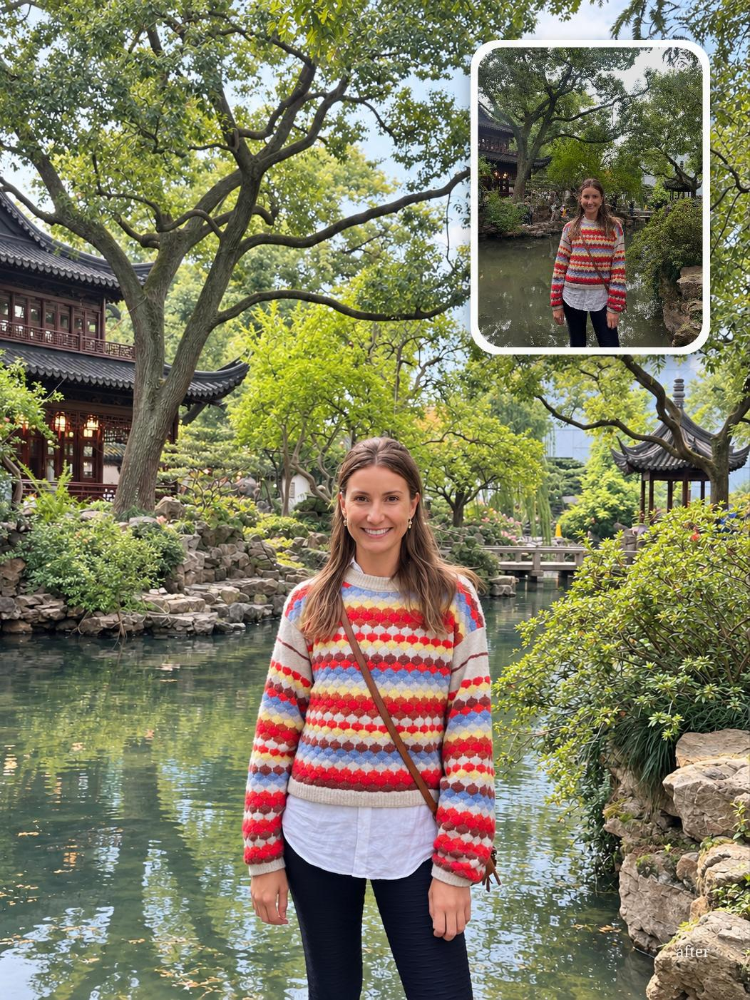

<p align="center"></p>

# 旅行清透蓝天

**A · 稳妥**　改动强度：中　·　原分类：清新日系与人像

提亮中间调，灰白天空换成通透蓝天白云，绿色自然、中性色干净，人物不磨皮，亮净透轻的游客照成片

| 适合题材 | 适合光线 | 不适合 |
|---|---|---|
| 人像、风光、街景、水面 | 阴天、晴天顺光 | 夜景、室内、要保留阴天情绪的照片 |

> 同类合并：049_01（已并入本风格，原提示词见 git 历史）

## 提示词

```text
将这张普通游客照整理成干净、通透、明亮、有摄影完成度
的旅行成片。保留人物身份、五官、表情、姿势、服装、地
点真实性、核心环境结构和真实光源，不随意增删人物、车
辆、建筑或重要场景元素。适度优化裁切、留白、透视和广
角畸变，使构图更稳定。提高整体曝光与中间调，但保留黑
位和阴影层次，保护天空、皮肤、白衣、墙面及灯光高光，
避免过曝和HDR感。综合色彩保持中低饱和，重点提升洁净
度与综合色分离，蓝色清透、绿色自然、中性色干净。人物
精修保持真实，不磨皮、不美白、不改脸。若原图有阴天或
灰白天空，在光线逻辑允许时可自然整理为通透蓝天并保留
云层；若有水面，可增强清晰度、层次与真实反光，但不
做镜面、翡翠色或宝石蓝。最终保持亮、净、透、轻、清
爽、有空气感，避免泛白、奶油感、荧光色、AI柔光和过度
锐化。
```

## 前后对比

| 原图 | 成片 |
|---|---|
|  |  |
|  |  |

<sub>原标题：旅行清透　·　作者：Delin（抖音）</sub>
