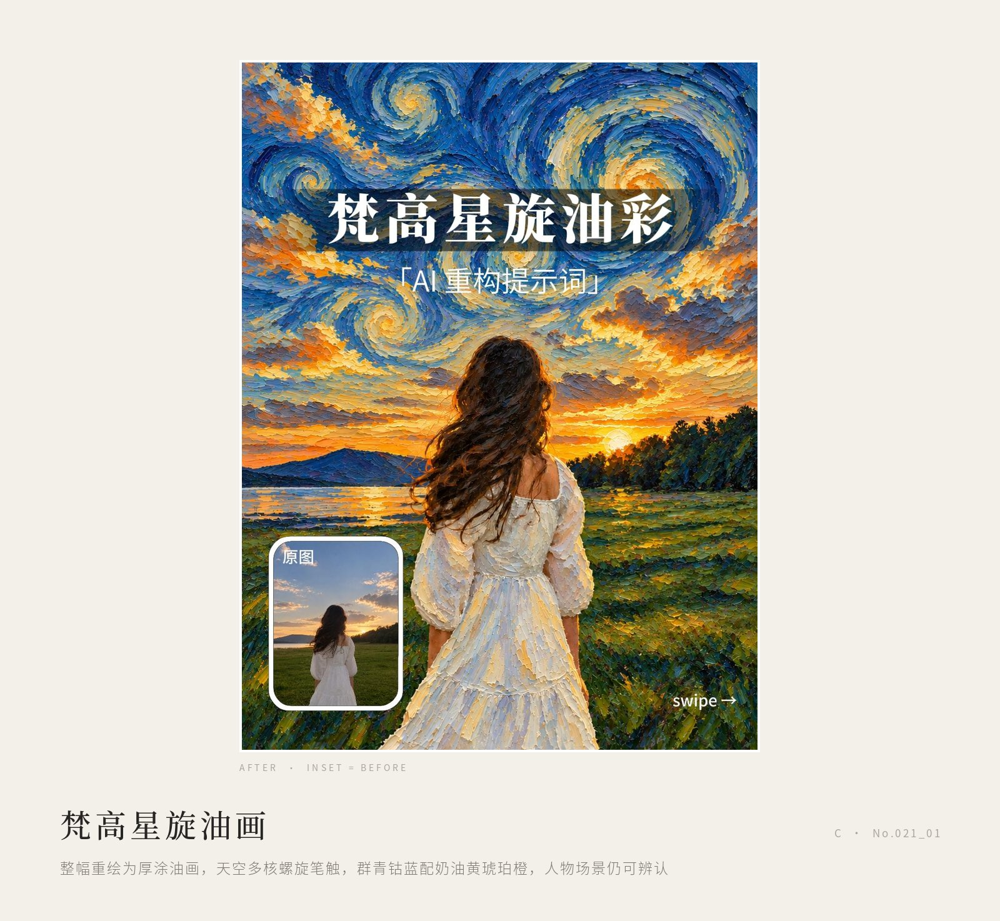
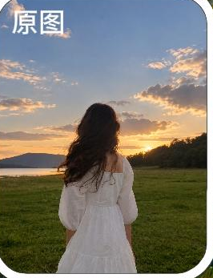
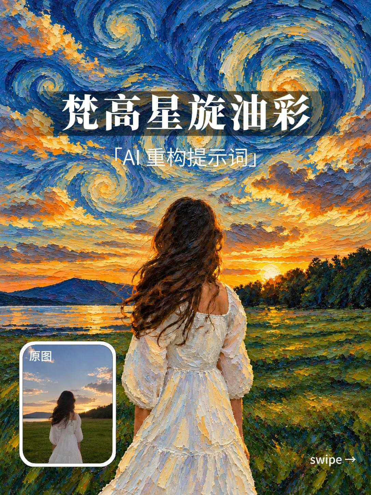
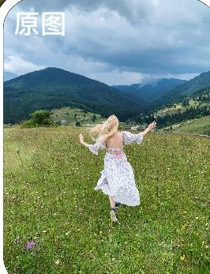
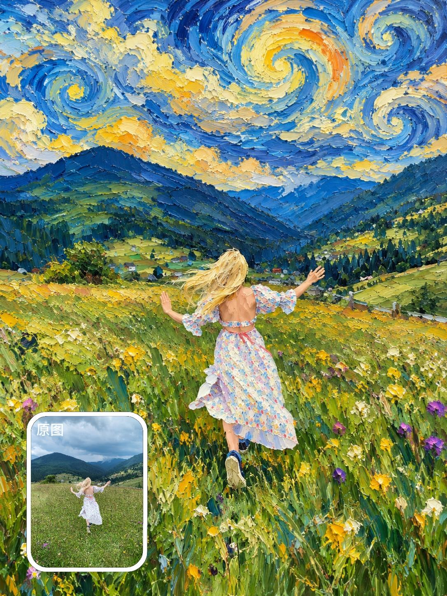
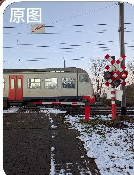
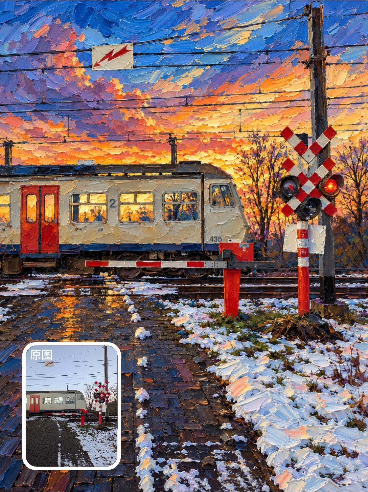

<p align="center"></p>

# 梵高星旋油画

**C · 反差**　改动强度：重　·　原分类：风格重构与特殊题材

整幅重绘为厚涂油画，天空多核螺旋笔触，群青钴蓝配奶油黄琥珀橙，人物场景仍可辨认

| 适合题材 | 适合光线 | 不适合 |
|---|---|---|
| 风光、人像、街景、交通工具、城市建筑 | 任意 | 需要保持照片真实感的场合；天空占比很小的画面效果打折 |

## 提示词

```text
保持输入照片的人物身份、姿态、身体比例、服装轮廓、主体
位置、原始构图、透视、场景、时间天气与真实光源，不新增
或替换主体。将摄影彻底重绘为高密度手工厚涂油画，而非油
画滤镜。整幅画以清晰可见的中大型粗厚笔触为主体，颜料强
烈堆积、推挤、覆盖，局部才使用较小笔触塑造人物五官、手
部和关键结构。天空形成多核心、多尺度的明确螺旋笔触场：
分布多处大小不一的旋涡核心，由粗厚弯曲笔触层层环绕并向
中心卷入，大旋涡、中型旋涡与小型回旋错落交织，再以宽阔
S形、波浪形和长弧形色带连接，旋涡大小、方向、松紧均不
规则，避免规则同心圆和机械重复。建筑、水面、地面、植
被、服装同样保持粗厚而有方向性的实体笔触，分别沿透视、
轮廓、波浪、枝叶及人体曲面流动，不恢复摄影式细腻纹理。
综合色彩以群青、钴蓝、深蓝、蓝绿为骨架，原有亮部转化为
奶油黄、金黄、琥珀橙。强化刮刀痕、厚颜料脊线、不完全混
色与底色间隙，同时保持人物和原场景清晰可辨。
```

## 前后对比

| 原图 | 成片 |
|---|---|
|  |  |
|  |  |
|  |  |

<sub>原标题：「AI重构梵高油彩，这厚涂感太对味了」　·　作者：Delin（抖音）</sub>
