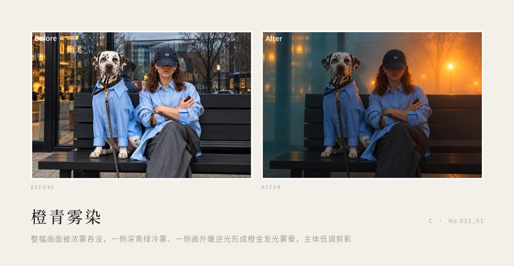
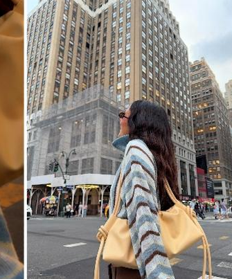
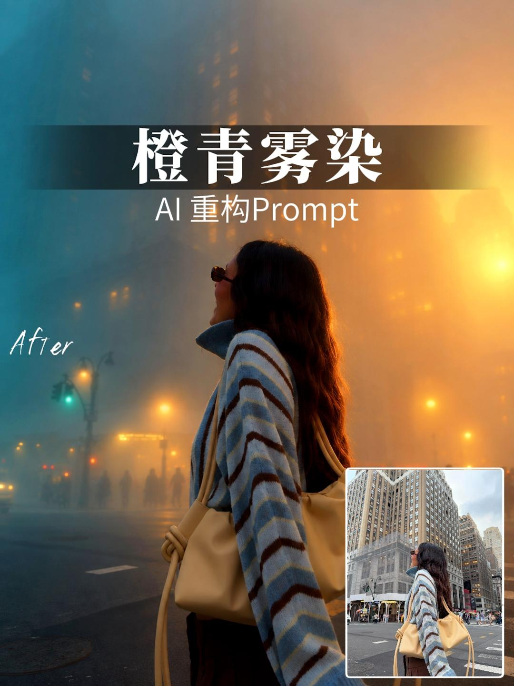
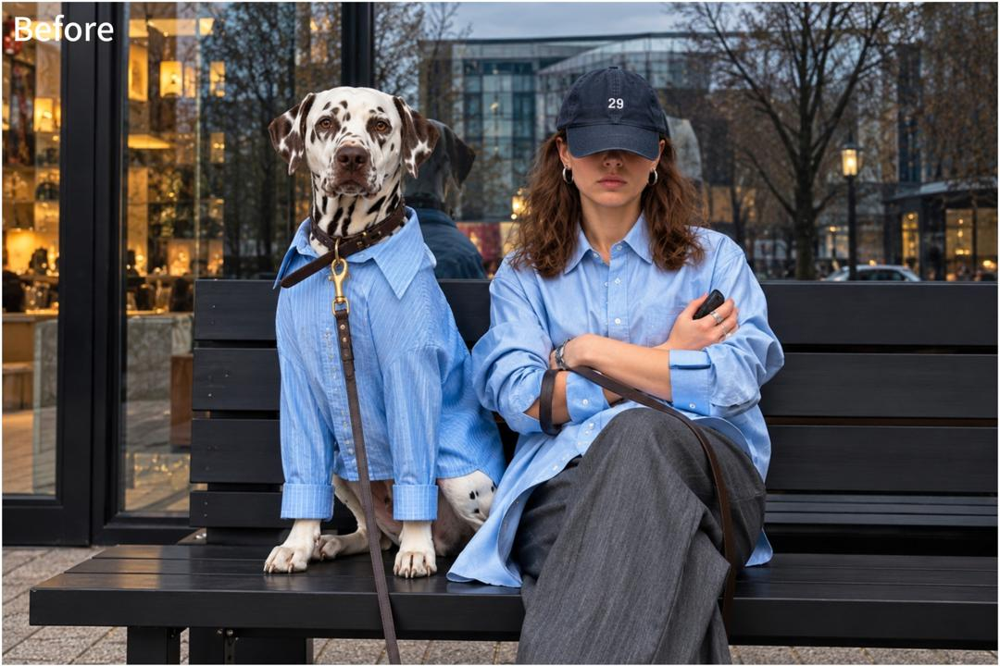
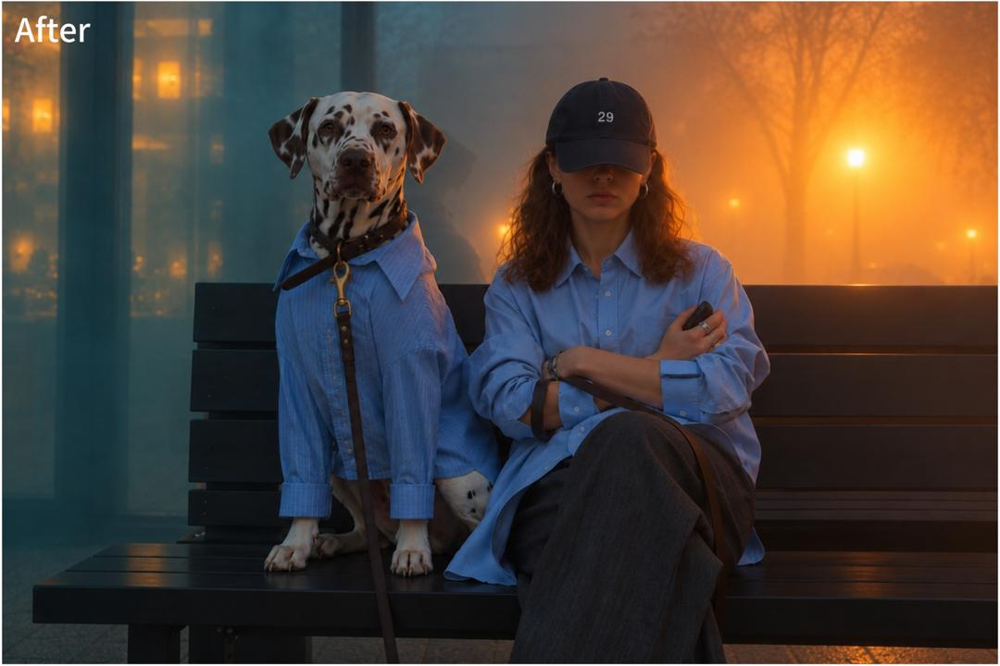
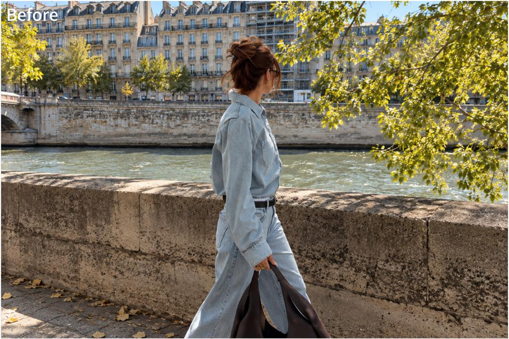
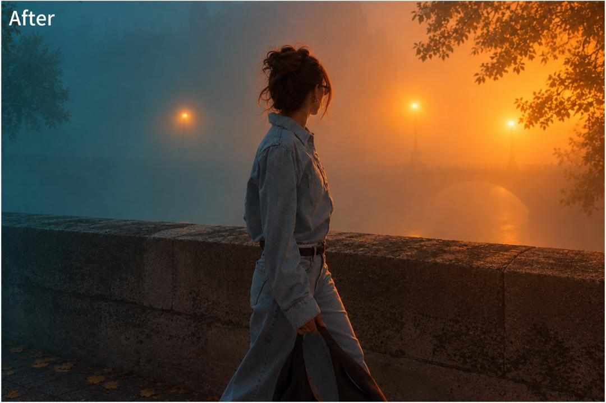

<p align="center"></p>

# 橙青雾染

**C · 反差**　改动强度：重　·　原分类：青橙冷暖电影色

整幅画面被浓雾吞没，一侧深青绿冷雾、一侧画外暖逆光形成橙金发光雾晕，主体低调剪影

| 适合题材 | 适合光线 | 不适合 |
|---|---|---|
| 人像、街景、城市建筑 | 任意 | 需要保留背景信息或人多杂乱的照片 |

## 提示词

```text
保持主体身份、姿态、构图、透视、环境与材质。将完整
景深置于高密度浓雾中，前景也有可见空气介质，中远景
进一步被雾吞没。建立鲜明但自然的双色雾光：一侧为明
确的深青绿、蓝绿色冷雾，综合色相清晰且保持冷感；另
一侧由隐藏的画外强暖逆光穿透浓雾，使空气形成明亮浓
郁的橙金、琥珀色发光半圆形雾晕，最亮处金黄，向暗部
过渡为橙褐。冷暖两侧综合色彩保持纯净、有综合色彩密
度，不被灰雾中和，仅在主体附近柔和渗透。主体保持低
调曝光，正面偏暗，仅发丝和局部轮廓被暖光强穿透。浓
雾降低背景反差和细节，但主体综合色彩与黑位保持干
净；柔感来自空气散射、宽柔Bloom和Veiling glare，而非
全局去饱和或灰色蒙层。依照原图质感适量提升对比度。
地面保持干燥哑光，无积水、湿地和暖色倒影。禁止脏
灰、粗糙、米灰雾、综合色彩发白、综合色彩平均化、硬
光束、HDR和过度锐化。
```

## 前后对比

| 原图 | 成片 |
|---|---|
|  |  |
|  |  |
|  |  |

<sub>原标题：青橙冷暖雾感碰撞，真的太吃氛围了！这次做了一套新的氛围感 Look：「橙青雾染」　·　作者：Delin（抖音）</sub>
