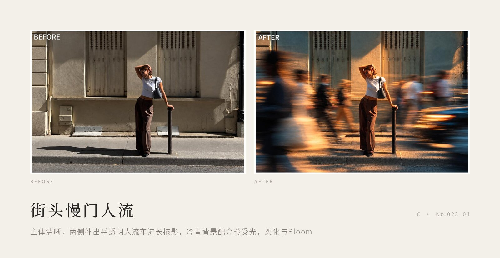
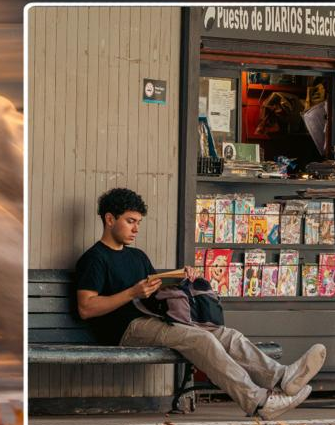
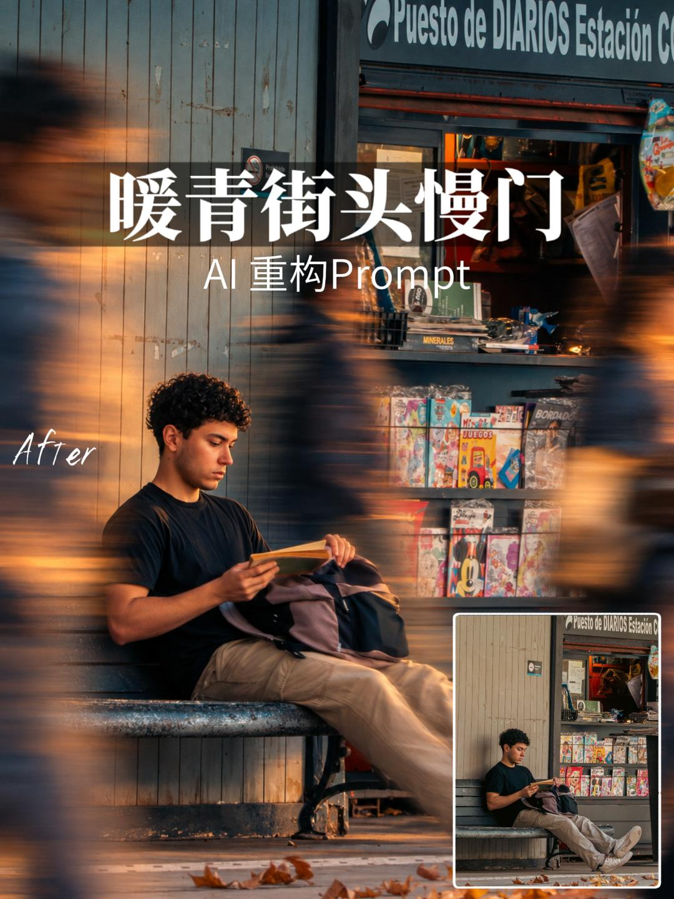
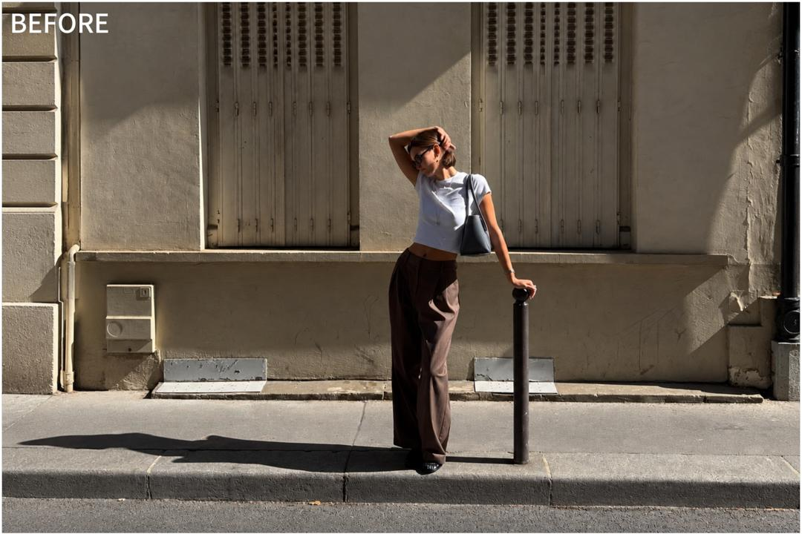
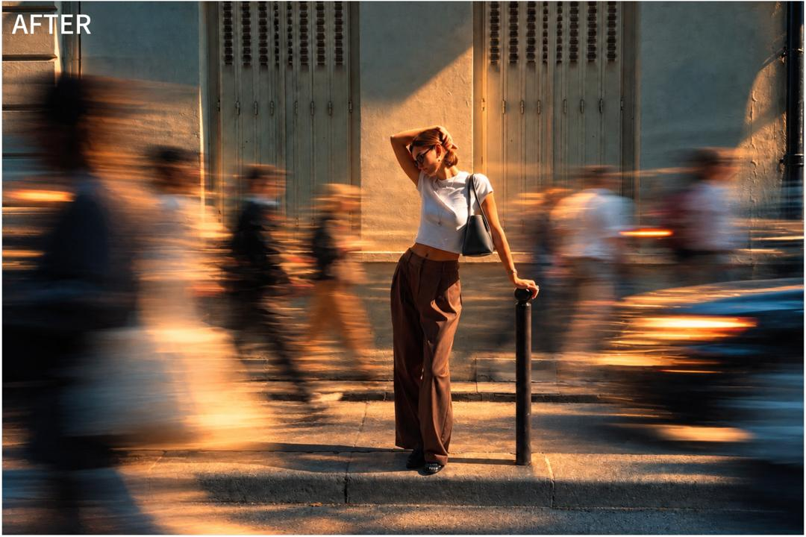
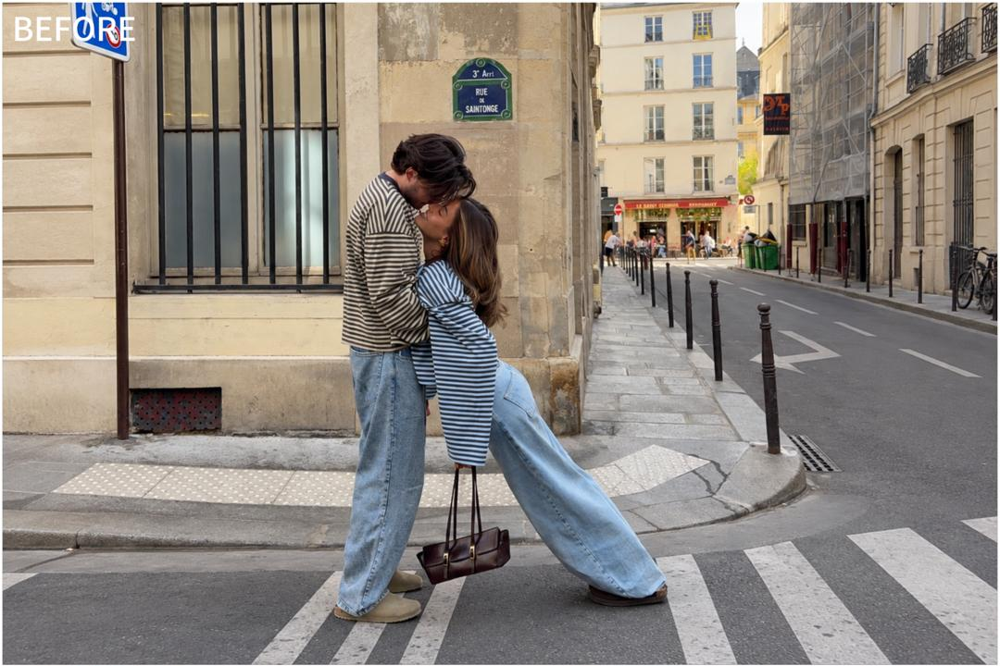
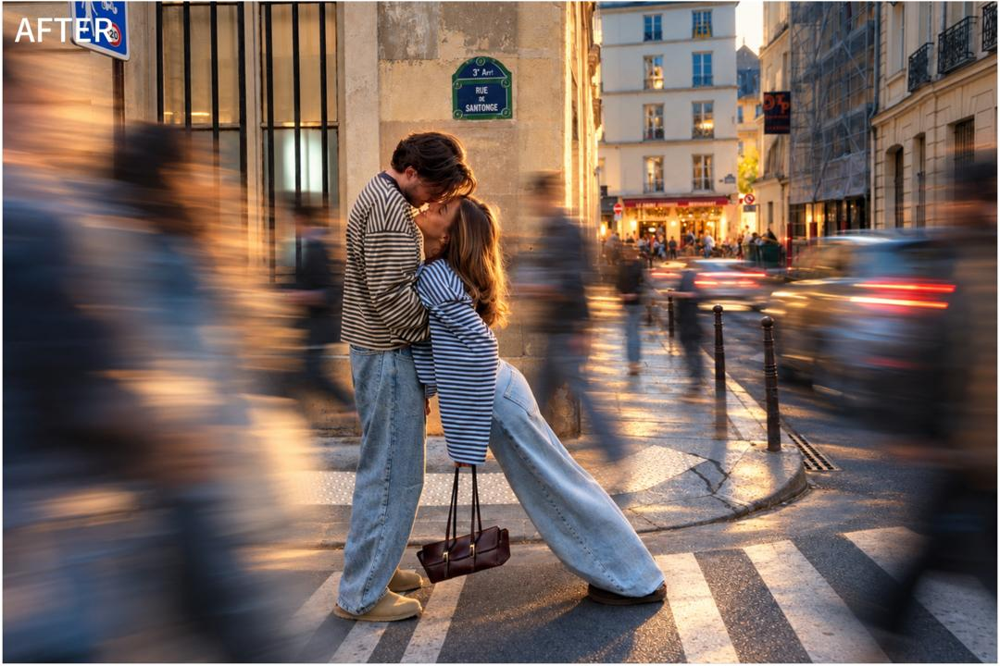

<p align="center"></p>

# 街头慢门人流

**C · 反差**　改动强度：重　·　原分类：风格重构与特殊题材

主体清晰，两侧补出半透明人流车流长拖影，冷青背景配金橙受光，柔化与Bloom

| 适合题材 | 适合光线 | 不适合 |
|---|---|---|
| 人像、街景 | 晴天顺光、黄昏、逆光 | 无人物的风光建筑、非街道场景 |

## 提示词

```text
保持原图构图、透视、静态建筑道路与主体身份不变，主
体面部、头部、肩颈和上半身保持最清晰，仅腿脚、衣
摆、手臂保留短距离连续拖尾。以主体为视觉锚点，在主
体左侧与右侧同时建立分层动态拖影：两侧近景都出现半
透明、大尺度、低细节的人流遮挡拖影，中景行人形成中
长残影，车辆沿真实行驶方向做连续水平拉伸；拖影强度
由近到远递减，并以左右包夹的流动感衬托主体，使主体
处于最稳定、最醒目的清晰中心。若原图动态对象不足，
可在合理位置少量补充行人或车流。综合色调采用冷暖对
撞，背景与阴影偏青蓝青绿，阳光高光与主体受光偏金
橙，暖色主体可更饱和，背景冷色适度压低，整体带轻微
复古柔化与少量Bloom。禁止模糊主体脸部、拖动静态建
筑、无依据堆人堆车或复制人物。
```

## 前后对比

| 原图 | 成片 |
|---|---|
|  |  |
|  |  |
|  |  |

<sub>原标题：定格当下，时间流转你是主角！普通街头照，我保留了人物、构图和街景，只让周围的人流和车流“动起来”　·　作者：Delin（抖音）</sub>
