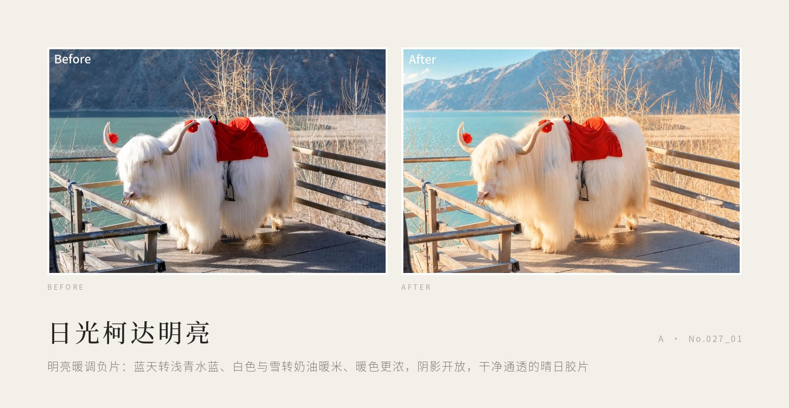
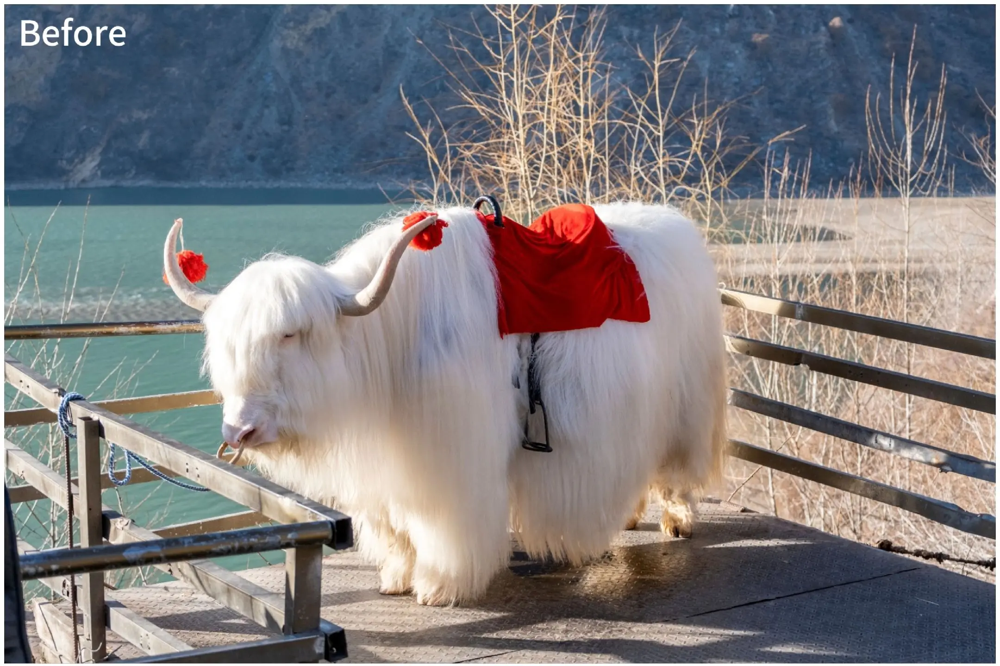
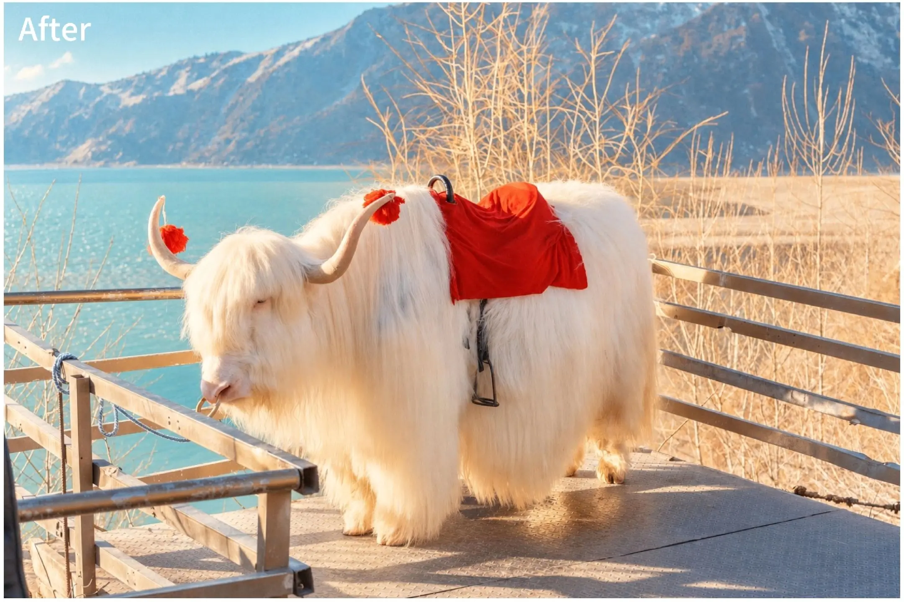
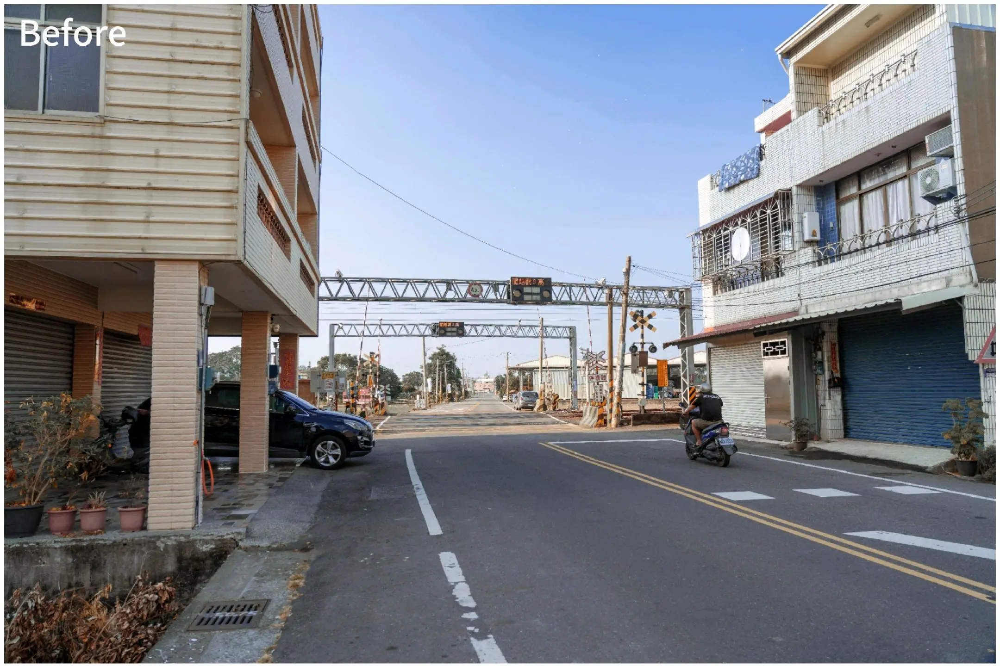
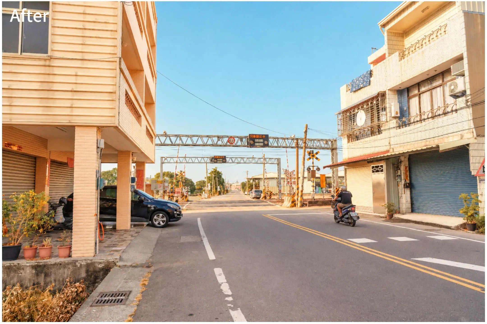
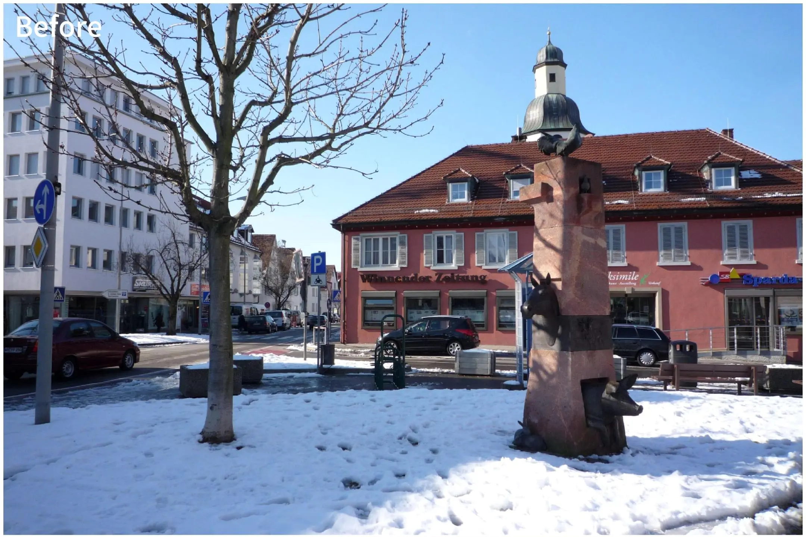
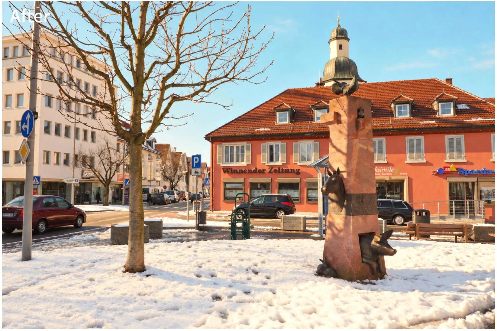

<p align="center"></p>

# 日光柯达明亮

**A · 稳妥**　改动强度：中　·　原分类：胶片复古与相机色彩

明亮暖调负片：蓝天转浅青水蓝、白色与雪转奶油暖米、暖色更浓，阴影开放，干净通透的晴日胶片

| 适合题材 | 适合光线 | 不适合 |
|---|---|---|
| 风光、街景、城市建筑、交通工具、人像 | 晴天顺光 | 阴天、夜景、无天空的室内效果有限 |

> 同类合并：030_01, 036_01, 045_01, 047_01（已并入本风格，原提示词见 git 历史）

## 提示词

```text
保持主体身份、构图、场景语义、关键结构、真实光线方向与材质关系不变，将画面重构为明亮暖调彩色负片日光成像。已有晴空、远景蓝域和蓝色物体是核心响应：把较深纯蓝、钴蓝和偏紫蓝主动向更明亮的浅青蓝、水青和轻青灰蓝迁移，适度抬高明度、降低过高饱和度并削弱蓝紫感；高亮蓝域可接近青白，深处仍保留层级，云层和中性白不能被整片染青。白色、雪面、浅石材与受光面进入奶油白、暖米和淡金，高光以宽缓肩部压缩而不剪白。红、橙、棕、肤色及天然暖材质保持较高综合色彩密度，绿色降低数码鲜嫩感并向自然黄绿或轻橄榄收束。阴影开放、黑位有重量，中间调最厚。降低数码锐度与过强微反差，加入细密随机负片颗粒和极轻综合色彩层扩散，不添加漏光、划痕、日期戳或边框。画面干净平滑，无色彩断层和脏污感。
```

## 前后对比

| 原图 | 成片 |
|---|---|
|  |  |
|  |  |
|  |  |

<sub>原标题：被这个提示词惊艳到了 | 日光柯达感胶片　·　作者：Delin（抖音）</sub>
