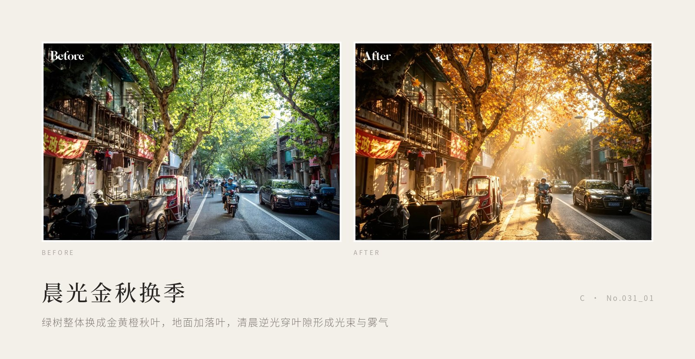
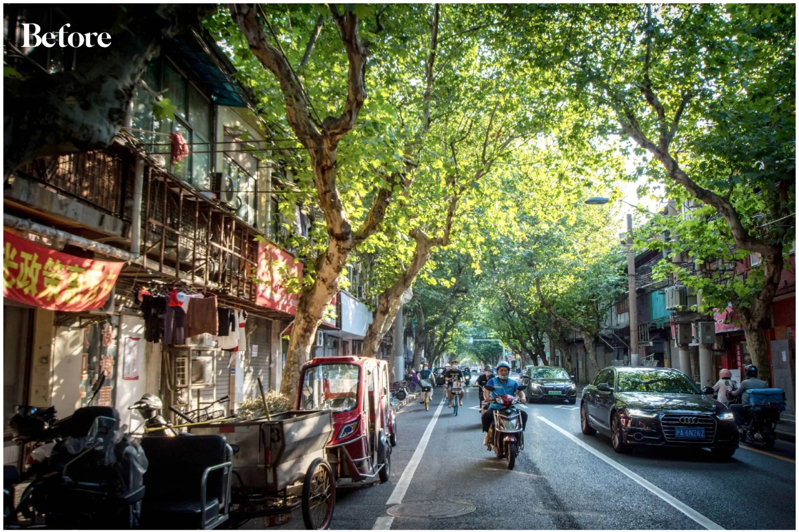
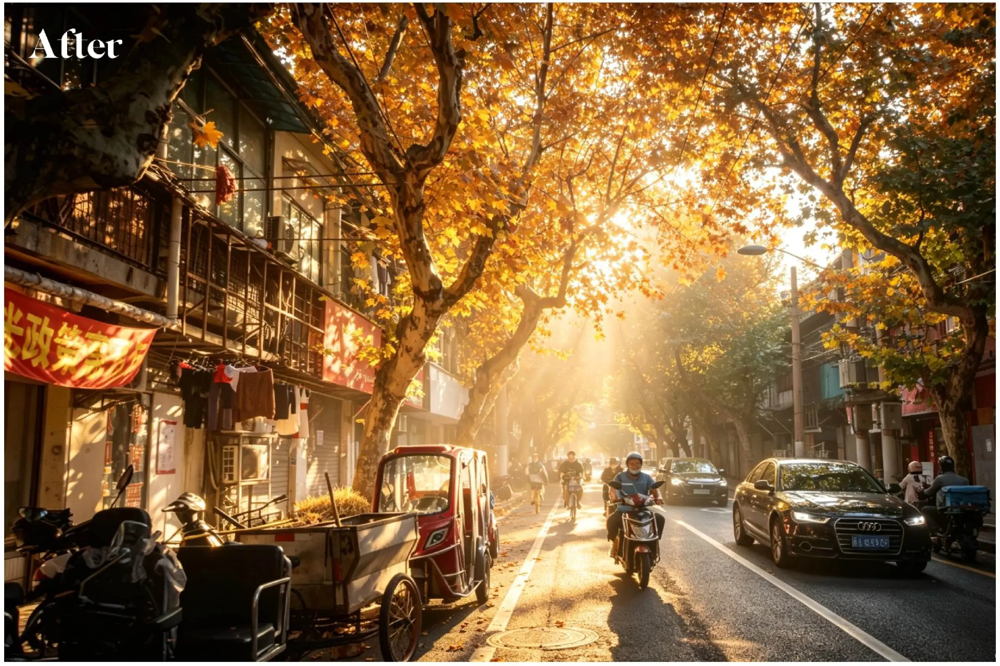
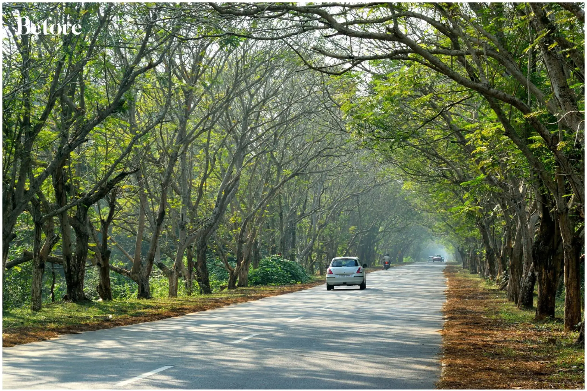
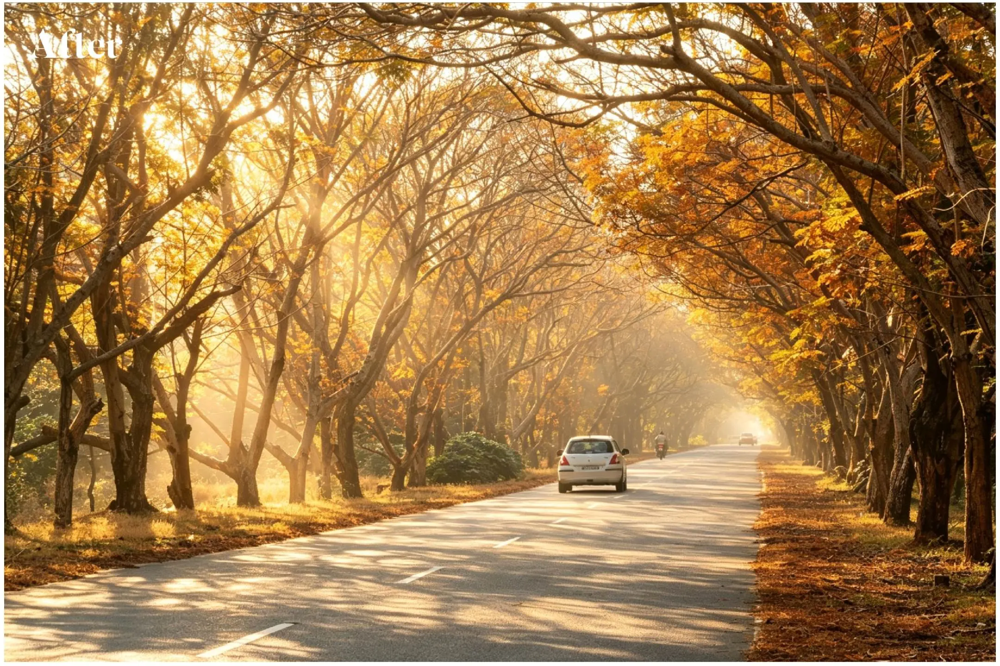
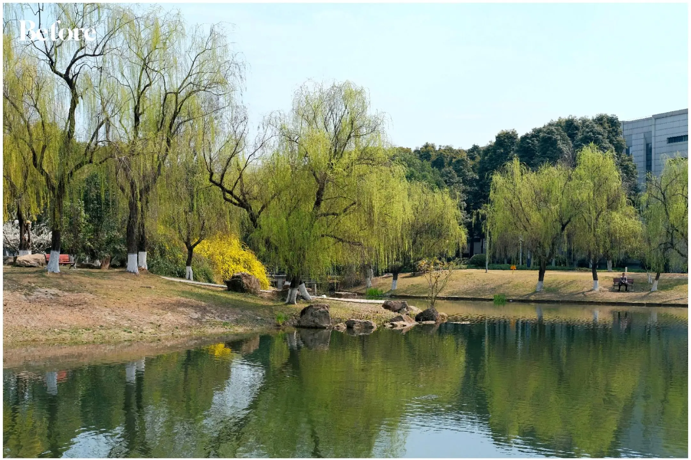
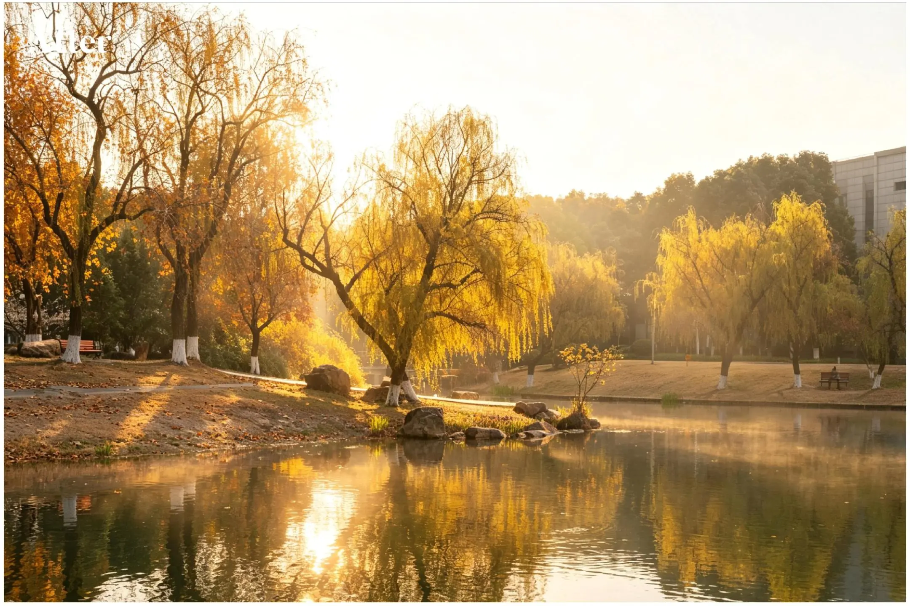

<p align="center"></p>

# 晨光金秋换季

**C · 反差**　改动强度：重　·　原分类：暖光黄昏与秋日

绿树整体换成金黄橙秋叶，地面加落叶，清晨逆光穿叶隙形成光束与雾气

| 适合题材 | 适合光线 | 不适合 |
|---|---|---|
| 风光、植物花卉、街景 | 晴天顺光、任意 | 无植被或以人像为主的照片 |

## 提示词

```text
保持原图构图、主体位置、透视关系、画面比例和已有物体不变，不新增不存在的物体。仅将照片重构为晨光金秋氛围：落叶乔木、柳树、阔叶灌木和部分草本叶片由绿色自然过渡为金黄色、橙黄色和暖棕色，部分叶片仍保留深浅不同的绿色，形成真实的秋季渐变，静止秋叶统一全黄；松树、柏树、樟树、冬青、竹类等常绿树种保持淡绿或青绿色，不统一变黄，保留不同树种的色彩差异和层次。草地和开阔地面逐渐干枯泛黄，呈现金黄草甸质感；原有地面增加自然落叶，落叶以少量散落在道路边缘、树根周围、草丛间和低洼处为主，避免均匀铺满，符合原有地面透视、遮挡、风向和阴影关系。加入清晨低角度侧后方逆光，阳光穿过树枝，秋叶边缘形成明亮金色轮廓光，光束穿透叶隙，空气柔和朦胧；若原图存在地面或水面，增加细碎温暖高光反射。整体为温暖金色氛围，柔和长阴影，树干纹理清晰锐利，叶片纹理细腻，高对比但不过曝，真实自然摄影，写实风景，单反相机质感，浅景深，温暖胶片色调，超高清细节，宁静治愈的秋日晨间氛围。
```

## 前后对比

| 原图 | 成片 |
|---|---|
|  |  |
|  |  |
|  |  |

<sub>原标题：晨光金秋 | 照片换季 | 提示词　·　作者：Delin（抖音）</sub>
