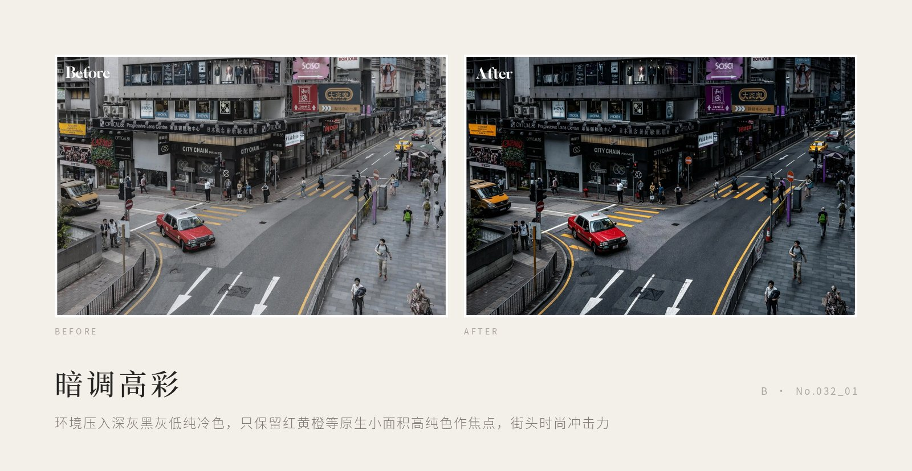
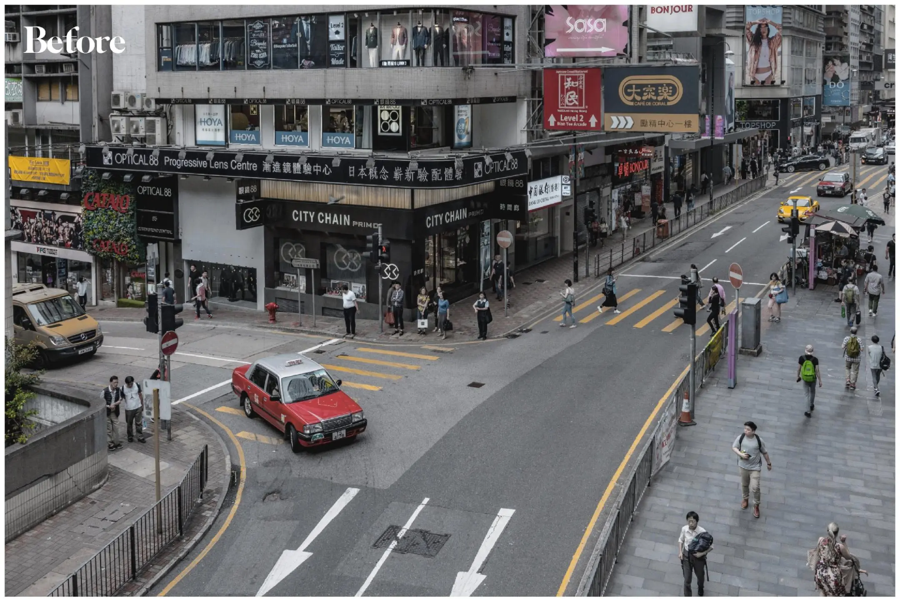
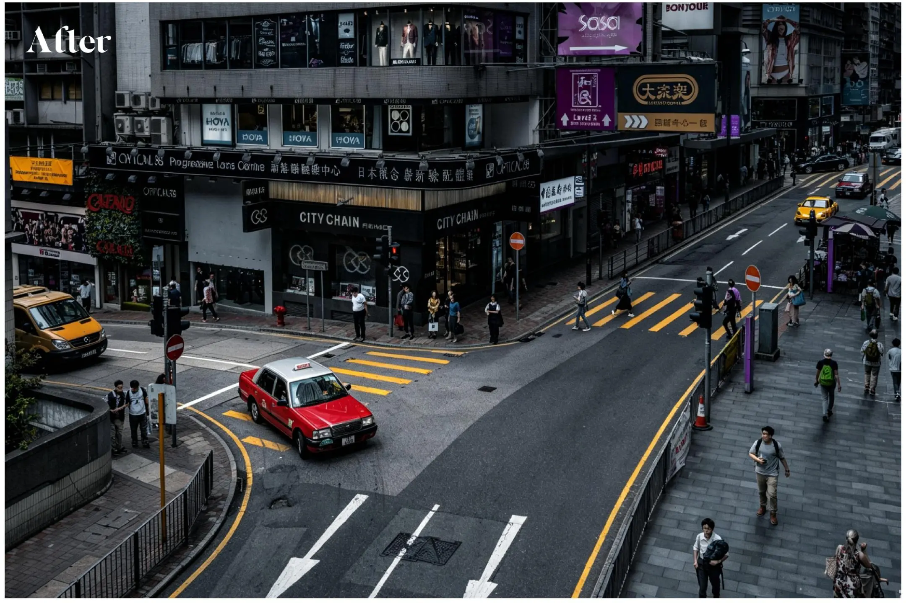
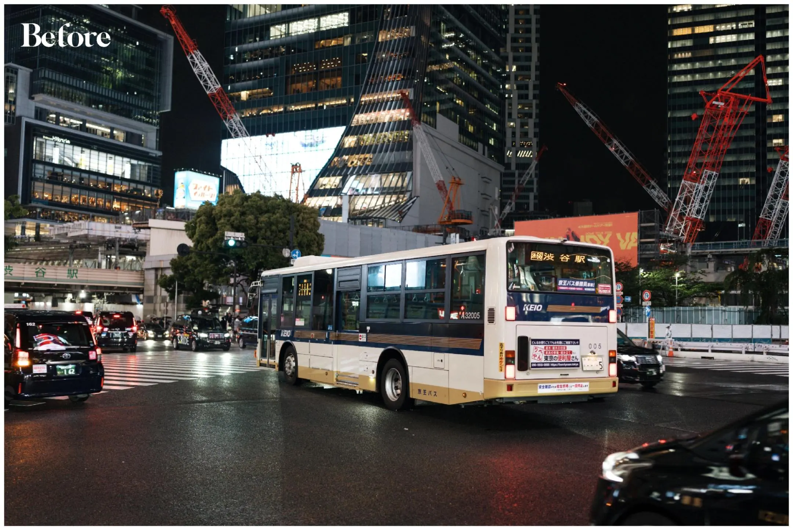
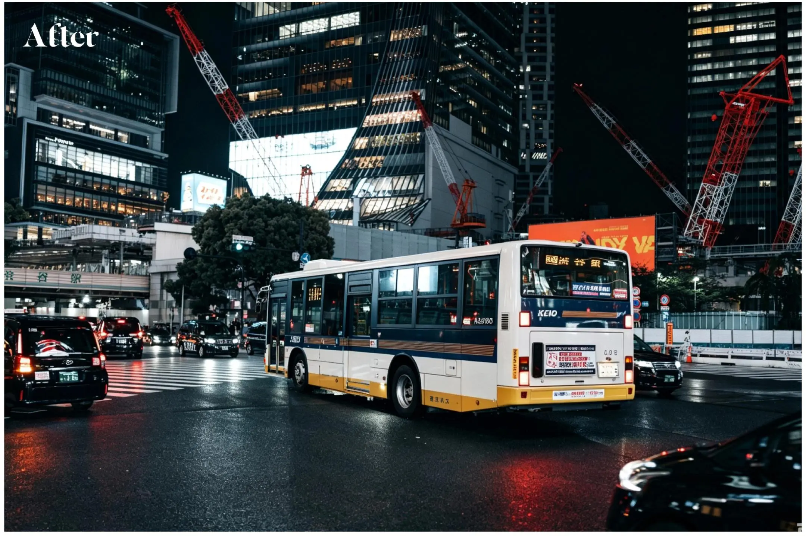
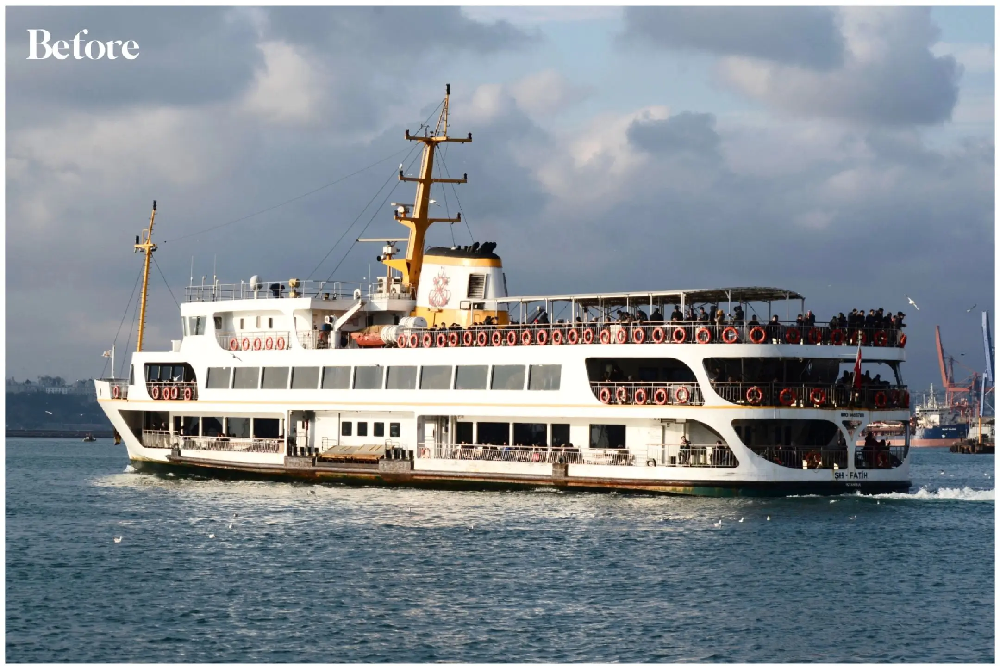
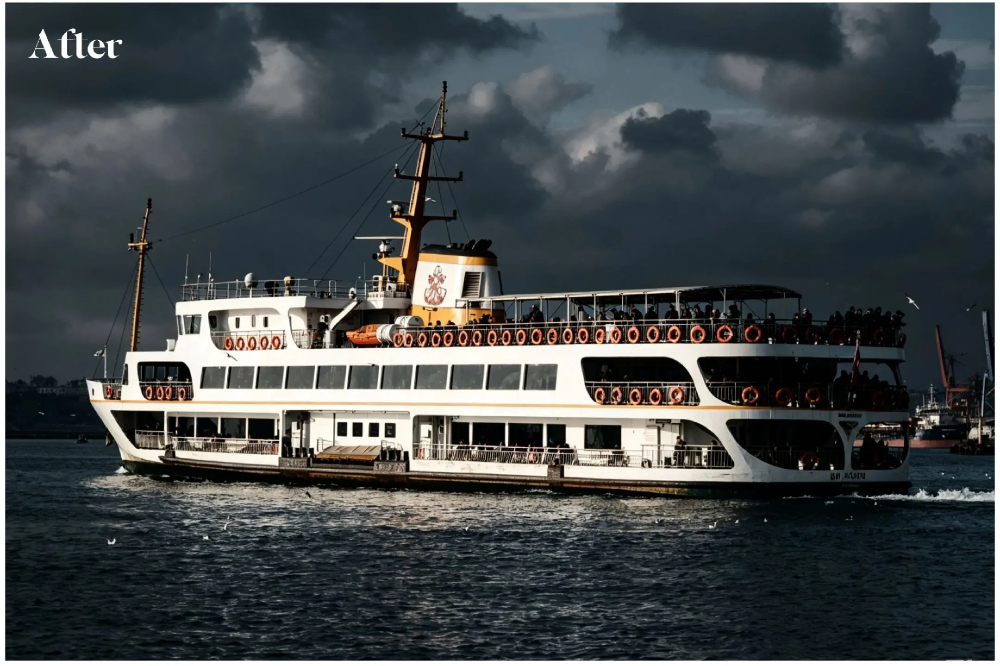

<p align="center"></p>

# 暗调高彩

**B · 氛围**　改动强度：中　·　原分类：暗调冷色与雾感

环境压入深灰黑灰低纯冷色，只保留红黄橙等原生小面积高纯色作焦点，街头时尚冲击力

| 适合题材 | 适合光线 | 不适合 |
|---|---|---|
| 街景、城市建筑、交通工具、夜景、水面 | 晴天顺光、阴天、夜晚、任意 | 色彩单一、没有亮色焦点的画面 |

> 同类合并：018_04, 042_01, 054_01, 055_01（已并入本风格，原提示词见 git 历史）

## 提示词

```text
将画面塑造成现代、年轻的暗色高彩视觉。大部分环境进入深灰、黑灰和低纯度冷色空间，降低背景中无关颜色的竞争，同时保留原图真正重要的小面积高纯度色彩，让红、橙、黄、紫或其他具有视觉意义的原生颜色成为明确焦点。不要统一覆盖色调，也不要把整张照片变成霓虹效果。主体保持清晰，肤色自然，暗部保留纹理，高光克制。整体具有街头与年轻时尚摄影的视觉冲击，但仍然像真实摄影。不得新增灯光、物体、人物或场景。
```

## 前后对比

| 原图 | 成片 |
|---|---|
|  |  |
|  |  |
|  |  |

<sub>原标题：暗色高彩Prompt/塑造高级扫街质感　·　作者：Delin（抖音）</sub>
