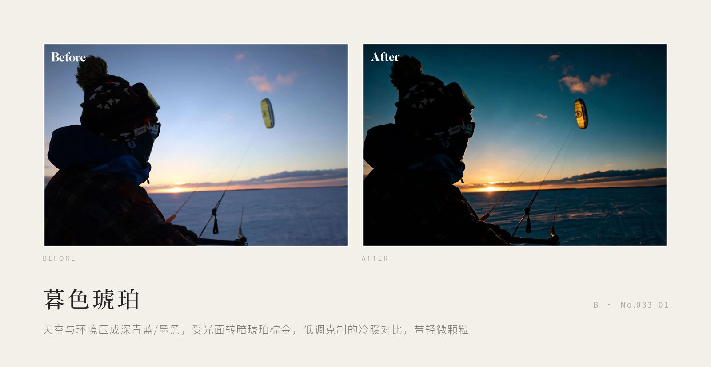
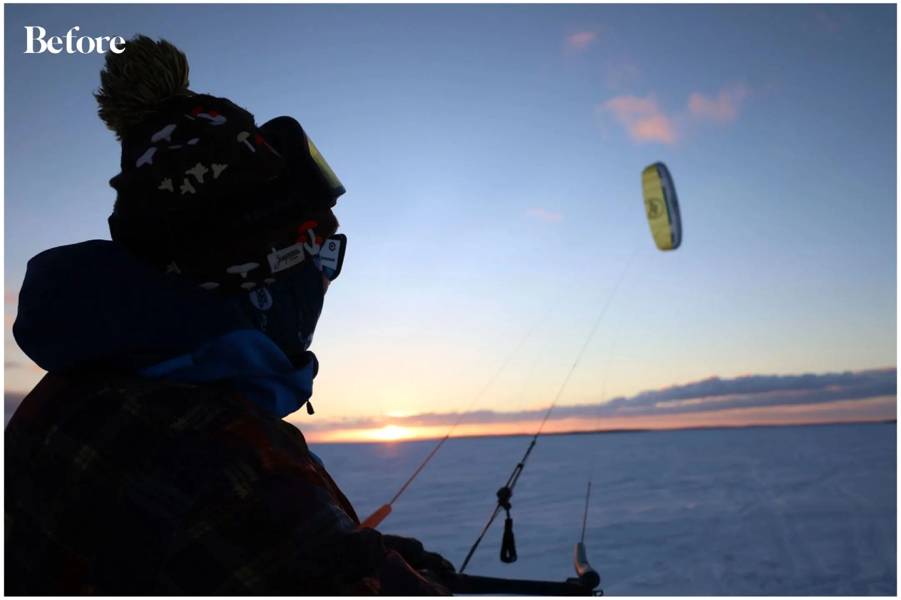
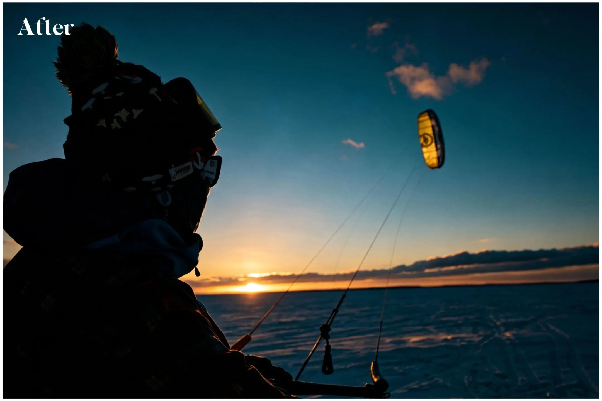
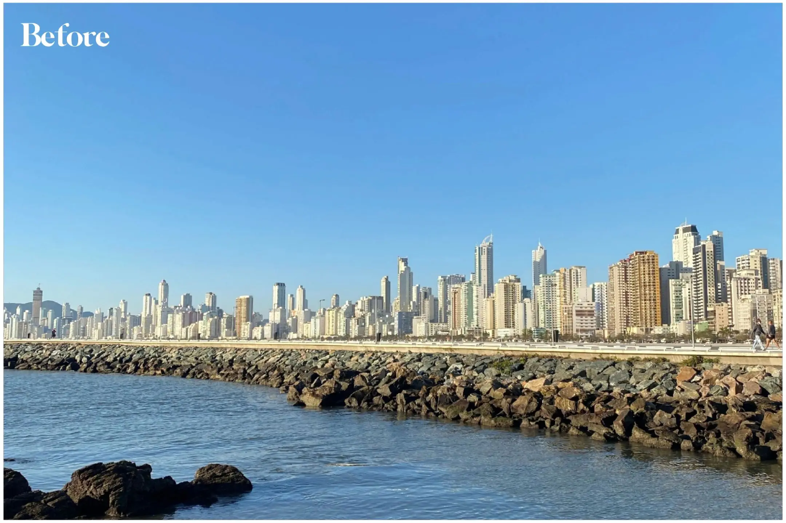
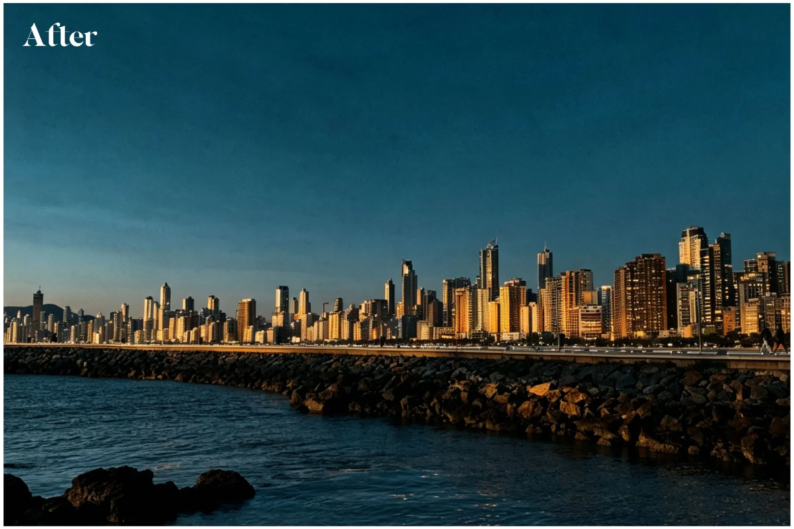
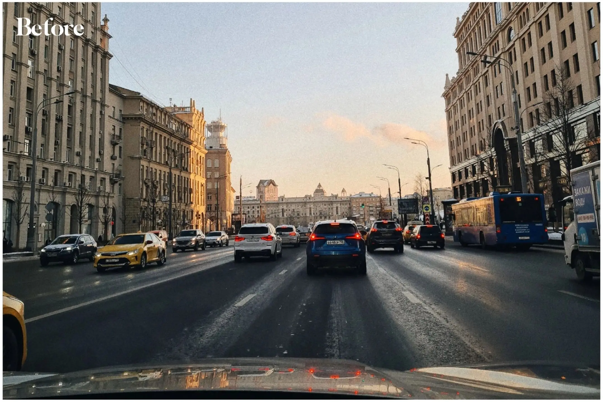
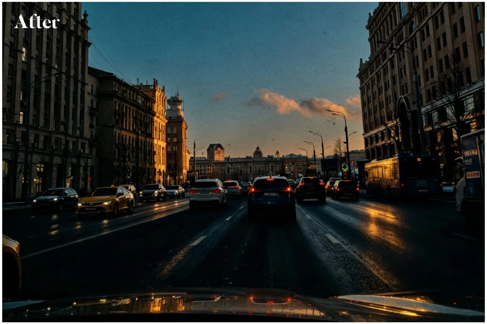

<p align="center"></p>

# 暮色琥珀

**B · 氛围**　改动强度：中　·　原分类：青橙冷暖电影色

天空与环境压成深青蓝/墨黑，受光面转暗琥珀棕金，低调克制的冷暖对比，带轻微颗粒

| 适合题材 | 适合光线 | 不适合 |
|---|---|---|
| 城市建筑、街景、风光、水面、人像 | 晴天顺光、黄昏、逆光 | 本身已很暗的夜景或室内弱光 |

> 同类合并：005_01, 010_01, 013_01, 020_01, 026_01, 029_01（已并入本风格，原提示词见 git 历史）

## 提示词

```text
将照片调为深暮色电影感风格，以深青蓝、墨黑、暗琥珀、棕金橙构成整体色彩关系。整体降低环境色彩纯度与明度，冷色进入阴影和环境暗部，暖色主要在所有受光面，形成克制的冷暖对比；黄色、橙色向暗琥珀金迁移，蓝色、青色向深青蓝压低。采用低调深黑影调，压低黑位和大面积暗部，中间调偏暗，同时保留暗部真实细节；高光集中、克制，不泛白不过曝。强化明确的方向性光影与局部明暗分离，让主体受光区域从深暗环境中自然突出。保持真实摄影质感，适度增强微对比、层次与空间纵深，加入轻微自然胶片颗粒，避免过度锐化、HDR、泛光和塑料感。整体营造沉静、深沉、冷峻、克制、电影化的暮色氛围，禁止增加灯光或其他图内不存在的光源。
```

## 前后对比

| 原图 | 成片 |
|---|---|
|  |  |
|  |  |
|  |  |

<sub>原标题：暮色琥珀 | 内心丰富的人无法抗拒的色调　·　作者：Delin（抖音）</sub>
