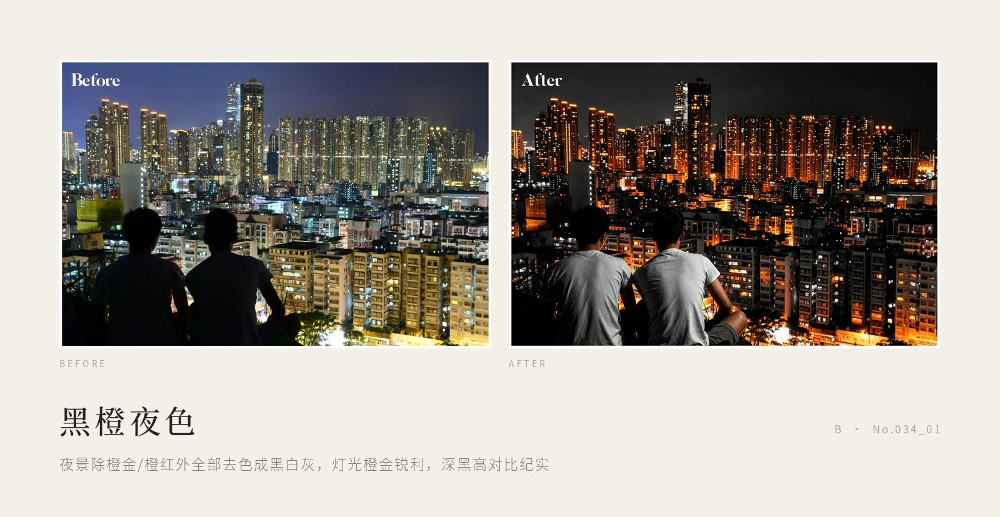
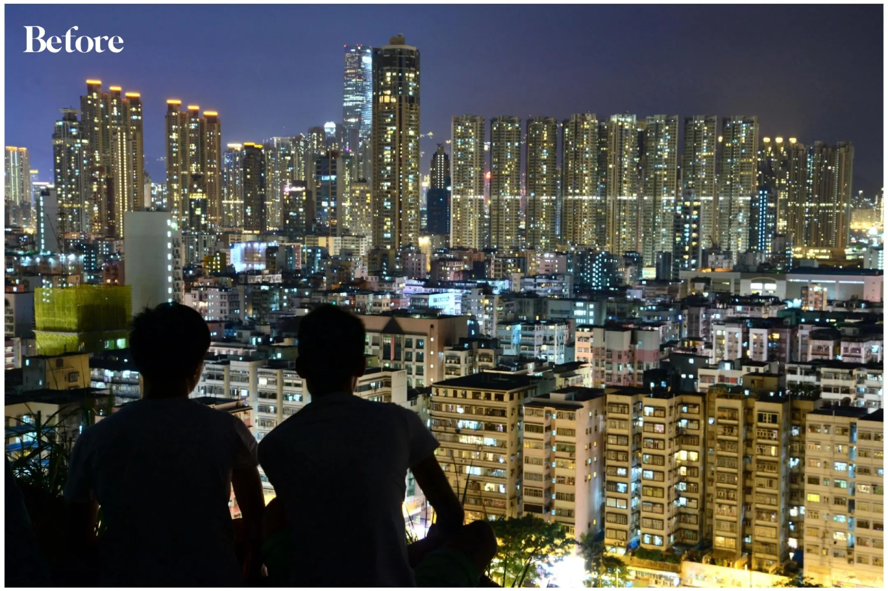
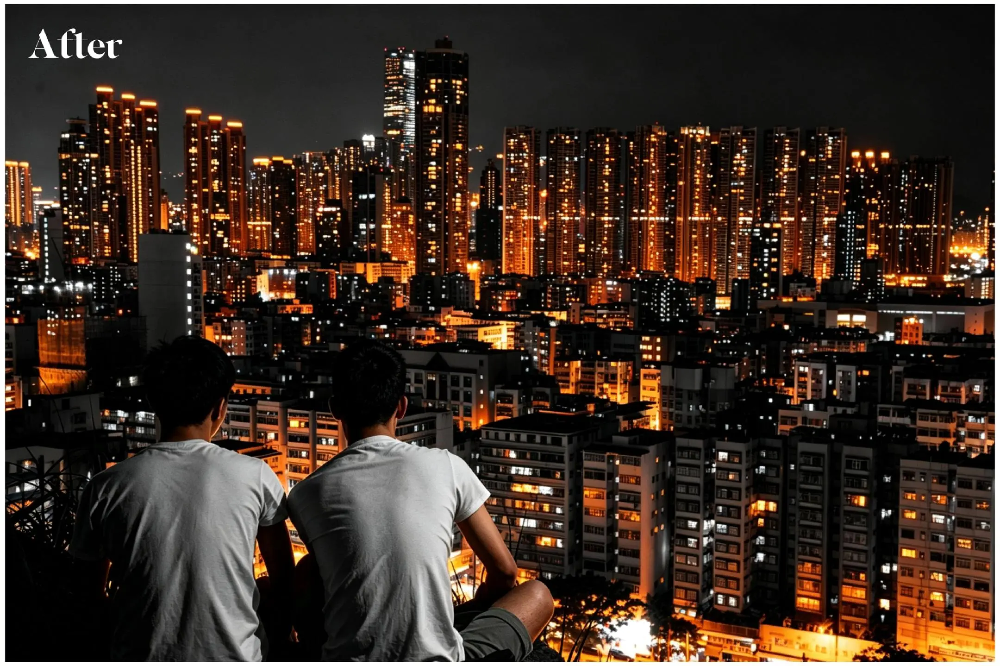
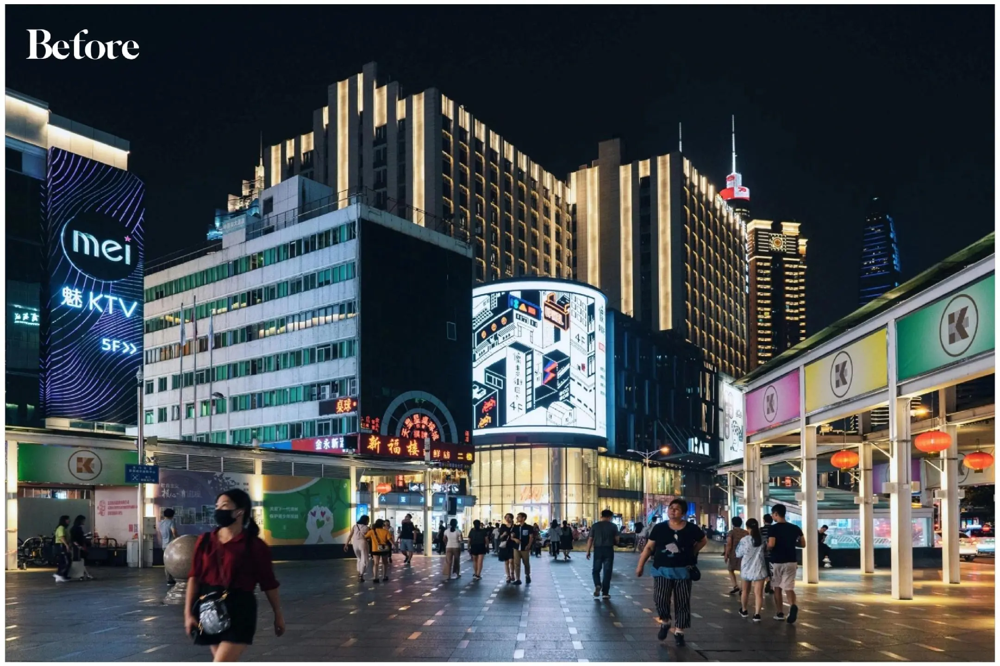
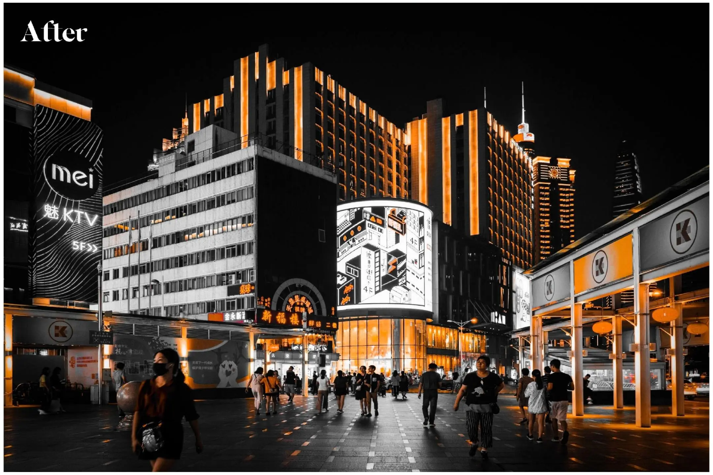
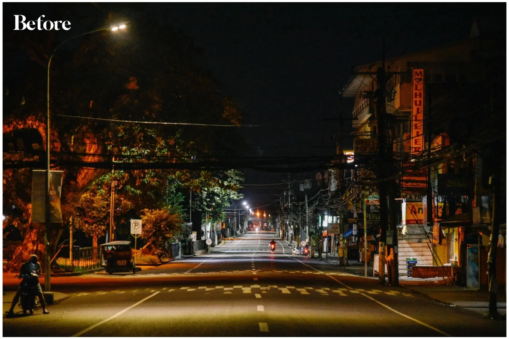
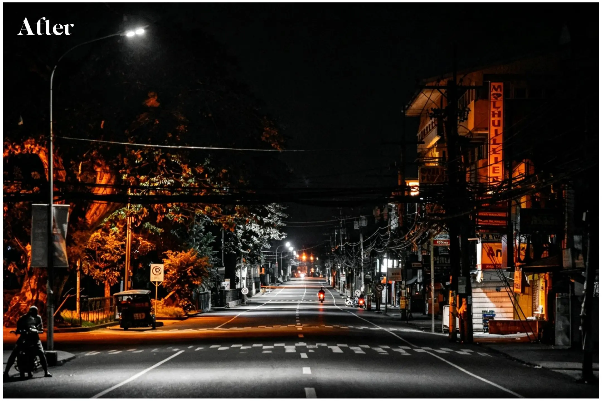

<p align="center"></p>

# 黑橙夜色

**B · 氛围**　改动强度：中　·　原分类：暖光黄昏与秋日

夜景除橙金/橙红外全部去色成黑白灰，灯光橙金锐利，深黑高对比纪实

| 适合题材 | 适合光线 | 不适合 |
|---|---|---|
| 夜景、城市建筑、街景 | 夜晚 | 白天照片、冷色霓虹是主角的照片 |

## 提示词

```text
纪实摄影风格，城市夜景现场记录，无过度艺术化渲染、无赛博特效、无氛围感滤镜。将照片调整为后期暗夜黑橙色调，以橙金色、橙红色、黑色、深灰、中灰、亮灰为唯一核心色彩结构。画面内所有黄色、橙色、橘黄色、金黄色等黄色系色彩统一向橙金色迁移；所有红色、深红色、浅红色等红色系色彩统一向橙红色迁移。除橙金色与橙红色以外，全部彩色必须完全去除色相，彻底转为黑白灰。蓝色、绿色、青色、紫色、霓虹蓝、霓虹绿等非指定色彩全部饱和度归零，暗部、阴影、夜空、建筑背光面、路面、墙面、背景区域只允许呈现中性黑、深灰、中灰、亮灰；严禁出现任何绿色、青色、蓝色、紫色、灰青、暗绿、彩色噪点等冷色污染。整体压低环境以及非主体区域的明度，强化深黑暗部，完整保留黑、深灰、中灰、亮灰之间丰富清晰的明度层次，杜绝画面死黑、暗部细节丢失。适度压暗光源本身的亮度，严格保留原有光源的位置、形状与轮廓；光源边缘清晰干脆、锐利硬朗，禁止产生晕光、Bloom、Glow、光晕扩散、雾化、柔焦、整体柔化、灯光发光溢出等效果。人物皮肤维持原生自然真实肤色与完整肤色明暗层次，禁止将皮肤强制染为橙色；仅允许地面、环境表面原生存在的微弱反光产生有限范围的橙色反射。严格禁止橙黄色大面积溢色，不得覆盖人体、衣物以及画面主体。依靠高画面对比度、扎实的明暗分离、局部环境压暗以及自然渐变暗角完成画面视觉聚焦。橙金色仅分布在真实受光面、暖色物体、有效光源、环境反光区域；橙红色仅保留于原有红色光源、暖色招牌以及真实受光区域。画面整体风格深沉、干净、锐利、通透、具备高级质感。禁止荧光橙、塑料感橙色、画面整体覆上一层统一橙色调、暗部偏色、灯光光晕、画面雾化、过度柔化。原绿色、青色、蓝色、紫色、洋红、灰青、黄绿、暗绿色处只可转黑、白、亮灰，不可新增或转为其他彩色。
```

## 前后对比

| 原图 | 成片 |
|---|---|
|  |  |
|  |  |
|  |  |

<sub>原标题：黑夜碰撞橙金 | 黑橙色调 | 提示词　·　作者：Delin（抖音）</sub>
