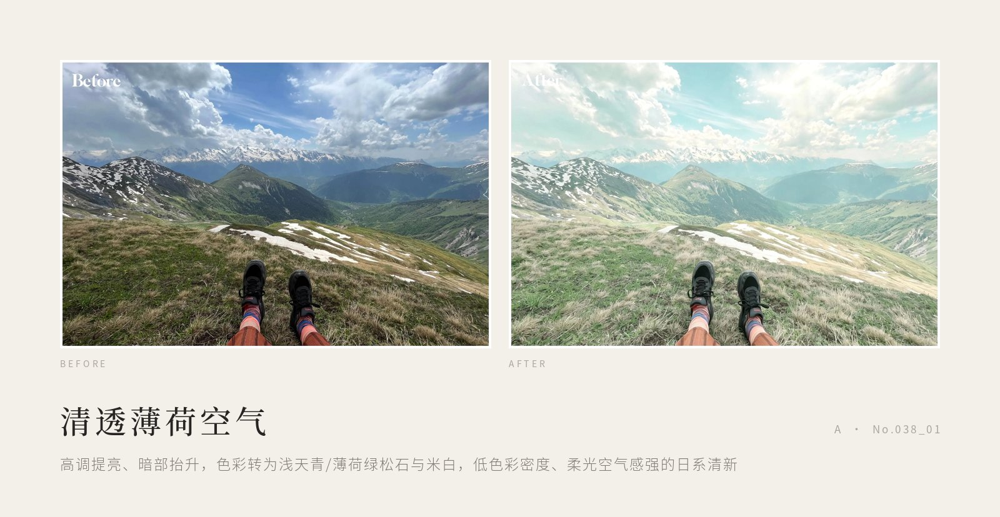
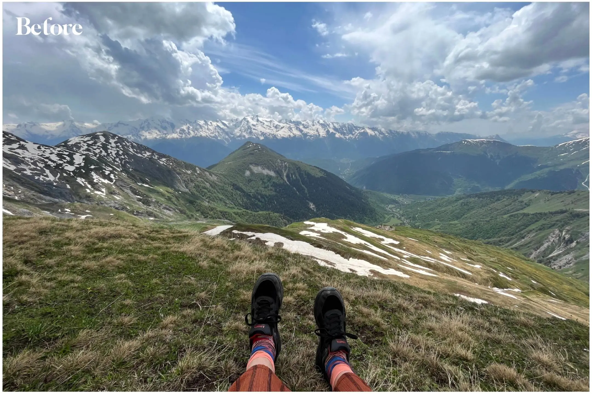
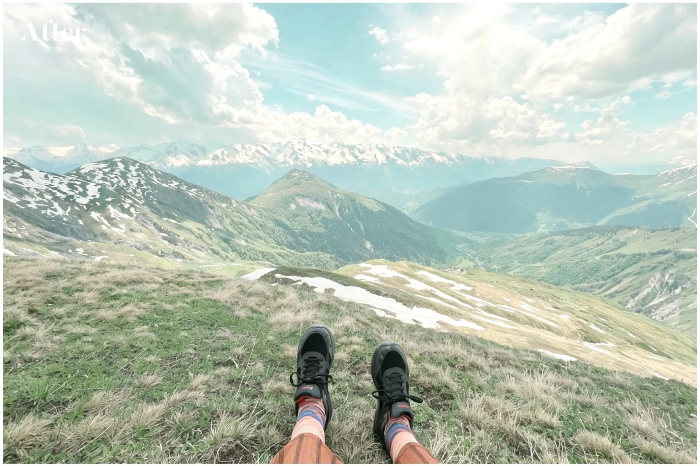
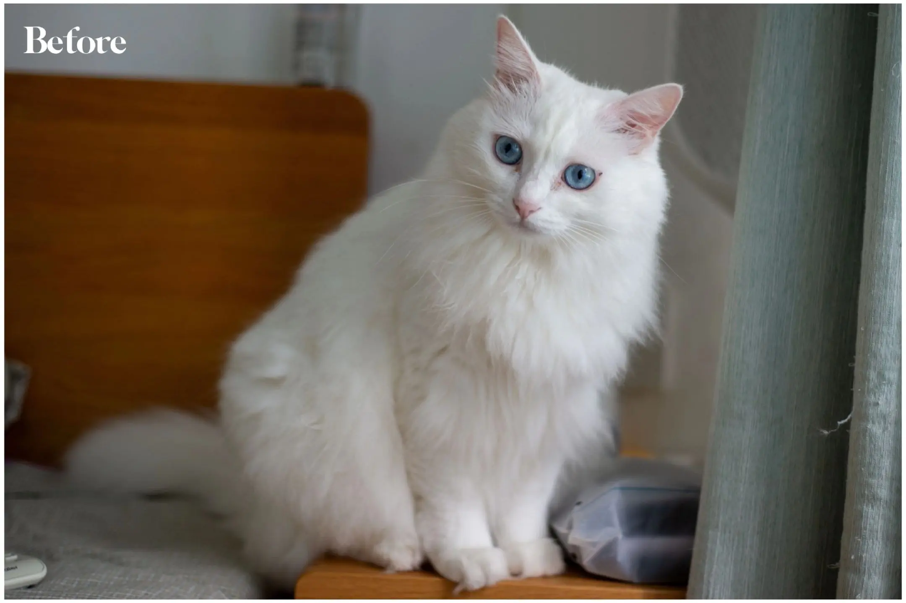
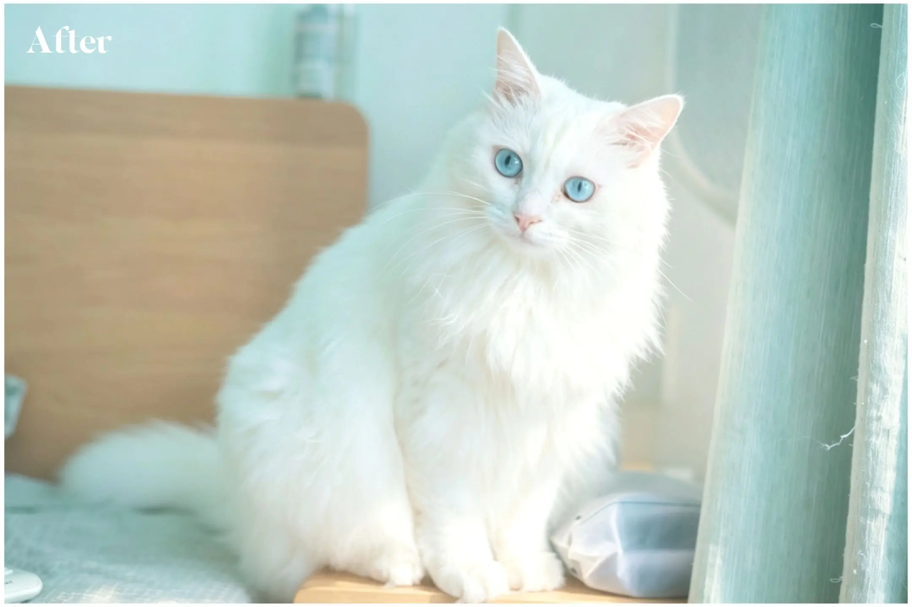
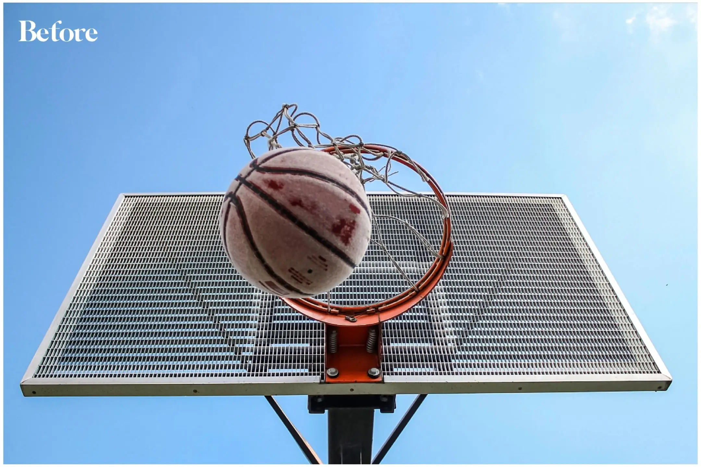
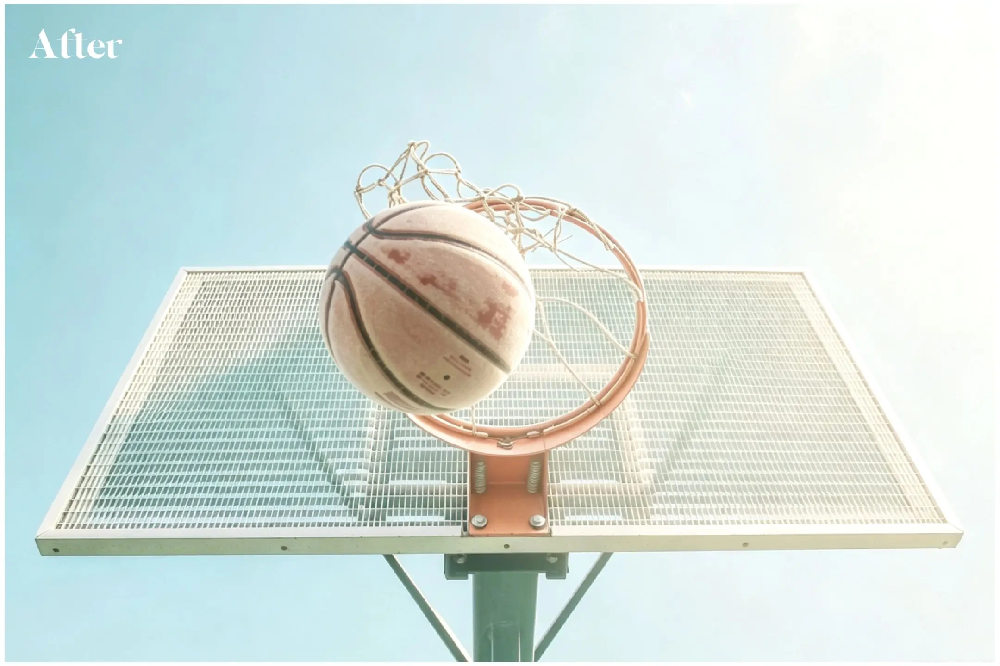

<p align="center"></p>

# 清透薄荷空气

**A · 稳妥**　改动强度：中　·　原分类：清新日系与人像

高调提亮、暗部抬升，色彩转为浅天青/薄荷绿松石与米白，低色彩密度、柔光空气感强的日系清新

| 适合题材 | 适合光线 | 不适合 |
|---|---|---|
| 风光、静物、人像、植物花卉 | 晴天顺光、阴天、室内 | 夜景、本身偏暖要保留暖调的场景、需要厚重感的照片 |


## 提示词

```text
“以浅天青、绿松石青、茶青绿、柔米白、低饱和柔大地色为色彩基底，拉开明暗空间但保持阴影柔软通透，通过空气透视、高光柔化、暗部抬升与低色彩密度，形成清浅干净、松弛明亮的日系空气影像。”
```

## 前后对比

| 原图 | 成片 |
|---|---|
|  |  |
|  |  |
|  |  |

<sub>原标题：清透薄荷 | 调色提示词　·　作者：Delin（抖音）</sub>
