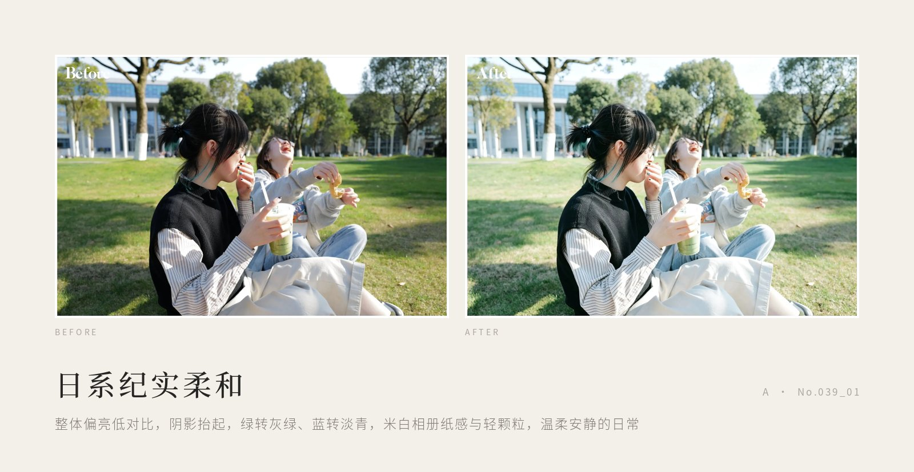
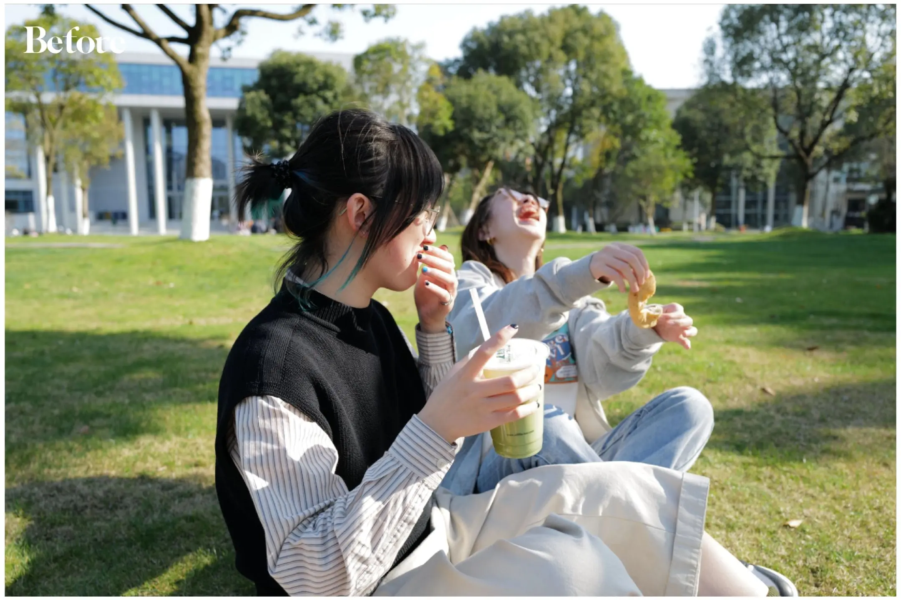
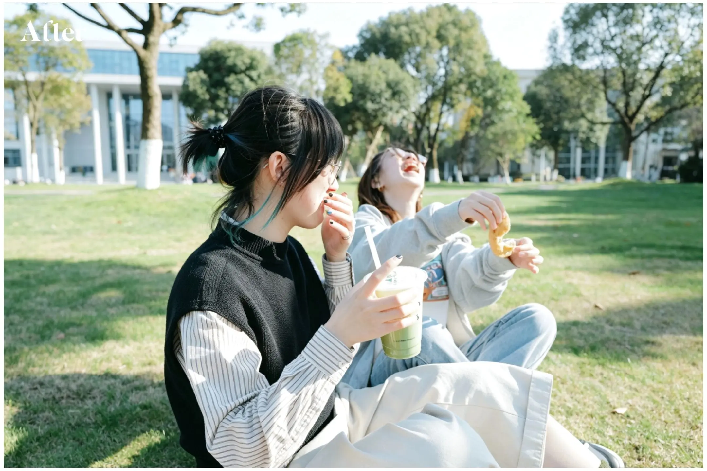
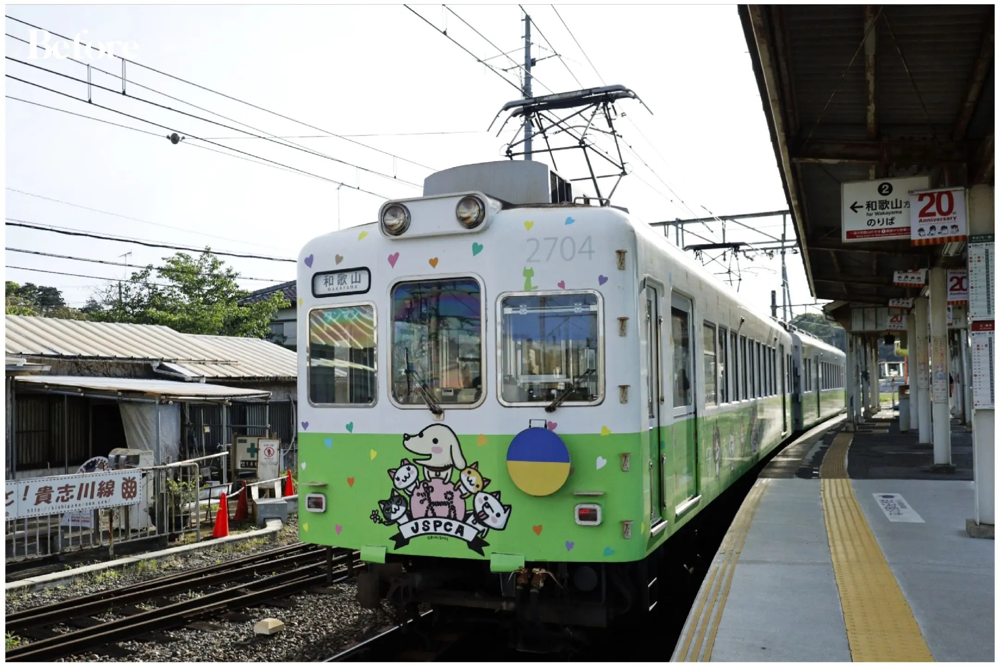
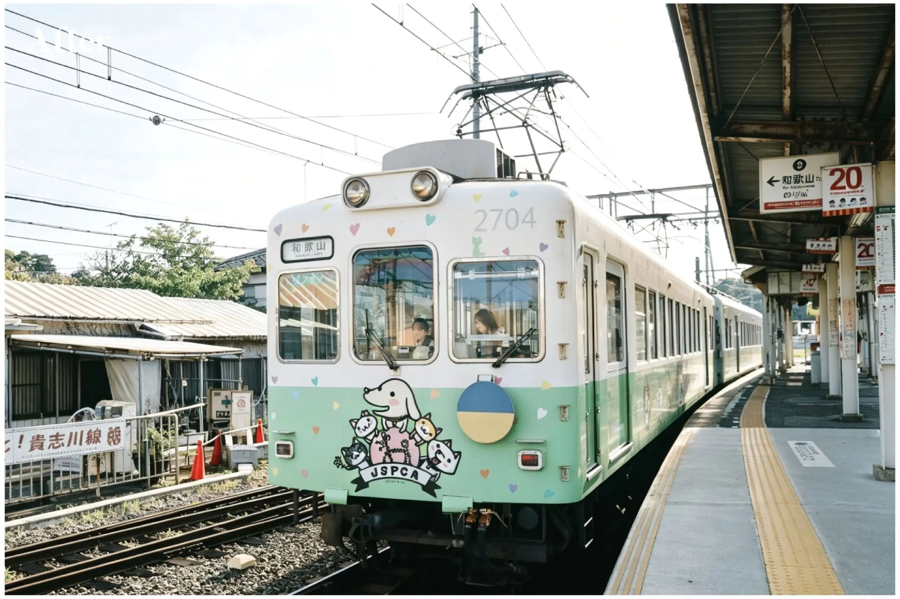
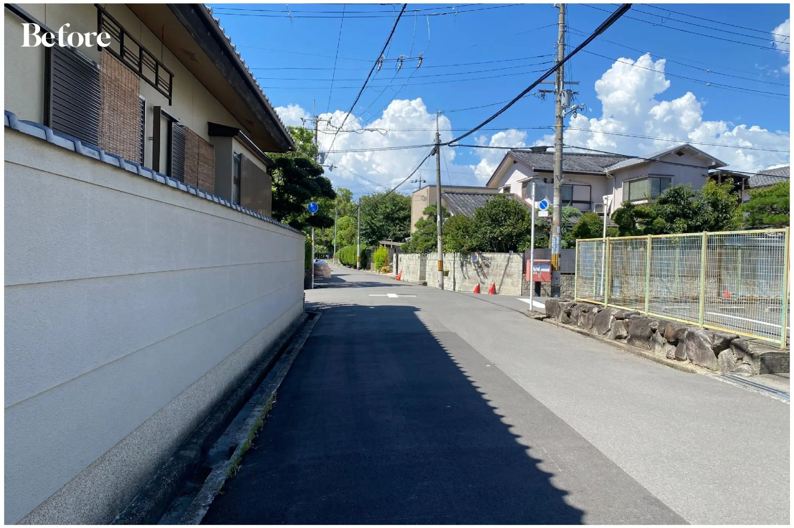
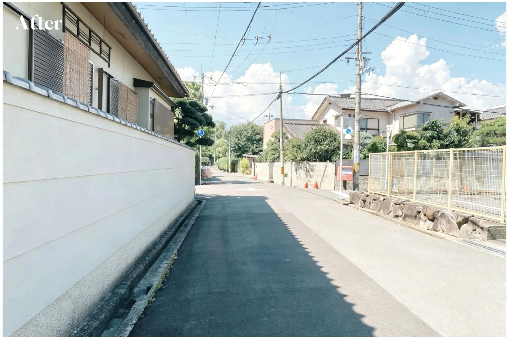

<p align="center"></p>

# 日系纪实柔和

**A · 稳妥**　改动强度：中　·　原分类：清新日系与人像

整体偏亮低对比，阴影抬起，绿转灰绿、蓝转淡青，米白相册纸感与轻颗粒，温柔安静的日常

| 适合题材 | 适合光线 | 不适合 |
|---|---|---|
| 人像、街景、交通工具、城市建筑 | 晴天顺光、阴天、任意 | 夜景；需要浓烈色彩或厚重感的照片 |

## 提示词

```text
保留原始构图，所有画面内容不变，不增加、不删除、不改变人物五官与身体比例。将画面调整为接近滨田英明摄影的日常纪实色调：整体曝光偏亮，高光柔和但不过曝，阴影明显抬起，黑位不要压黑，画面有浅米色相册纸质感。色彩以米白、浅灰、淡青蓝、灰绿、暖肤色、浅褐为主，整体饱和度降低，但不是灰蒙蒙的黑白灰感。绿色不要鲜艳，转向柔和灰绿、鼠尾草绿、浅青绿色；蓝色不要深蓝，变成淡青蓝、天空灰蓝；红色和橙色降低纯度，保留自然暖感。人物肤色保持温润偏暖，但不要过粉、过红、过黄。对比要低，明暗过渡自然，避免强烈阴影和刺眼高光；细节保留，但降低数码锐利感，加入非常轻微的胶片颗粒和柔焦感。整体呈现真实、松弛、温柔、安静的家庭生活摄影氛围，像自然光下拍摄并经过温和胶片调色的日常照片。禁止：过度磨皮、塑料肤质、HDR、过度锐化、浓重滤镜、荧光色、强青橙色、商业摄影反差、改变构图、改变人物比例、增删元素。
```

## 前后对比

| 原图 | 成片 |
|---|---|
|  |  |
|  |  |
|  |  |

<sub>原标题：日系纪实柔和色 | 提示词　·　作者：Delin（抖音）</sub>
