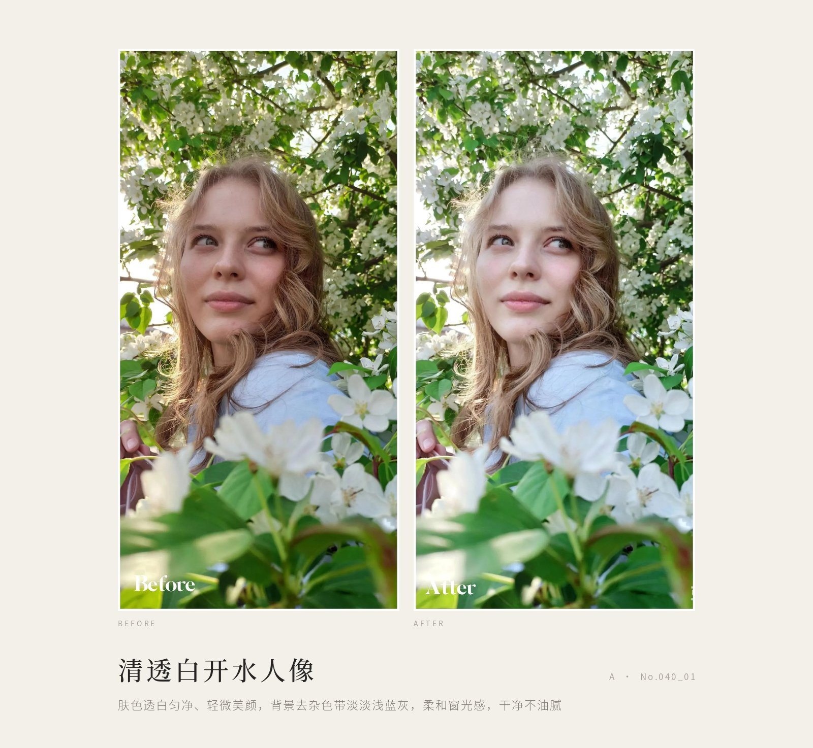
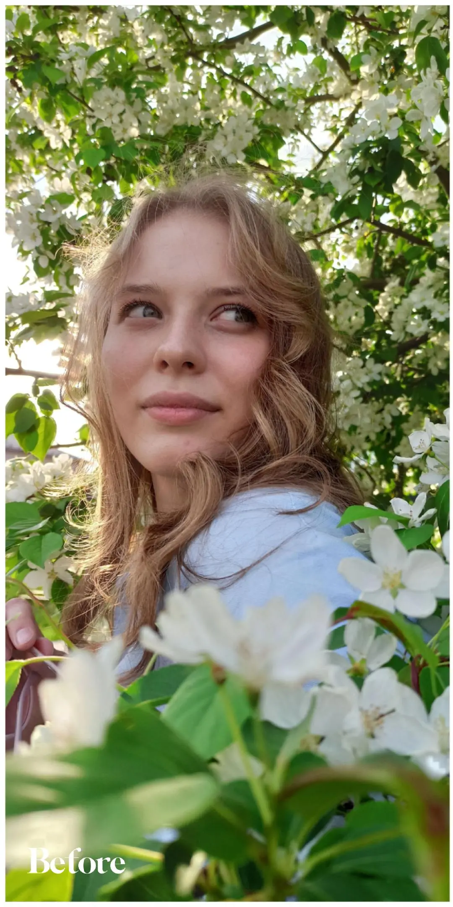
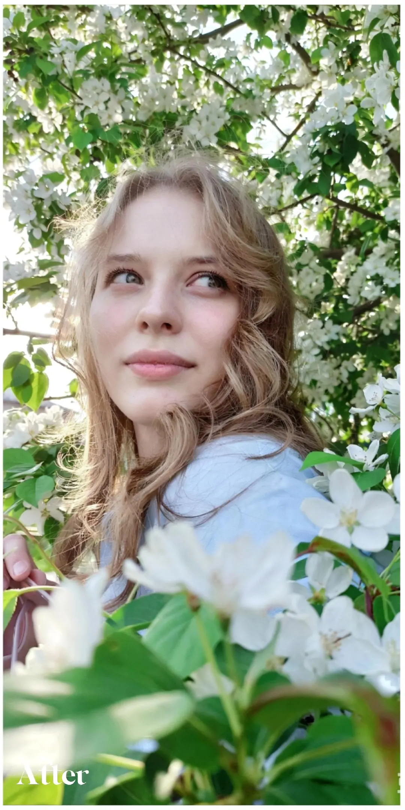
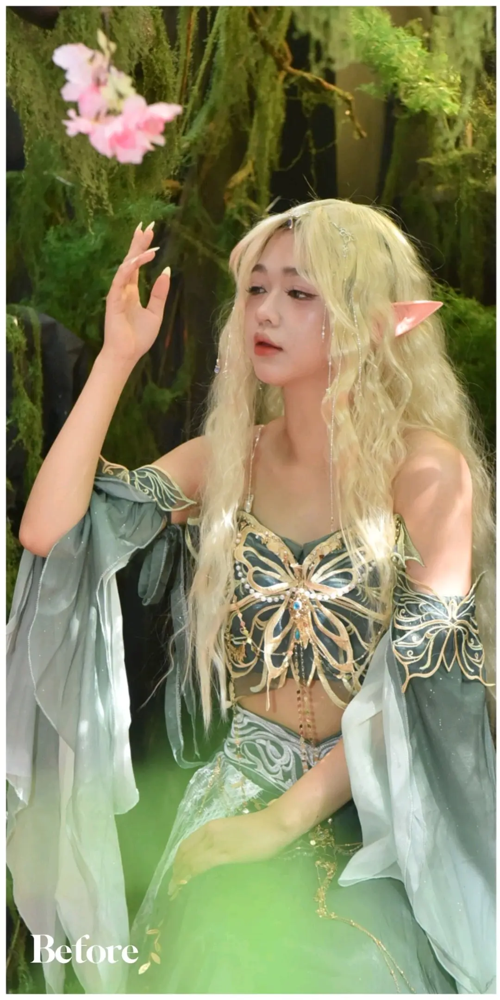
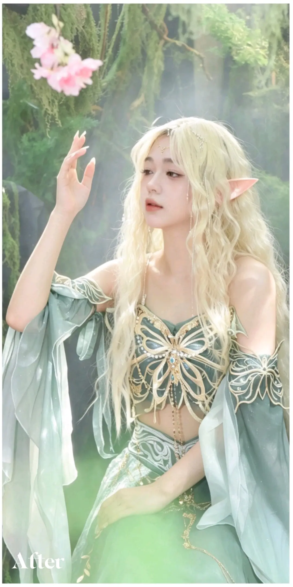
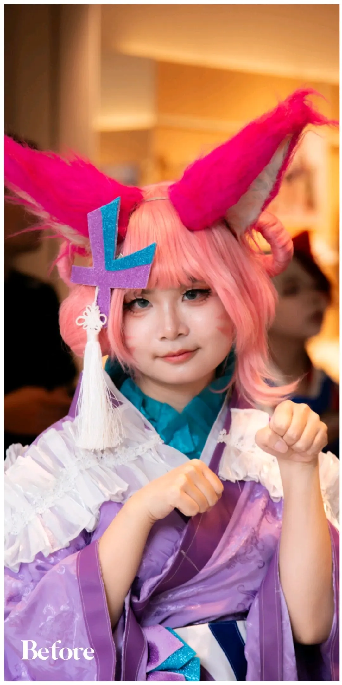
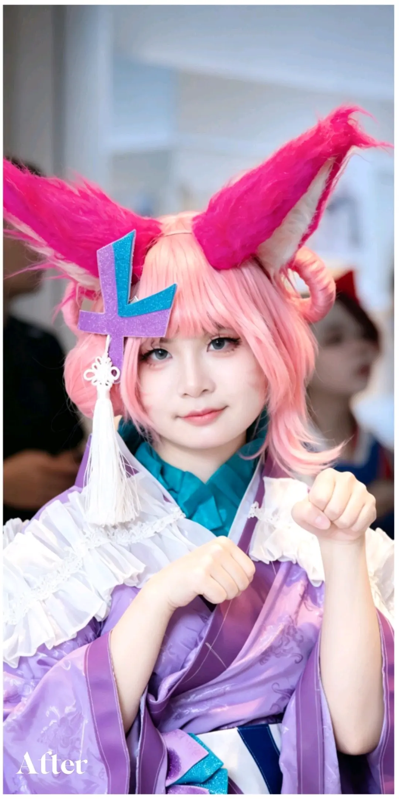

<p align="center"></p>

# 清透白开水人像

**A · 稳妥**　改动强度：轻　·　原分类：清新日系与人像

肤色透白匀净、轻微美颜，背景去杂色带淡淡浅蓝灰，柔和窗光感，干净不油腻

| 适合题材 | 适合光线 | 不适合 |
|---|---|---|
| 人像 | 任意 | 无人物的照片；需要保留浓郁暖调或夜景氛围的人像 |

## 提示词

```text
“【最高优先级】图生图后期精修与光影重绘处理。允许根据当前色调重绘整体光影：面部高光柔和重塑，阴影层次自然保留，背景与服装明暗统一；允许适度人像精修：自然提亮肤色、均匀肤色、淡化暗沉和泛红、轻微瑕疵修饰、毛孔柔化、眼下轻微减淡、增强眼神清晰度、整理发丝边缘、轻微优化服装褶皱、背景去杂色、轻微虚化杂乱区域、统一环境色调。人脸肤色区域独立保护，不被环境色、滤镜色或HDR效果过度浸染，肤色只做自然提亮与色调微优化。禁止大幅度瘦脸瘦身，禁止改变五官原生结构、人物身份、年龄感、姿态、服装和构图，禁止磨皮过度成塑料皮肤。【核心风格】清透白开水精修，窗边柔光清透人像质感【色彩与色调映射】主色透白，辅助色柔粉、浅蓝灰，过渡色米灰、干净白。色调映射：高光透白，中间调柔粉，阴影浅蓝灰，仅背景非主体区域带轻微浅蓝灰倾向，人物肤色保持自然稳定。物体保留自身固有底色，仅做色调浸染，禁止色相大幅度偏移，禁止HDR效果。【人像精修细节】自然提亮匀肤，淡化黑眼圈、鼻翼泛红和嘴角暗沉，轻微修饰瑕疵，毛孔柔化但保留皮肤原生质感，强化眼神干净通透，整理发丝毛边，保留淡妆细节。【环境处理细节】背景清除杂乱黄、绿、红色，仅非人物背景施加微弱浅蓝灰倾向，轻微虚化脏点和杂物，保留窗边、墙面、室内物品原有结构，不新增元素。【光影重绘规则】根据当前色调重绘光影：窗边柔光从侧前方照亮面部，额头、鼻梁、眼下、唇部保持清透亮部，鼻翼、眼窝、下巴保留自然阴影，整体通透但不过曝。【肤色保护规则】人脸肤色区域独立保护，不被环境浅蓝灰、滤镜色或HDR效果过度浸染；肤色只做透白提亮、均匀和柔粉微优化，禁止明显发灰。【质感】保留自然皮肤纹理、淡妆细节、发丝边缘、服装洁净清爽质感，整体干净通透。【氛围】干净清爽，清透白开水人像氛围【负面提示词】不要大面积死白高光，不要高饱和色彩溢出，不要让肤色发灰，不要重塑人物五官，不要改变人物身份，不要磨皮过度，不要丢失淡妆细节，不要新增任何元素，禁止过重噪点、夸张光斑、塑料皮肤。”
```

## 前后对比

| 原图 | 成片 |
|---|---|
|  |  |
|  |  |
|  |  |

<sub>原标题：人像 | 清透白开水 | 提示词　·　作者：Delin（抖音）</sub>
