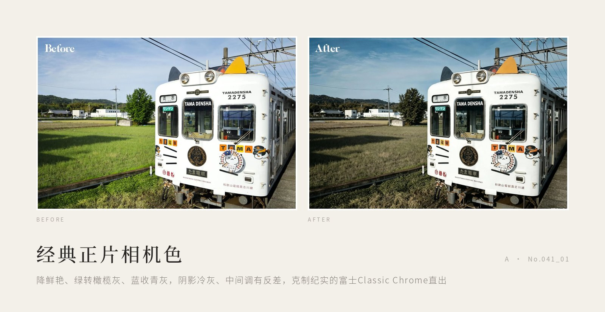
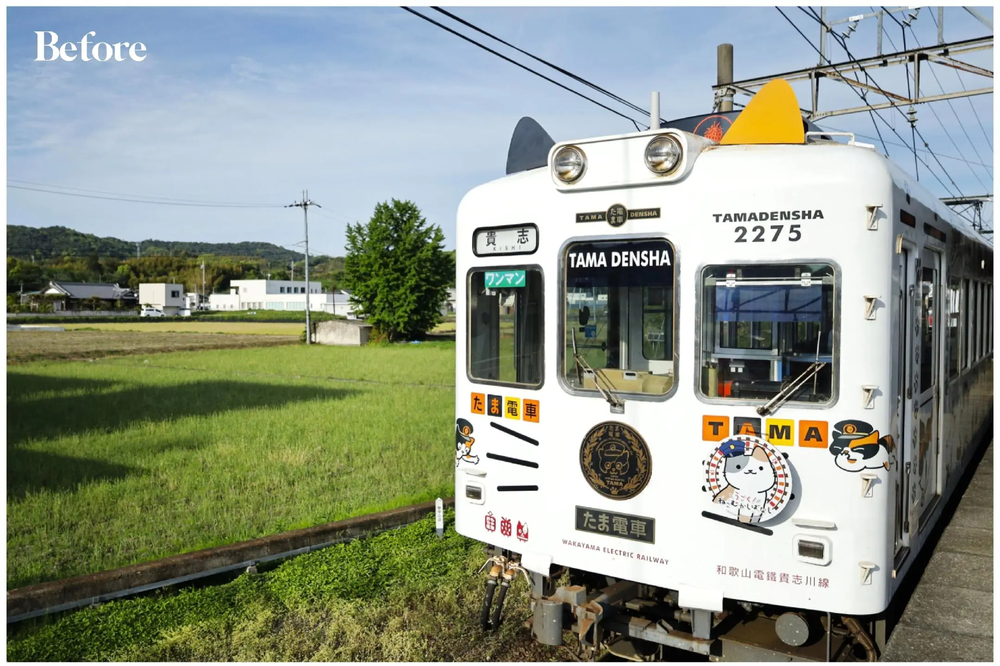
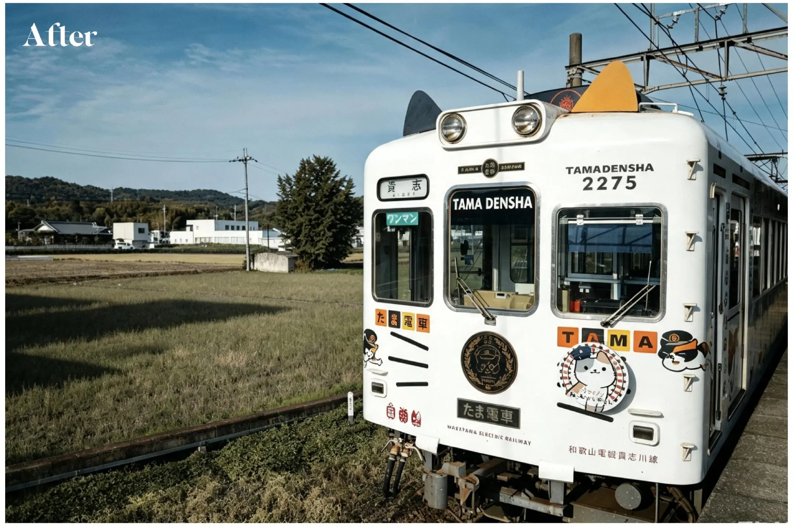
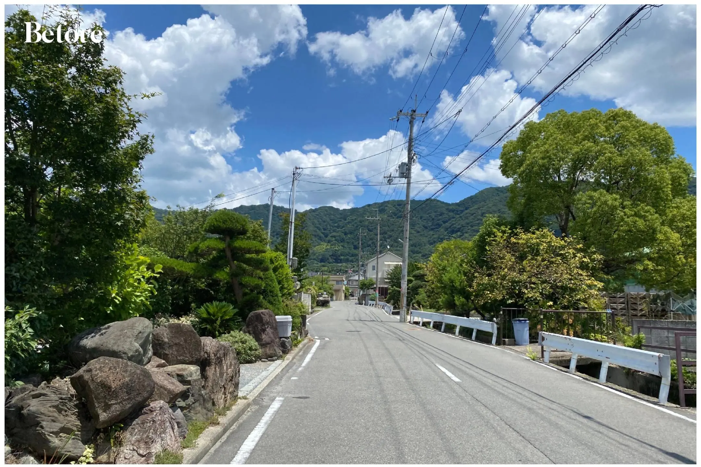
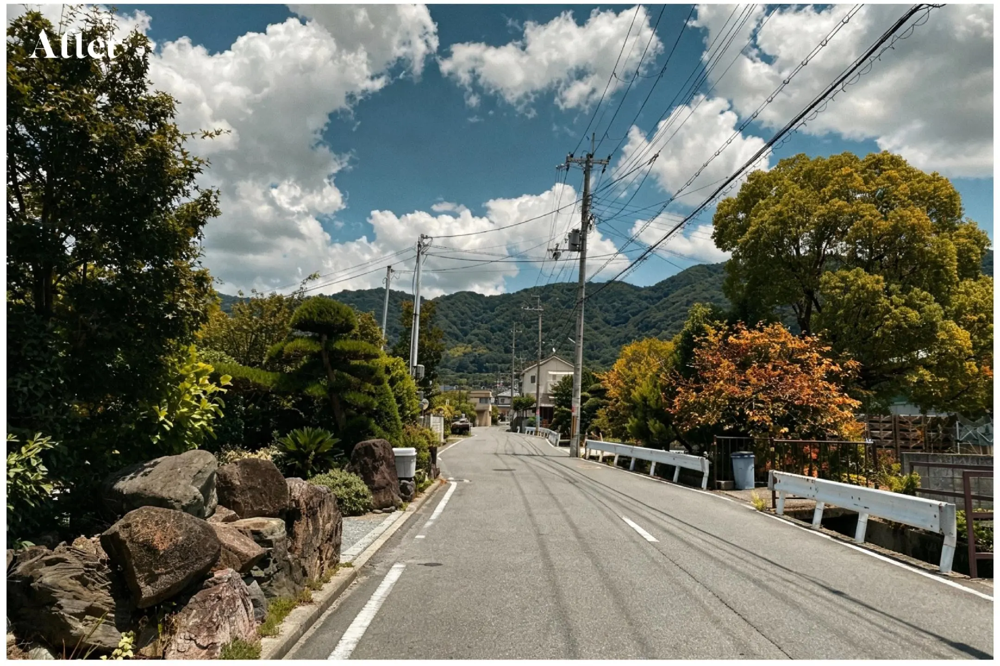
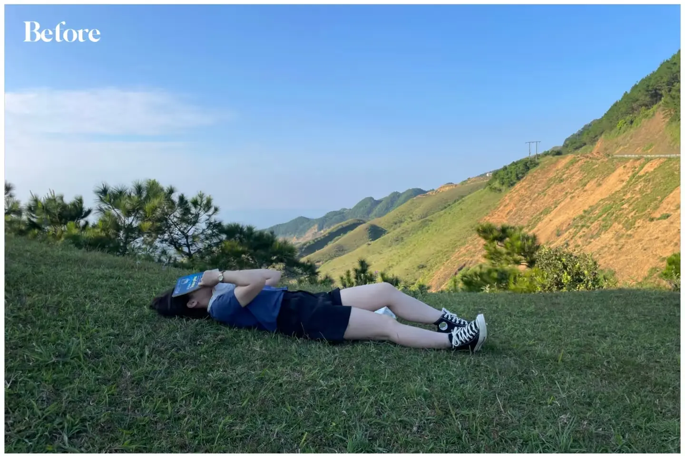
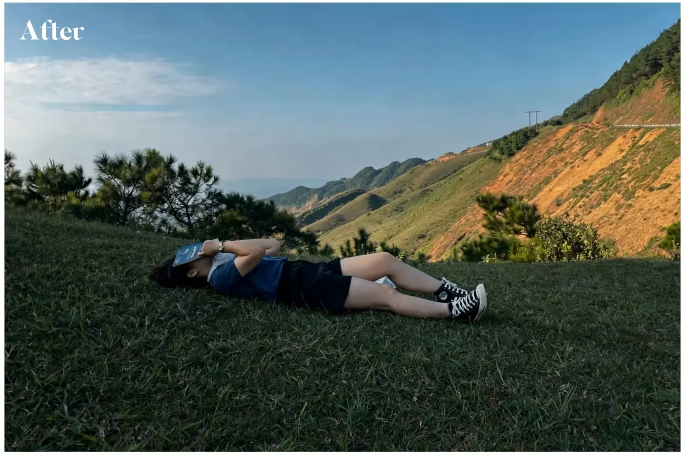

<p align="center"></p>

# 经典正片相机色

**A · 稳妥**　改动强度：中　·　原分类：胶片复古与相机色彩

降鲜艳、绿转橄榄灰、蓝收青灰，阴影冷灰、中间调有反差，克制纪实的富士Classic Chrome直出

| 适合题材 | 适合光线 | 不适合 |
|---|---|---|
| 风光、街景、交通工具、城市建筑、人像 | 晴天顺光、阴天 | 想要温暖甜美氛围的人像 |

> 同类合并：044_01, 048_01, 050_01（已并入本风格，原提示词见 git 历史）

## 提示词

```text
“保持原图构图、人物和所有物体结构不变，仅模拟相机直出色彩。整体保持自然曝光和真实白平衡，降低数字照片过度鲜艳感；绿色压低纯度并略偏橄榄灰，蓝色向青蓝与灰蓝收敛，黄色和橙色保持自然暖度但不过饱和，红色保留真实识别度。人物肤色保持自然中性偏暖，不橙不红。高光柔和，阴影略带冷灰，中间调保留细节和适度反差，不刻意通透、不压暗。加入轻微胶片色彩压缩感和细腻颗粒，整体呈现克制、真实、纪实的相机直出效果”。
```

## 前后对比

| 原图 | 成片 |
|---|---|
|  |  |
|  |  |
|  |  |

<sub>原标题：AI复刻Classic Chrome色调　·　作者：Delin（抖音）</sub>
