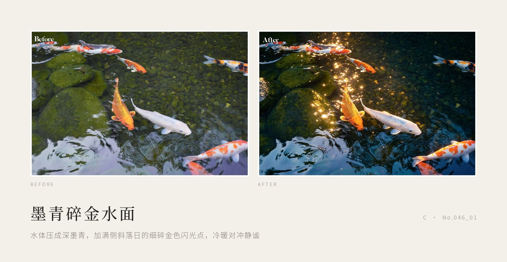
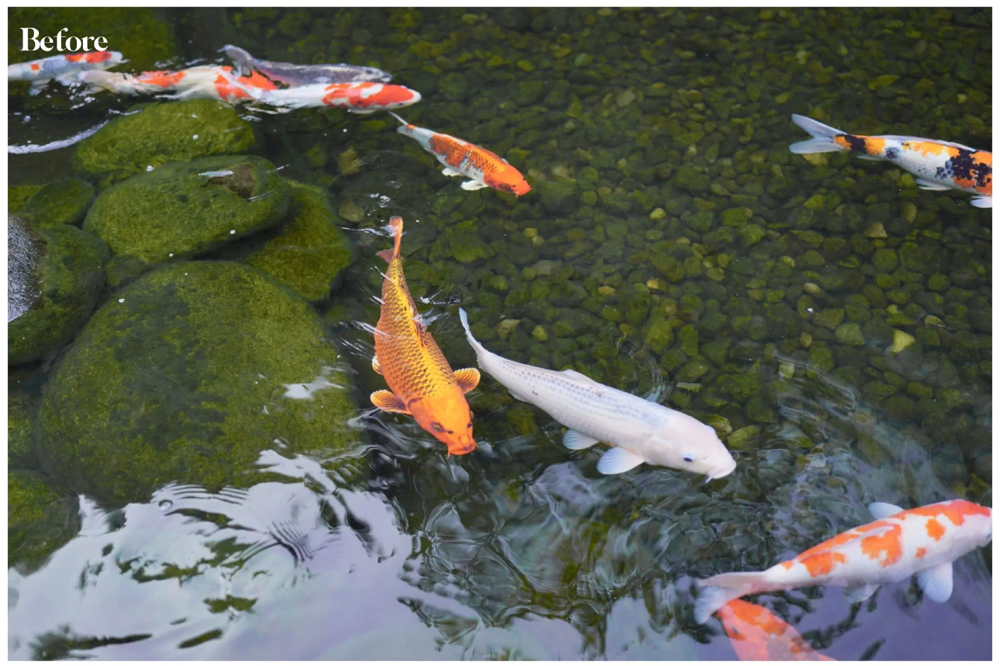
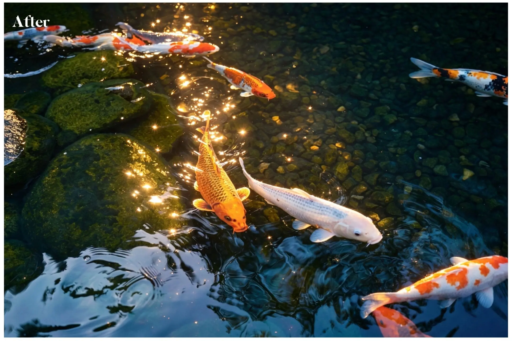
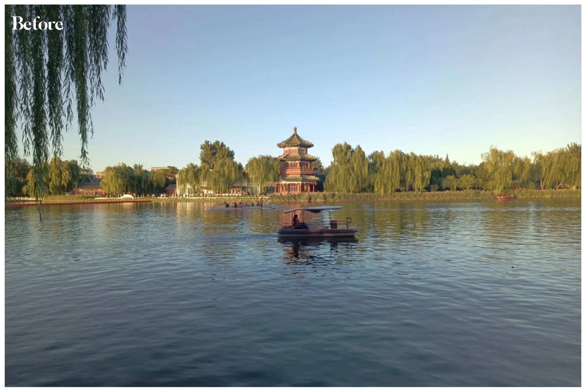
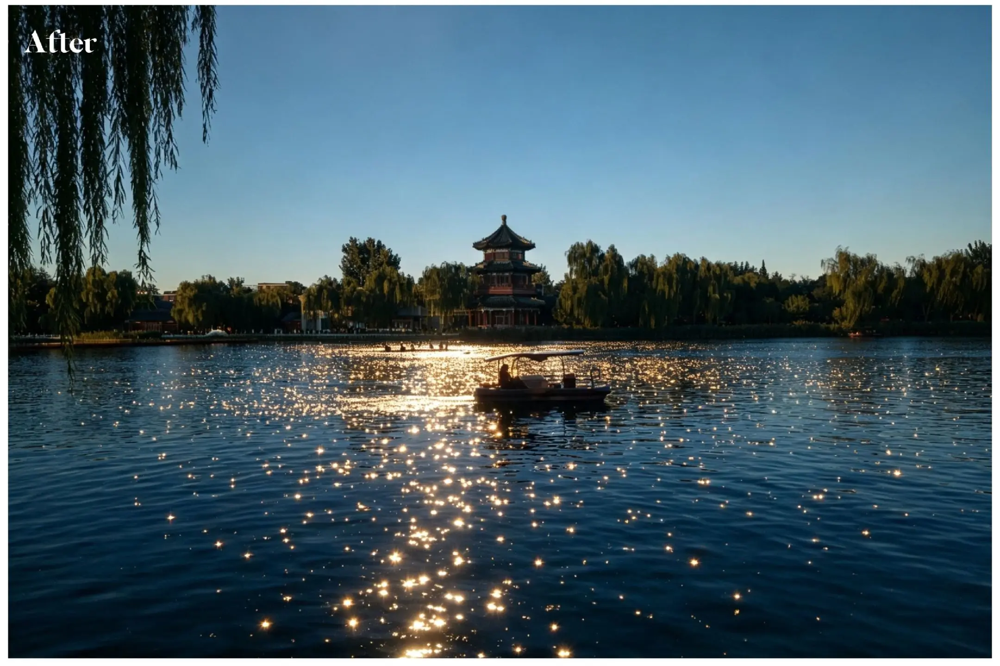
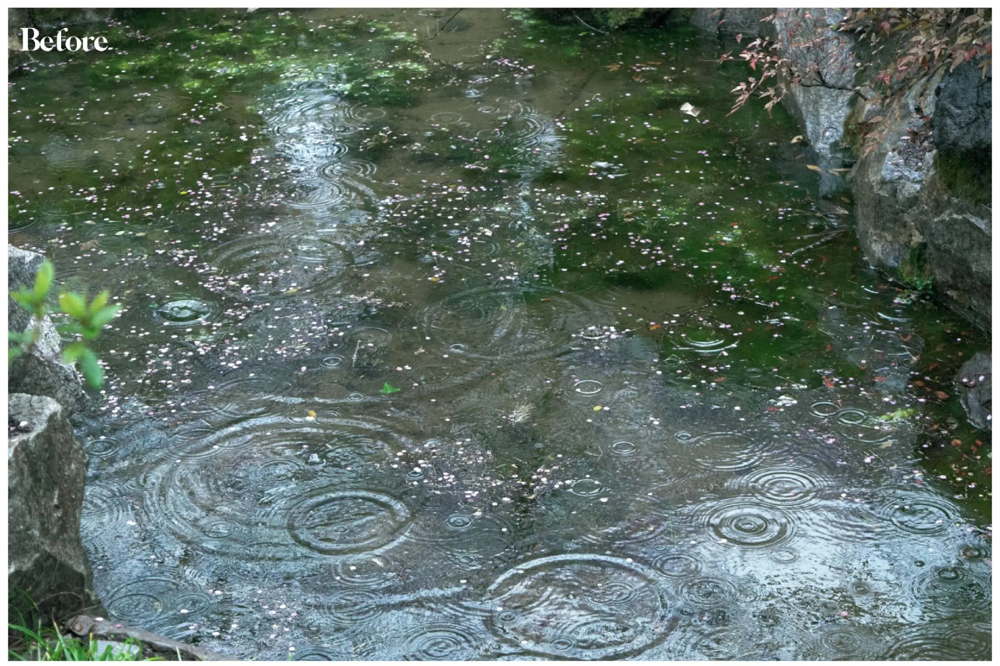
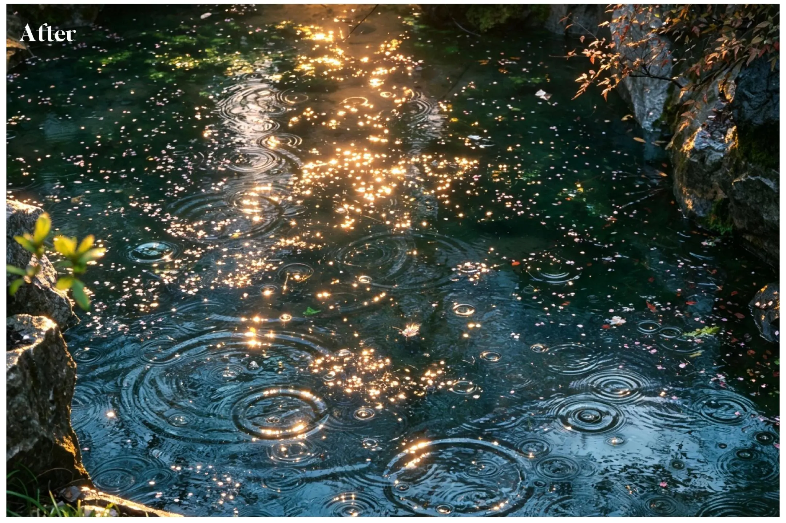

<p align="center"></p>

# 墨青碎金水面

**C · 反差**　改动强度：重　·　原分类：暖光黄昏与秋日

水体压成深墨青，加满侧斜落日的细碎金色闪光点，冷暖对冲静谧

| 适合题材 | 适合光线 | 不适合 |
|---|---|---|
| 水面 | 任意 | 不含水面的照片 |

## 提示词

```text
“完整锁定原图构图、物体、波纹、鱼群/落叶/花瓣轮廓不变，先校正基础画面：校准曝光与白平衡，去除脏灰；暗部层次丰富不死黑，高光不溢出，宽动态。写实静谧水面摄影，低明度深清澈墨青水面，侧斜落日柔光铺满水面，布满大量错落细碎暖金色星光碎金反光，光点闪烁；带有偏重的梦幻柔光，高锐度，波纹、倒影、水下石、鱼身、落叶、雨滴涟漪纹理锐利清晰。暗部自带细腻青蓝色阶，冷暖对比柔和高级，低噪点原生写实质感，无滤镜磨皮，松弛治愈安静氛围。侧斜落日柔光，水面铺满错落细碎暖金色星光碎金反光，低明度深墨青水体，高锐度清晰波纹倒影，暗部暗藏青蓝色阶，冷暖对冲静谧治愈写实水景。”。
```

## 前后对比

| 原图 | 成片 |
|---|---|
|  |  |
|  |  |
|  |  |

<sub>原标题：普通水面照片 | 爆改 | 墨青碎金　·　作者：Delin（抖音）</sub>
