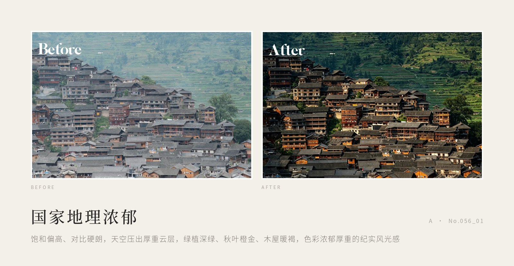
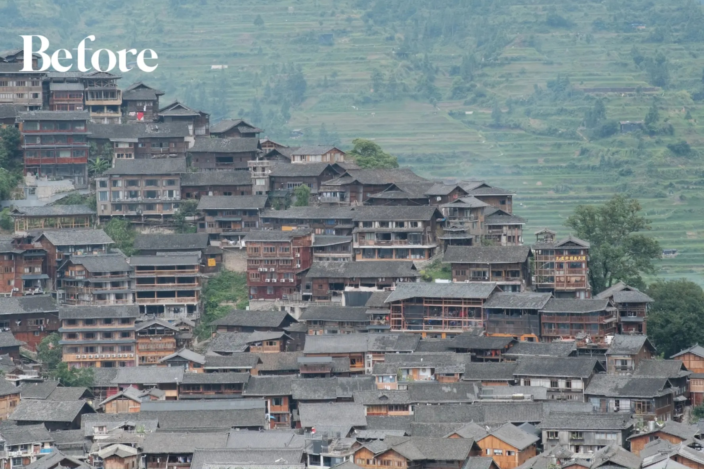
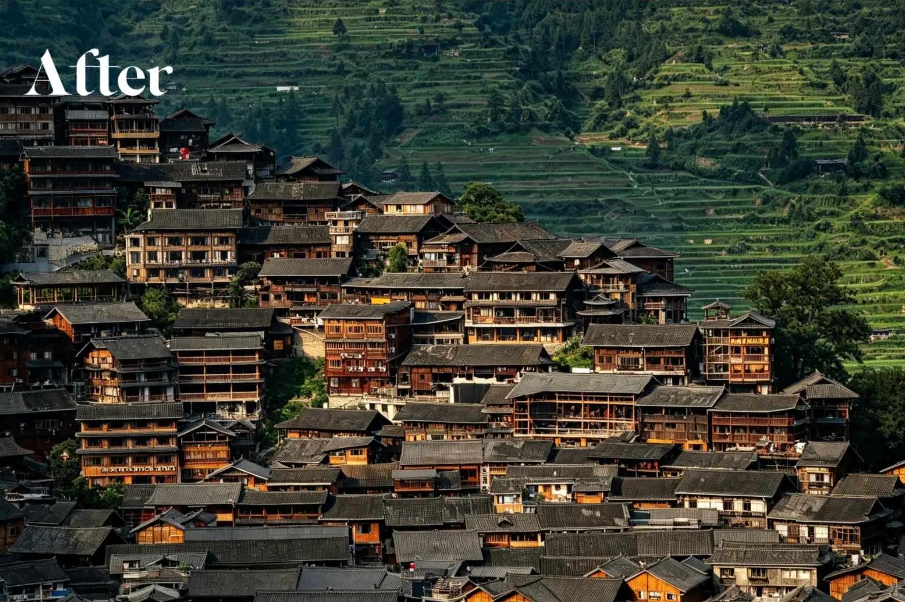
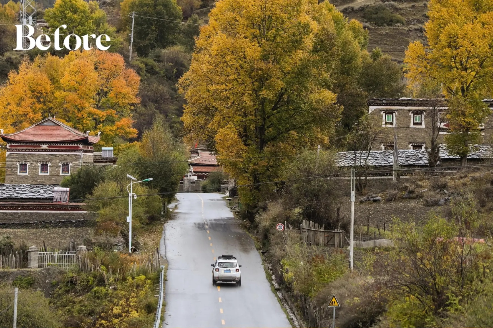
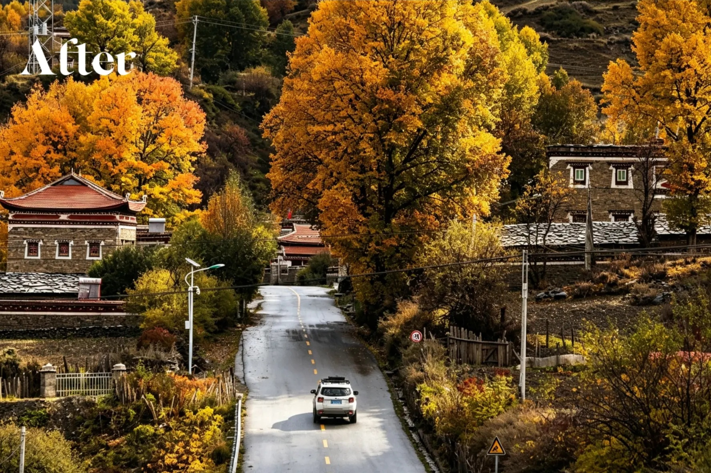
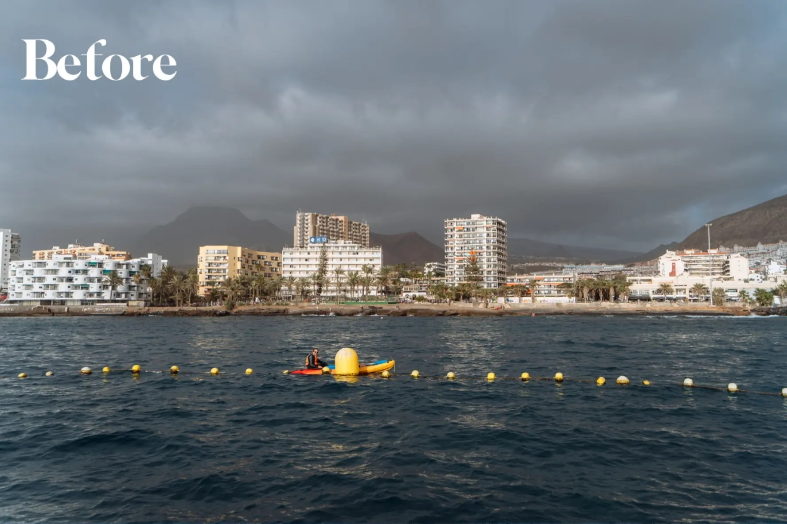
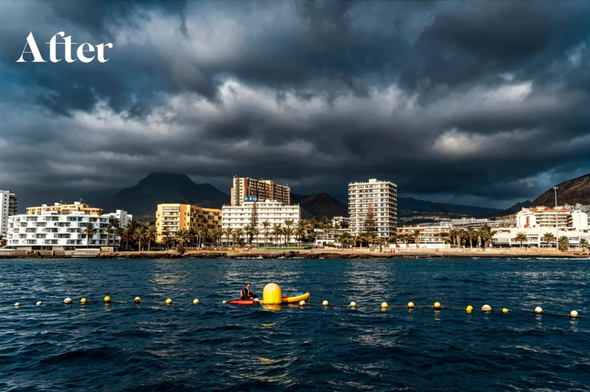

<p align="center"></p>

# 国家地理浓郁

**A · 稳妥**　改动强度：中　·　原分类：光影塑形与原片增强

饱和偏高、对比硬朗，天空压出厚重云层，绿植深绿、秋叶橙金、木屋暖褐，色彩浓郁厚重的纪实风光感

| 适合题材 | 适合光线 | 不适合 |
|---|---|---|
| 风光、街景、城市建筑、水面 | 阴天、晴天顺光、黄昏 | 小清新人像、室内，以及已经很饱和的照片 |

## 提示词

```text
“复刻《国家地理》经典纪实摄影调色风格，主打真实、浓郁、立体、复古的人文自然质感，全局色彩还原精准、饱和度适中偏高，原色通透扎实、真实耐看，无滤镜虚假感。画面对比度高级硬朗、光影层次立体分明，风光色彩浓郁饱满，蓝天通透、绿植鲜活、大地色调醇厚复古；人物纪实肤色自然真实、质感立体。暗部细节丰富、深邃干净，高光通透柔和、细节保留完整，全画面动态范围充足、容错度高。整体画面复古大气、纪实感浓厚、视觉冲击力强，兼具自然治愈与人文厚重质感，是自然风光、旅行纪实、人文扫街的顶级经典万能色调，高级经典、永不过时。”
```

## 前后对比

| 原图 | 成片 |
|---|---|
|  |  |
|  |  |
|  |  |

<sub>原标题：《国家地理》老法师色调，用Ai调出来了！完美复刻了《国家地理》的色彩浓郁厚重，光影立体硬朗　·　作者：Delin（抖音）</sub>
