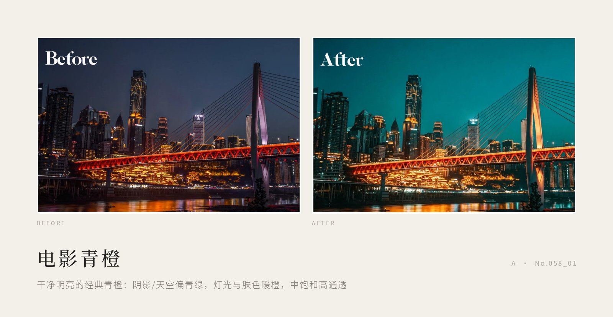
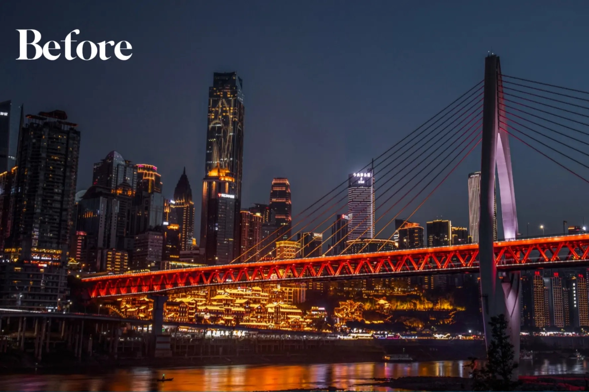
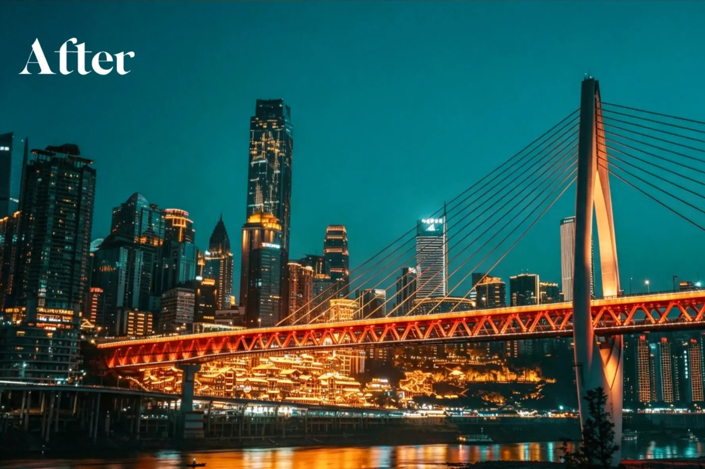
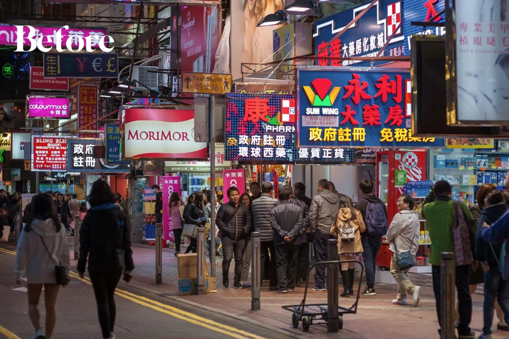
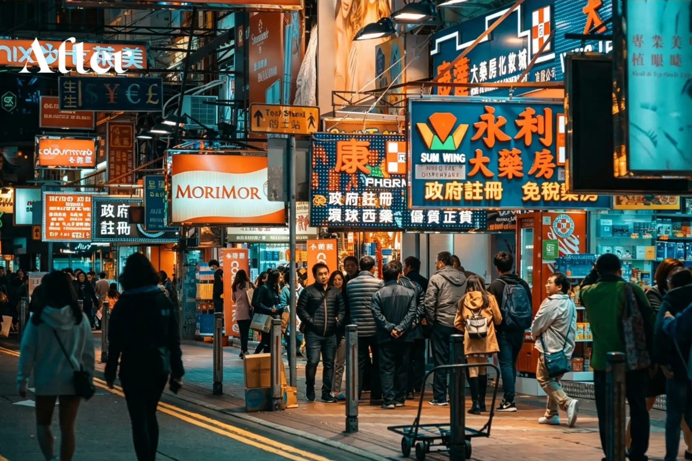
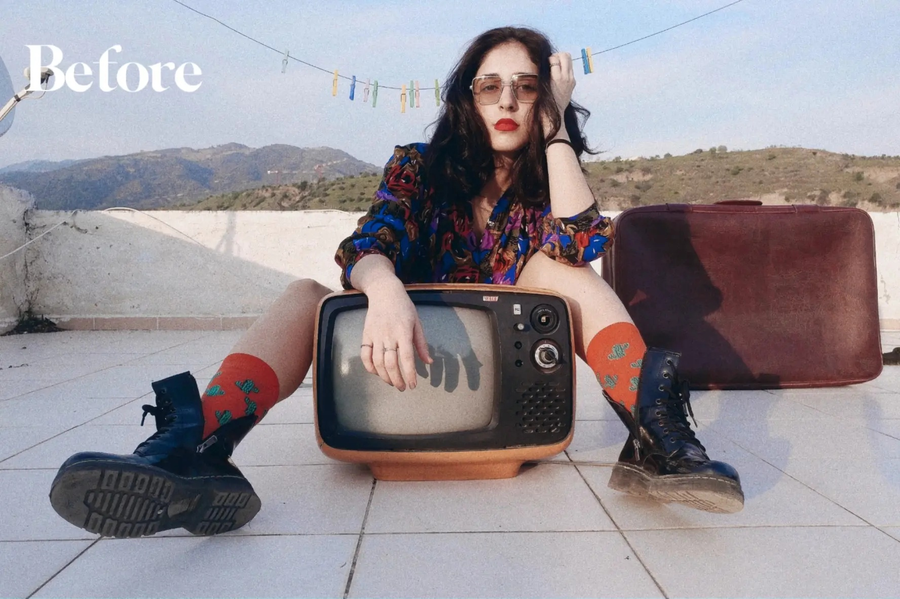
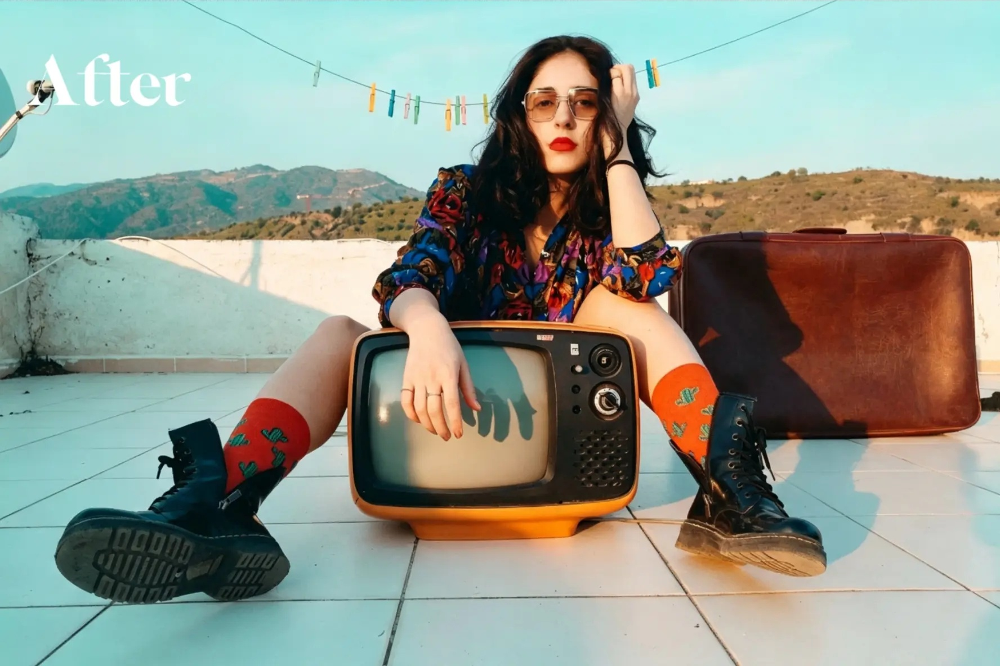

<p align="center"></p>

# 电影青橙

**A · 稳妥**　改动强度：中　·　原分类：青橙冷暖电影色

干净明亮的经典青橙：阴影/天空偏青绿，灯光与肤色暖橙，中饱和高通透

| 适合题材 | 适合光线 | 不适合 |
|---|---|---|
| 夜景、街景、城市建筑、人像 | 任意 | 肤色占比大的近景人像（地面/背景会整体发青） |

> 同类合并：051_01, 052_01, 062_01, 067_01（已并入本风格，原提示词见 git 历史）

## 提示词

```text
将照片调整为干净明亮的青橙色调风格，严格保持原始构图与全部画面真实细节。电影级专业调色，阴影叠加青绿色调，高光渲染暖橙色；强化冷暖色彩对比，提升画面空间层次感，打造深邃胶片电影光影；增加适当画面光感，整体中饱和度，高动态范围，阴影不死黑、高光不过曝、画面通透无杂色，柔化天空，色彩浓度适中无溢色，标准专业商业电影摄影质感。
```

## 前后对比

| 原图 | 成片 |
|---|---|
|  |  |
|  |  |
|  |  |

<sub>原标题：经典色调 |电影青橙 |改色提示词　·　作者：Delin（抖音）</sub>
