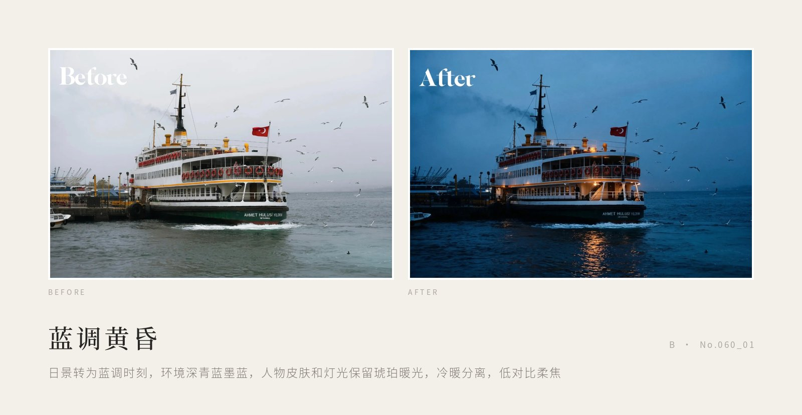
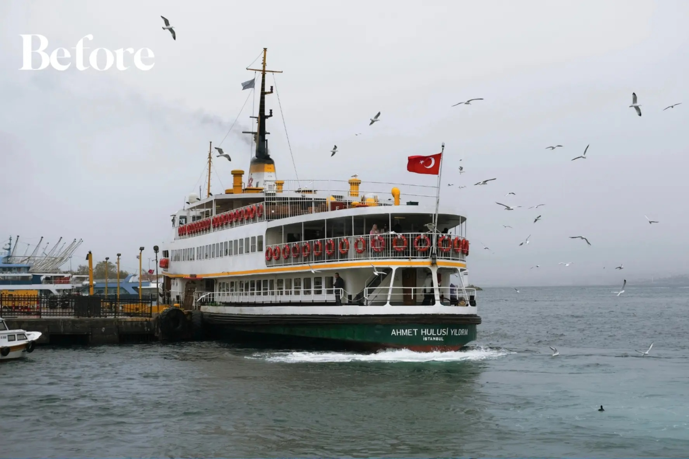
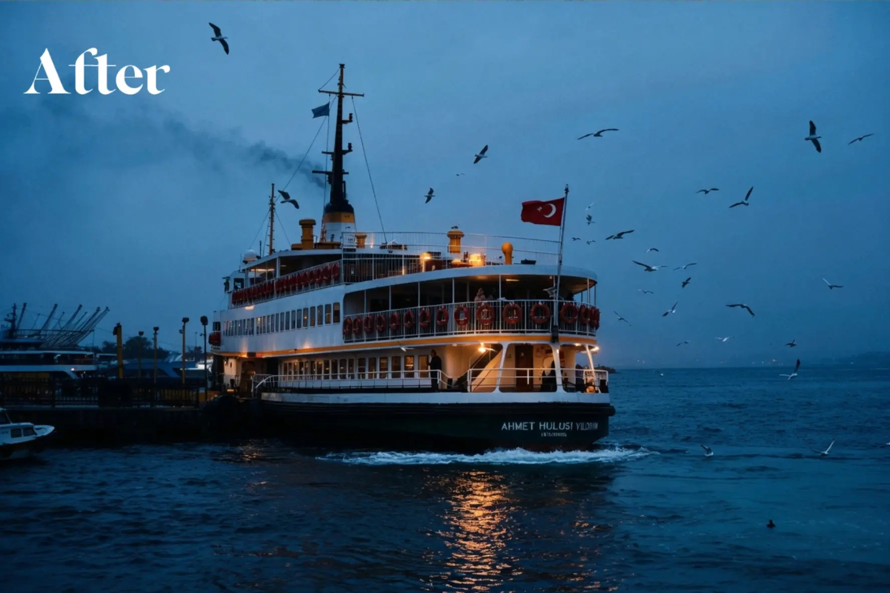
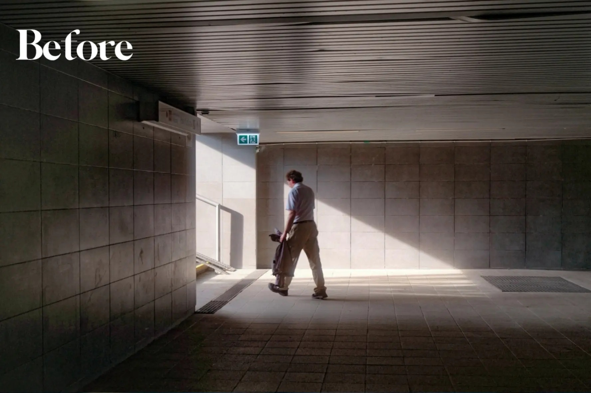
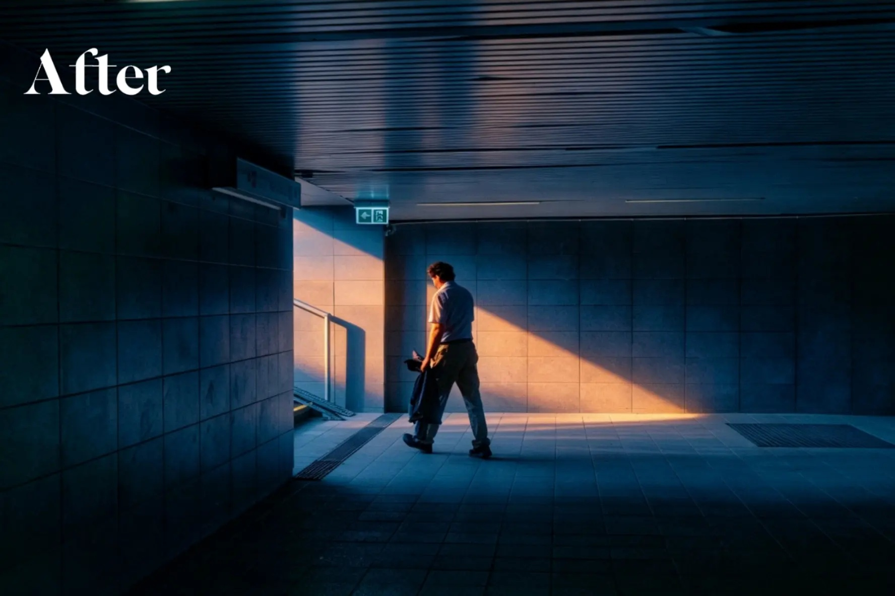
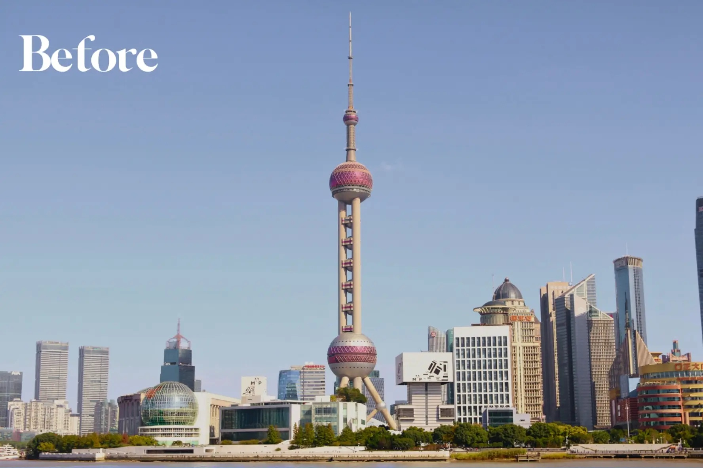
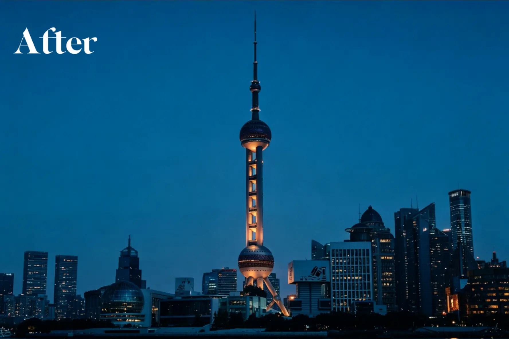

<p align="center"></p>

# 蓝调黄昏

**B · 氛围**　改动强度：重　·　原分类：暗调冷色与雾感

日景转为蓝调时刻，环境深青蓝墨蓝，人物皮肤和灯光保留琥珀暖光，冷暖分离，低对比柔焦

| 适合题材 | 适合光线 | 不适合 |
|---|---|---|
| 城市建筑、水面、街景、人像、交通工具 | 晴天顺光、阴天、黄昏、室内 | 已是夜景的照片、需要保留白天信息的照片 |

> 同类合并：043_01（已并入本风格，原提示词见 git 历史）

## 提示词

```text
“将照片调成蓝调黄昏电影摄影风格，保持原始构图和真实细节。模拟日落后蓝调时刻（blue hour）的摄影效果。整体降低曝光，营造安静、克制、忧郁的氛围。天空和环境调整为深青蓝、墨蓝色调，阴影区域加入冷蓝绿色，让暗部呈现蓝黑色层次。保留局部暖光，例如人物皮肤、灯光、建筑灯、夕阳余光，呈现柔和的琥珀橙色。采用冷暖对比调色：冷色占据环境，暖色集中在光源和主体。降低整体饱和度，降低对比度，压低高光，提高黑位层次。避免纯黑，让暗部保持细节和空气感。减少数码锐度，增加轻微电影柔焦和自然颗粒。呈现欧洲黄昏旅行摄影、安静夜晚、蓝色时刻电影画面。参考《爱在黎明破晓前》式欧洲黄昏氛围，但保持真实摄影。”
```

## 前后对比

| 原图 | 成片 |
|---|---|
|  |  |
|  |  |
|  |  |

<sub>原标题：蓝调电影感 | 提示词　·　作者：Delin（抖音）</sub>
