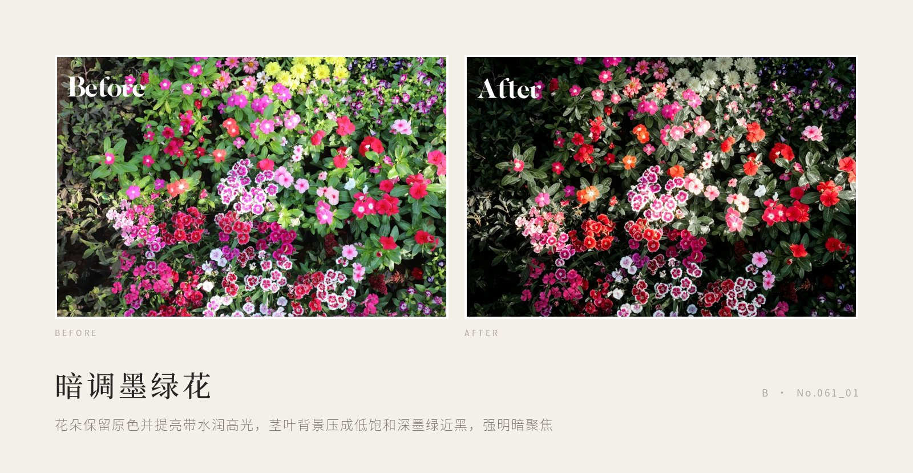
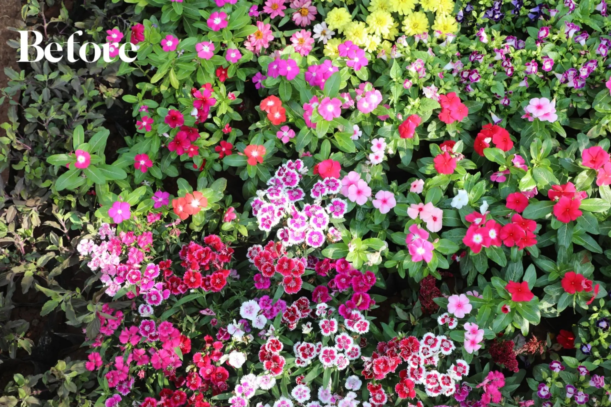
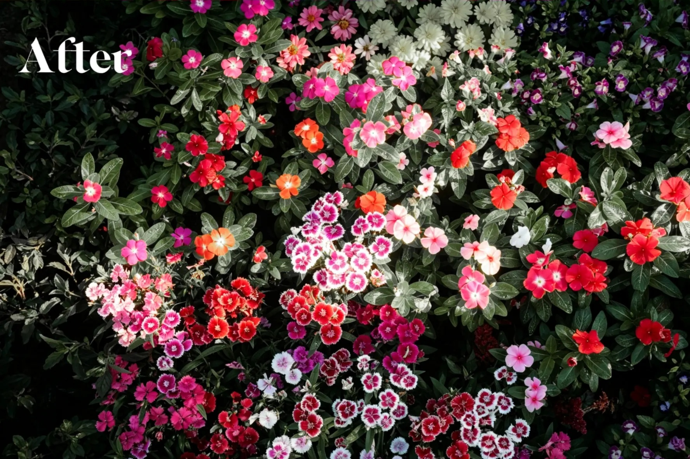
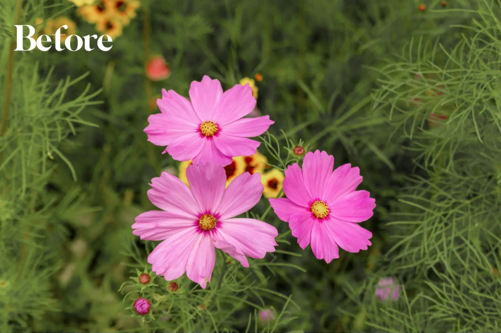
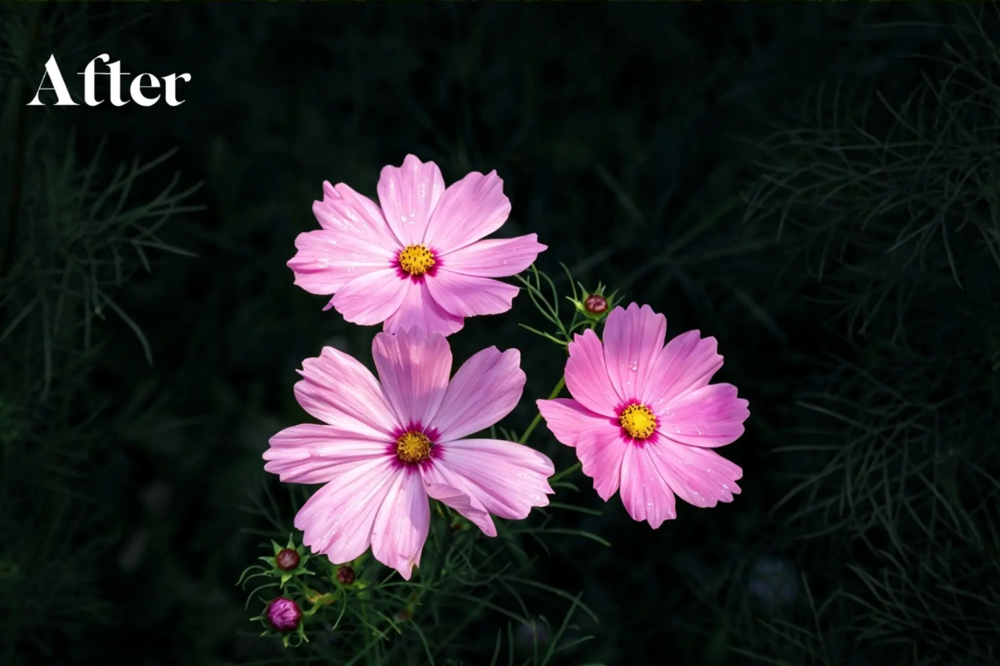
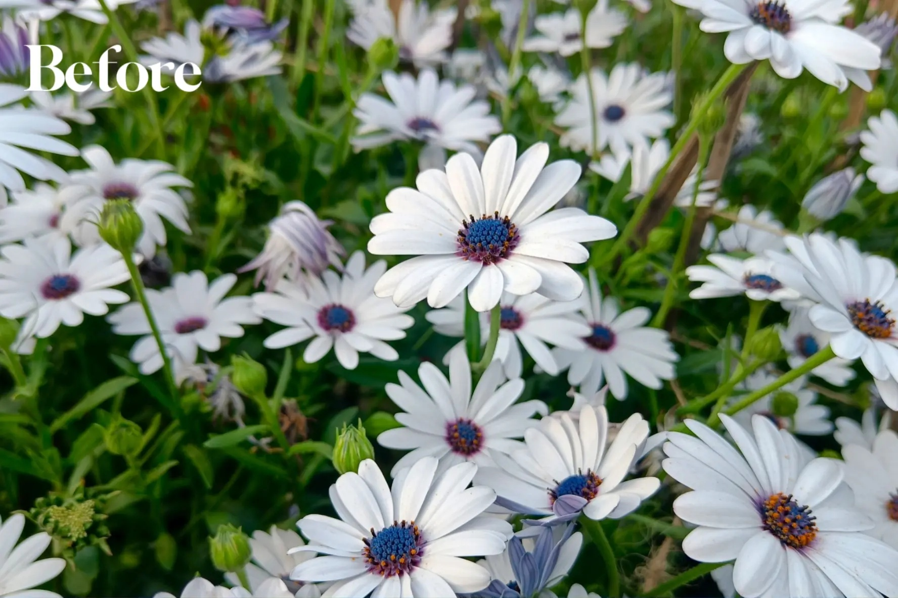
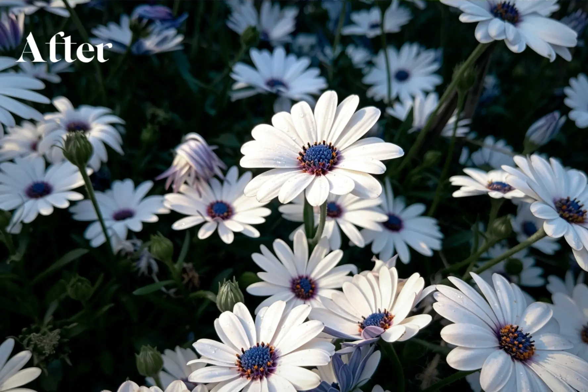

<p align="center"></p>

# 暗调墨绿花

**B · 氛围**　改动强度：中　·　原分类：风格重构与特殊题材

花朵保留原色并提亮带水润高光，茎叶背景压成低饱和深墨绿近黑，强明暗聚焦

| 适合题材 | 适合光线 | 不适合 |
|---|---|---|
| 植物花卉 | 晴天顺光、阴天、任意 | 非花卉题材 |

## 提示词

```text
“严格保留花朵原生色彩，单独提亮花瓣与花蕊，修饰花瓣瑕疵使其洁净通透；花瓣、花蕊附着水润湿润质感，添加自然日光直射形成的立体高光；画面中除全部花朵主体外，茎叶、绿植、背景统一压暗处理，调成低饱和深色暗调墨绿色，明暗对比强烈，氛围感高级。”
```

## 前后对比

| 原图 | 成片 |
|---|---|
|  |  |
|  |  |
|  |  |

<sub>原标题：暗调墨绿花朵 | 提示词　·　作者：Delin（抖音）</sub>
