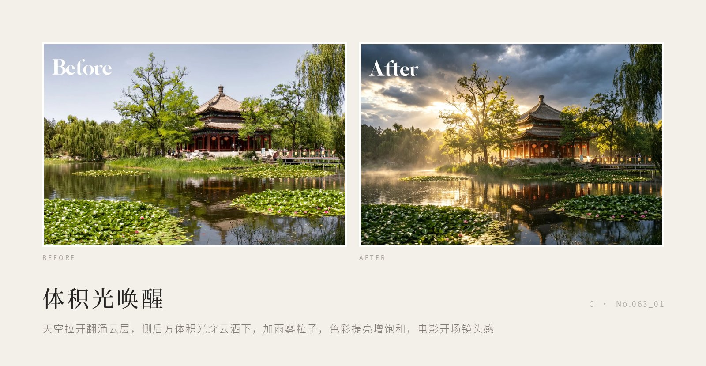
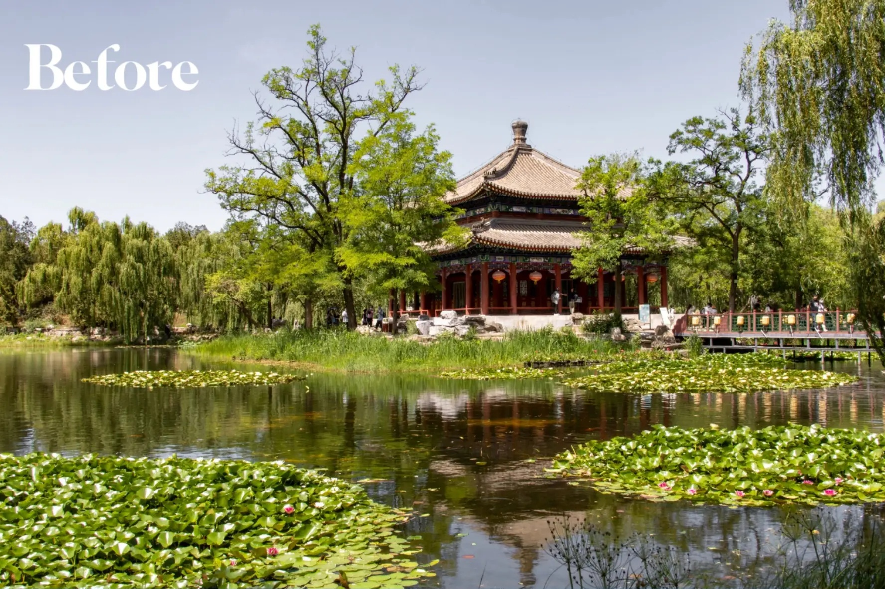
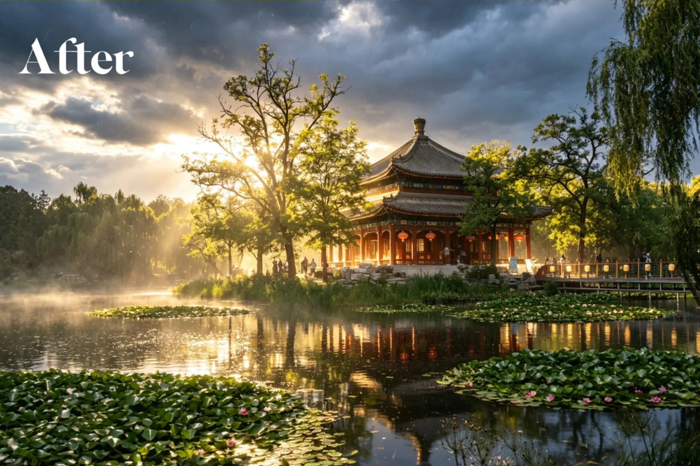
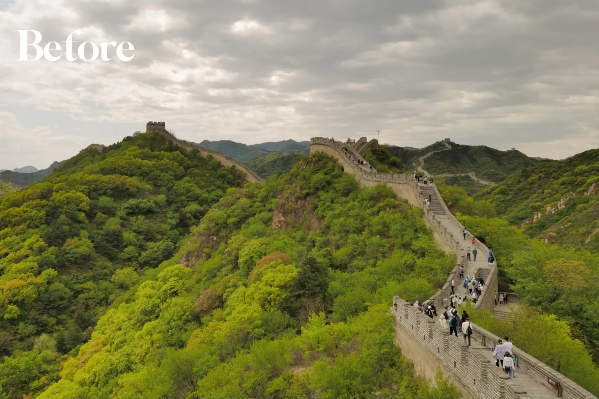
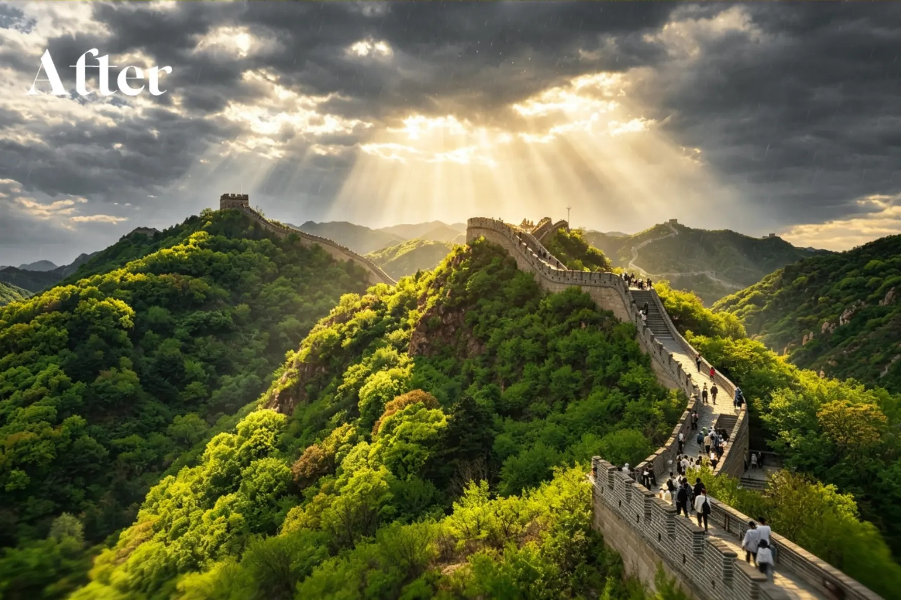

<p align="center"></p>

# 体积光唤醒

**C · 反差**　改动强度：重　·　原分类：风格重构与特殊题材

天空拉开翻涌云层，侧后方体积光穿云洒下，加雨雾粒子，色彩提亮增饱和，电影开场镜头感

| 适合题材 | 适合光线 | 不适合 |
|---|---|---|
| 风光、城市建筑、水面 | 阴天、晴天顺光 | 人像特写、室内、夜景；追求真实感的用户 |

> 同类合并：009_02, 065_01（已并入本风格，原提示词见 git 历史）

## 提示词

```text
“超写实电影级风格，在保持原始构图与主体位置不变的前提下允许画面重构，场景由普通现实状态被瞬间唤醒，整体光影与色彩显著增强，天空层次被大幅拉开，云层翻涌，形成明显的光影对比，主光源从画面侧后方切入，强烈体积光穿透云层，照亮主体与环境，环境中加入细微雨雾、粒子与空气透视，增强空间纵深感，色彩整体提亮并增加饱和度，但保持自然真实不过度夸张，前景轻微动态模糊，中远景清晰，形成强烈空间层次，画面具有电影开场镜头般的震撼感与叙事张力，维持原比例，保证画面结构与主体不发生畸变。”
```

## 前后对比

| 原图 | 成片 |
|---|---|
|  |  |
|  |  |
|  |  |

<sub>原标题：虽然Ai味重，但是架不住好看啊！提示词:“超写实电影级风格，在保持原始构图与主体位置不变的前提下　·　作者：Delin（抖音）</sub>
