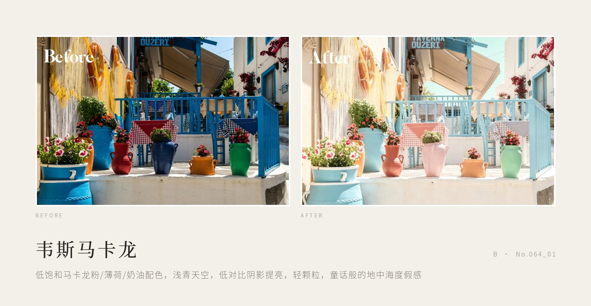
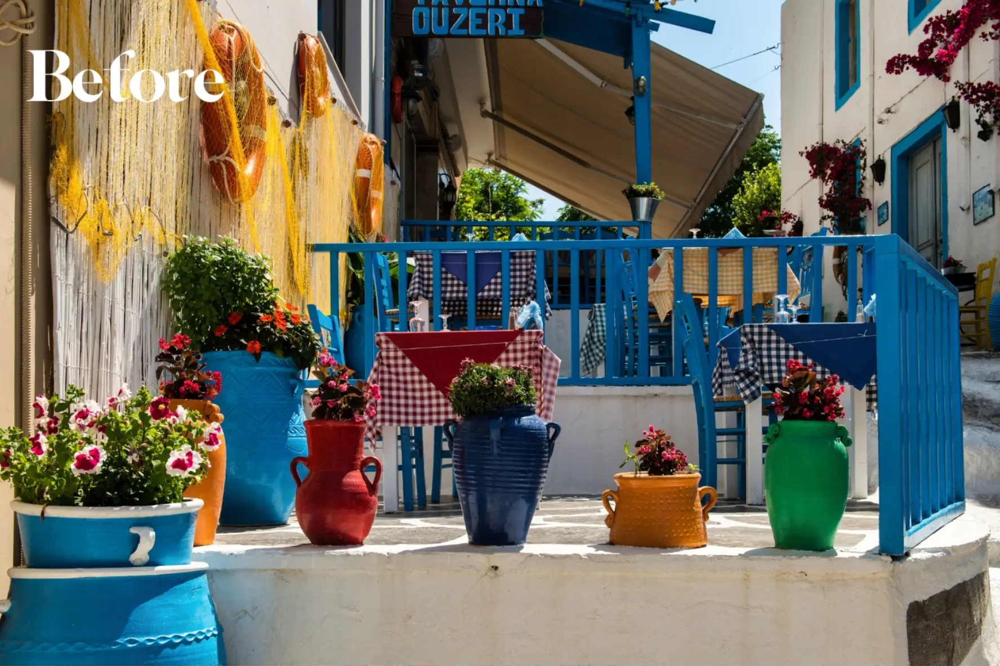
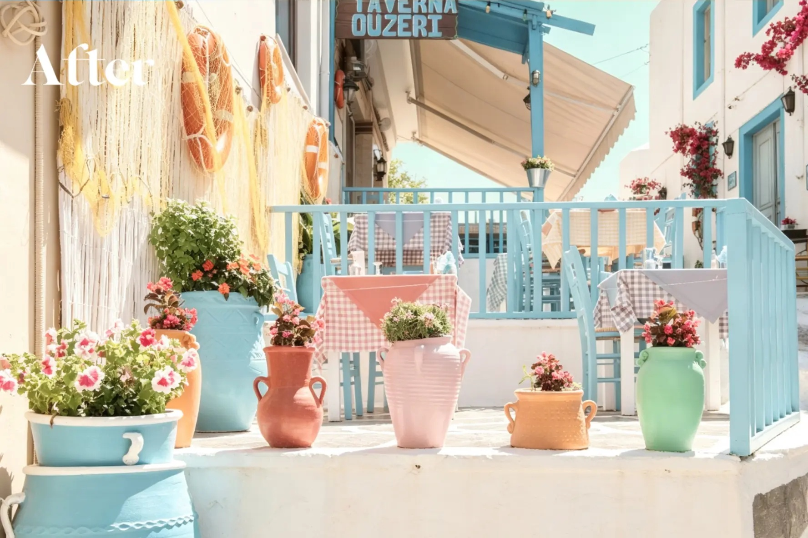
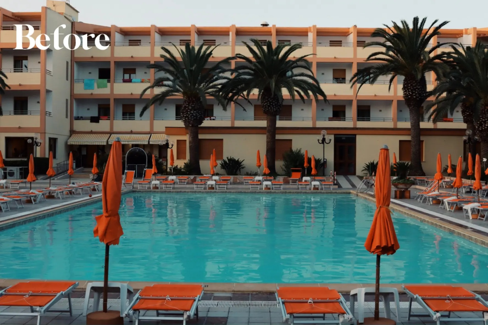
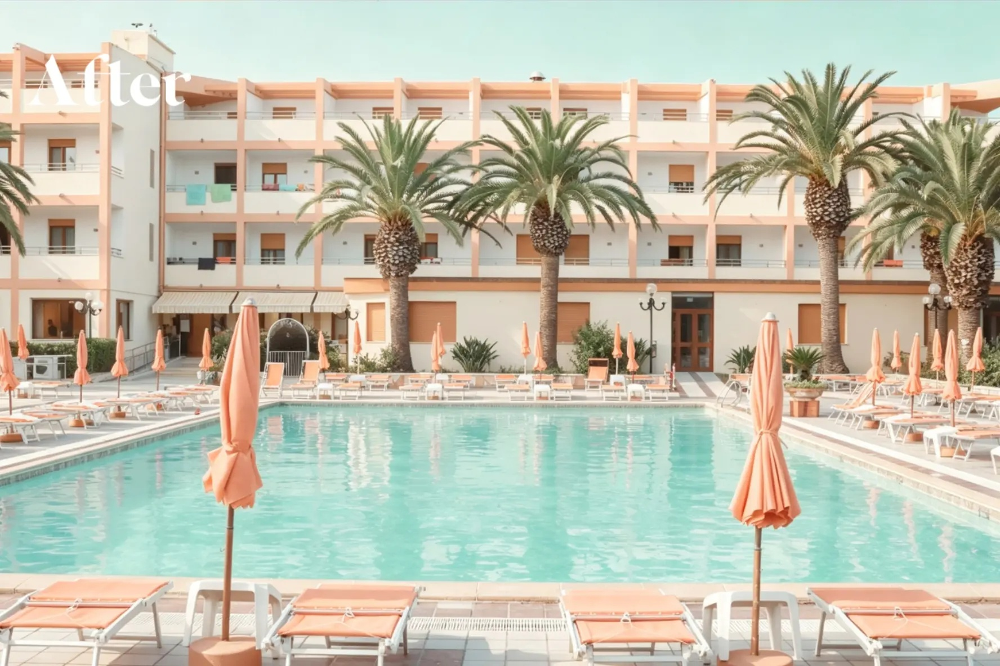
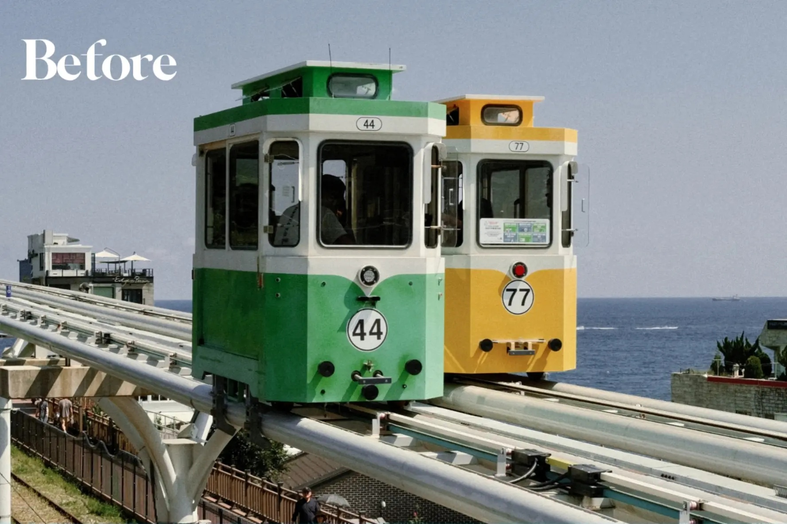
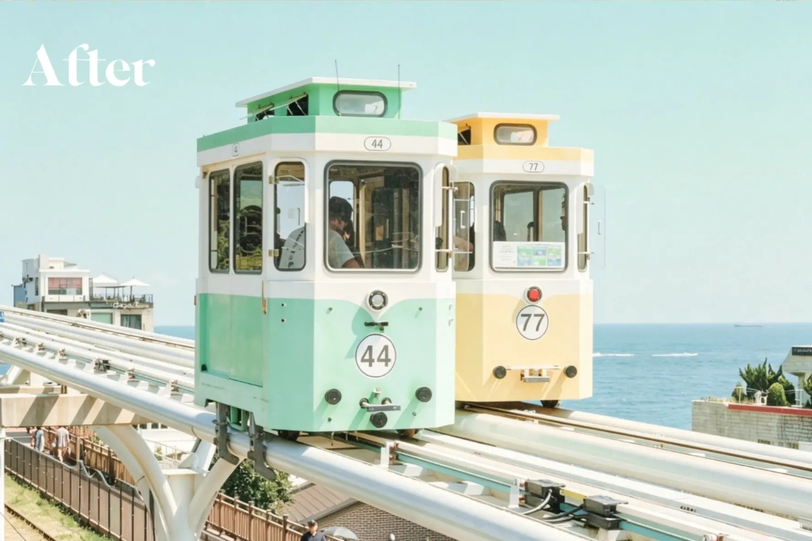

<p align="center"></p>

# 韦斯马卡龙

**B · 氛围**　改动强度：中　·　原分类：清新日系与人像

低饱和马卡龙粉/薄荷/奶油配色，浅青天空，低对比阴影提亮，轻颗粒，童话般的地中海度假感

| 适合题材 | 适合光线 | 不适合 |
|---|---|---|
| 城市建筑、街景、交通工具、静物 | 晴天顺光 | 暗调或夜景、人像特写（肤色可能被粉化）、色彩单一的照片 |

## 提示词

```text
韦斯安德森，富士胶片C200，地中海清新奶油调色，低饱和马卡龙柔和去灰配色，主色醒目同时不刺眼，柔光正午日光，低对比，阴影提亮，轻微胶片颗粒，主体环境清晰，通透浅青渐变天空，干净平整墙面，冷暖柔和对冲，治愈海岛度假氛围，干净低灰度，8K高清，柔和浅景深。
```

## 前后对比

| 原图 | 成片 |
|---|---|
|  |  |
|  |  |
|  |  |

<sub>原标题：Ai修图，看不腻的马卡龙！提示词:韦斯安德森，富士胶片C200，地中海清新奶油调色，低饱和马卡龙　·　作者：Delin（抖音）</sub>
