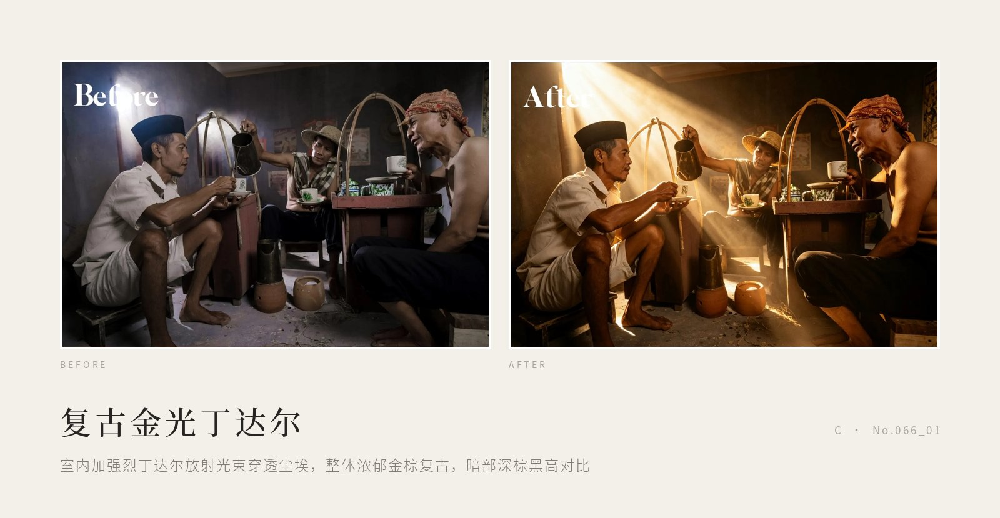
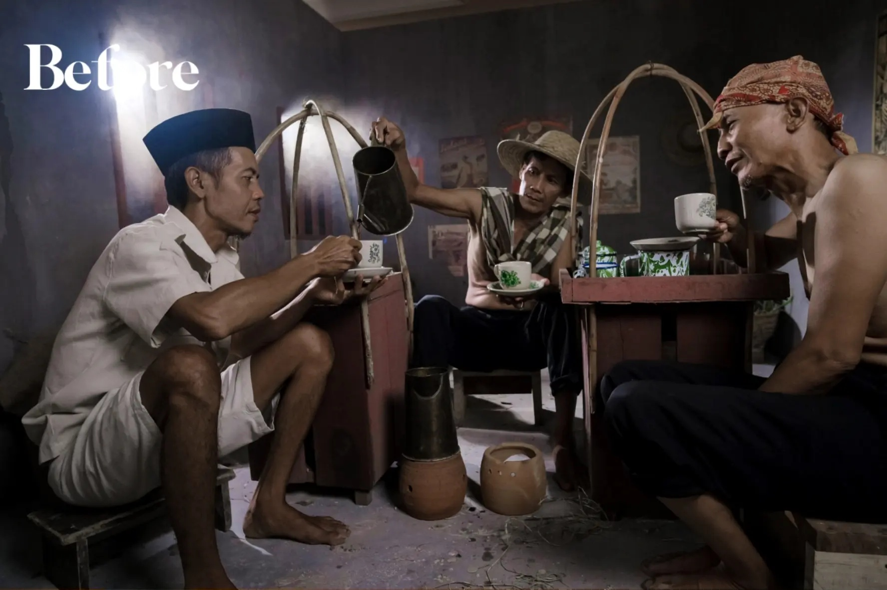
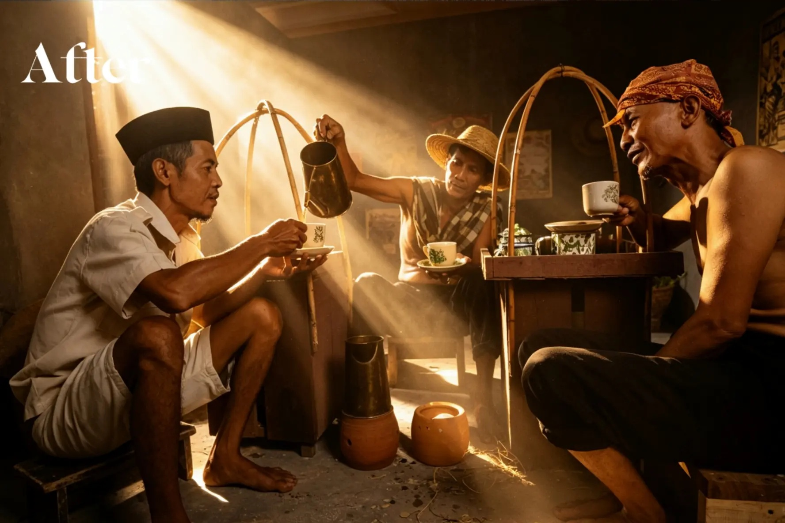
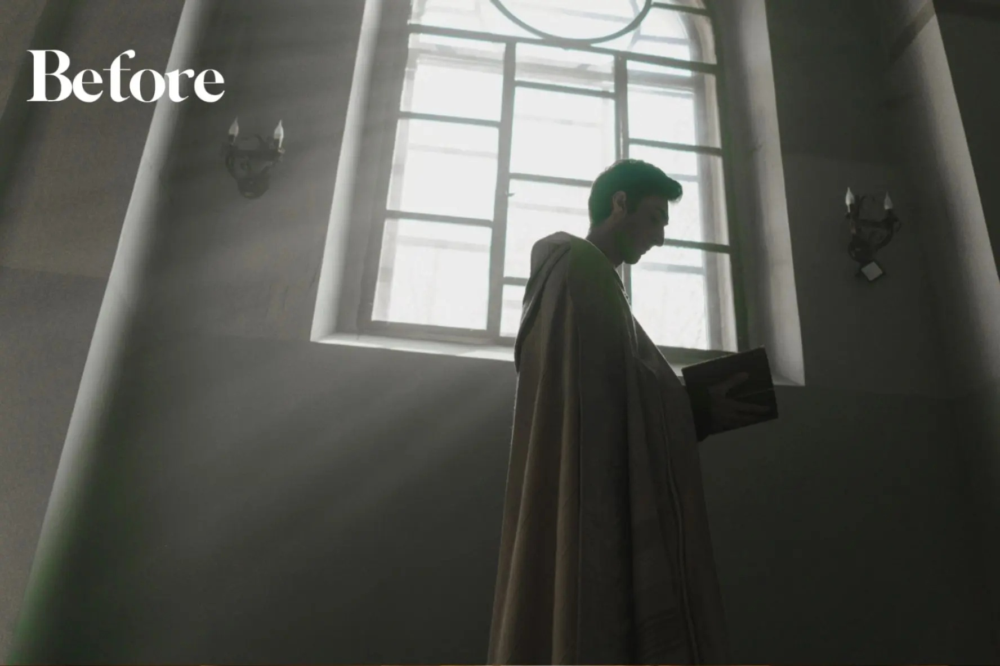
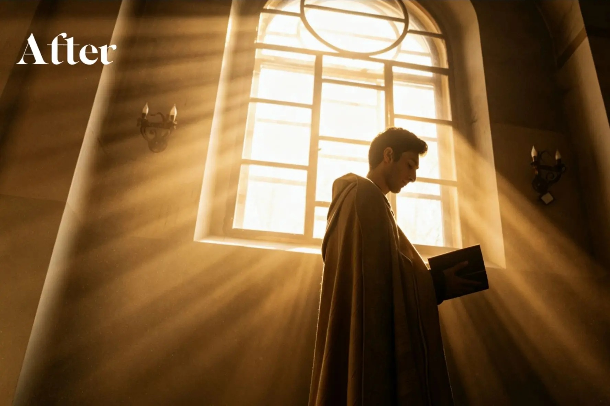
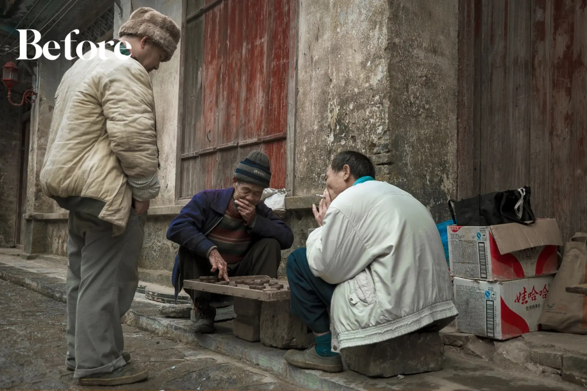
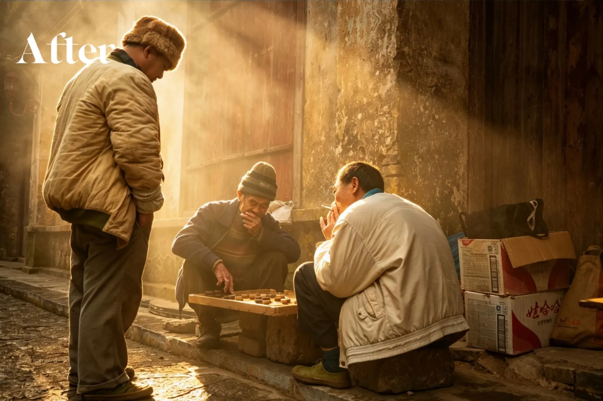

<p align="center"></p>

# 复古金光丁达尔

**C · 反差**　改动强度：重　·　原分类：暖光黄昏与秋日

室内加强烈丁达尔放射光束穿透尘埃，整体浓郁金棕复古，暗部深棕黑高对比

| 适合题材 | 适合光线 | 不适合 |
|---|---|---|
| 人像、静物、街景 | 室内、任意 | 开阔晴空风光、无遮挡结构的户外大场景 |

## 提示词

```text
“主体环境不变，电影级室内空间摄影，强烈丁达尔上帝光，穿透空气中的尘埃，形成清晰、柔顺的放射状光束，照亮空间场景，营造出神圣、静谧又充满岁月感的氛围。整体色调为浓郁的暖调复古金棕色调，高光偏金色，暗部偏深棕黑，高对比度，去灰同时保留画面层次；细腻的胶片颗粒感，复古美学，柯达 Portra 400 胶片质感，画面层次丰富，电影感叙事构图，强烈的情绪张力，光影质感突出。”
```

## 前后对比

| 原图 | 成片 |
|---|---|
|  |  |
|  |  |
|  |  |

<sub>原标题：复古金光宿命感的压迫 | 调色提示词分享　·　作者：Delin（抖音）</sub>
